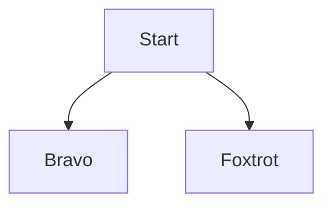

# Pesquisa: construtores visuais e correção de layout

> Status: plano de pesquisa (antes de implementar) · Produto: ODiagramador · Escopo inicial: Mermaid

## 1. Contexto

Hoje o ODiagramador tem dois jeitos de criar ou alterar um diagrama:

- escrever o código Mermaid no editor;
- pedir a um agente de IA, via MCP.

A proposta é um terceiro jeito: **botões de construtores**. A pessoa escolhe o tipo de diagrama (no início, só os do Mermaid) e monta o diagrama com os construtores daquele tipo, por exemplo nó, decisão, aresta e subgrafo num fluxograma, ou participante, mensagem e bloco `alt` num diagrama de sequência. Também deve ser possível **corrigir o layout** do diagrama.

Antes de construir, precisamos entender **quem usaria isso, para quê e o que "corrigir o layout" significa para essas pessoas**. O Mermaid **posiciona os elementos sozinho** (layout automático) e sua sintaxe não guarda posições. A avaliação técnica da seção 12 mostrou, porém, que o ODiagramador **consegue oferecer arrastar e soltar** usando o ELK em modo interativo dentro de um layout próprio, guardando as posições em comentários `%%` que outros renderizadores ignoram. Então a pergunta de pesquisa deixa de ser "dá para mover?" e passa a ser **"quanto controle as pessoas querem: só legibilidade, ordem e camada, ou coordenadas exatas?"**.

## 2. Objetivos da pesquisa

1. Entender **como as pessoas criam e alteram diagramas hoje**: texto, IA, Mermaid Live, draw.io, Lucidchart, Visual Paradigm, StarUML, Miro.
2. Descobrir **em que momentos** alguém prefere botões a escrever código ou pedir ao agente.
3. Definir **quais construtores** cada tipo de diagrama precisa e **como agrupá-los** na paleta.
4. Descobrir **o que "corrigir o layout" significa** para os usuários e quais correções o Mermaid consegue entregar.
5. Entender como botões, código e agente **convivem** no mesmo arquivo sem conflito.

### Decisões de produto que esta pesquisa vai embasar

| Decisão | Opções em aberto |
|---|---|
| Forma de edição | Formulário/inspetor (propriedades à direita) · manipulação direta na prévia (clicar no nó → "+ conectar") · as duas |
| Organização da paleta | Por tipo de elemento · por tarefa ("ligar", "agrupar", "decidir") · por frequência de uso |
| Correção de layout | Botões de ação ("Inverter direção", "Agrupar", "Aproximar") · correção em 1 clique a partir dos problemas detectados (W_WIDE, W_OVERLAP…) · ajustes finos (espaçamento, curvas, motor) |
| Sincronia com o código | Código sempre visível · código escondido para quem não programa · modo "avançado" |
| Papel do agente | Botões só para humanos · botões que geram um pedido ao agente ("melhore o layout") |

## 3. Hipóteses a validar

| # | Hipótese | Como saberemos se é falsa |
|---|---|---|
| H1 | Quem não programa evita o editor de código e desistiria do Mermaid sem botões. | Nos testes, não programadores concluem as tarefas só com código, sem queda grande de sucesso ou satisfação. |
| H2 | Programadores preferem o código, mas usam botões para a estrutura inicial e para coisas que não lembram (formas, blocos `alt`, cardinalidade). | Programadores ignoram a paleta ou dizem que ela atrapalha. |
| H3 | "Corrigir o layout" significa, principalmente, **acabar com cruzamentos, sobreposições e diagramas largos demais**. Quando a pessoa arrasta, basta respeitar **a ordem e a camada** (ELK interativo); coordenadas exatas são exceção. | A maioria se incomoda quando o nó "encaixa" numa camada em vez de ficar exatamente onde foi solto. |
| H4 | Correções em 1 clique ligadas aos problemas já detectados resolvem a maior parte dos casos de layout. | Os participantes não ligam o aviso à ação, ou a correção não resolve o problema visual. |
| H5 | Os construtores mais usados são poucos por tipo (cerca de 5 a 8). O resto pode ficar num menu "mais". | O card sorting mostra uso amplo, sem núcleo claro. |
| H6 | Mexer com botões enquanto um agente altera o mesmo arquivo gera confusão. | Ninguém se incomoda com mudanças vindas do agente durante a edição. |

## 4. Participantes

Recrutar **3 perfis**, com 2 a 3 pessoas por perfil nas entrevistas e nos testes:

| Perfil | Quem é | Por que importa |
|---|---|---|
| P1 Desenvolvedor(a) com IA | Usa Claude Code, Codex ou Cursor; escreve ou pede Mermaid para documentar código e arquitetura | Usuário principal do MCP; testa a convivência botões × código × agente |
| P2 Analista de processos ou negócio | Desenha fluxos de processo, regras, POPs; não programa | Público em que os botões fazem mais diferença (H1) |
| P3 Arquiteto(a), modelador(a) UML | Usa StarUML, Visual Paradigm ou Enterprise Architect; vai usar a futura engine UML | Expectativa de controle fino de layout (H3) e de construtores UML |

### Questionário de seleção (screener)

1. Com que frequência você cria ou altera diagramas no trabalho? *(diariamente / semanalmente / mensalmente / raramente → excluir "raramente")*
2. Quais ferramentas você usou nos últimos 3 meses? *(marcar todas)*
3. Você já escreveu diagramas em código (Mermaid, PlantUML, Graphviz)? *(nunca / já tentei / uso com frequência)*
4. Você usa assistentes de IA para criar documentação ou diagramas? *(sim / não)*
5. Que tipos de diagrama você mais faz? *(fluxograma, sequência, classes, estados, ER, gantt, outro)*

Meta de recrutamento: misturar quem nunca escreveu diagrama em código com quem usa com frequência, dentro de cada perfil.

## 5. Métodos e cronograma

| Semana | Método | Amostra | Saída |
|---|---|---|---|
| 1 | **Entrevistas contextuais** (45 min, remotas, com compartilhamento de tela de um diagrama real do participante) | 6–8 | Fluxo de trabalho atual, dores, significado de "layout ruim" |
| 1–2 | **Card sorting híbrido** (remoto, sem moderação) com cerca de 40 cartões de construtores (fluxograma, sequência e classes) | 15–20 | Agrupamento e nomes da paleta; núcleo de cerca de 5 a 8 construtores por tipo (H5) |
| 2 | Protótipo navegável de baixa/média fidelidade (ver seção 8) | — | Estímulo para os testes |
| 3 | **Teste de usabilidade moderado**, comparando código e botões na mesma tarefa, em ordem alternada | 6–9 (3 por perfil) | Taxa de sucesso, tempo, erros, preferência (H1–H4, H6) |
| 4 | Síntese: mapa de afinidade, *jobs to be done*, matriz impacto × esforço | — | Relatório, recomendações e backlog priorizado |

Opcional, em paralelo: **estudo de diário leve** (2 semanas, 5 pessoas) usando o ODiagramador atual. Cada pessoa registra todo momento em que quis "um botão para isso" ou em que o layout atrapalhou. O `.odiagramador/events.jsonl` ajuda a reconstruir as sessões, desde que o participante concorde em compartilhá-lo.

## 6. Roteiro de entrevista (45 min)

**Aquecimento (5 min)**
- Fale um pouco do seu trabalho. Onde os diagramas entram nele?
- Quem lê os diagramas que você faz?

**Contexto (10 min)** — peça para mostrar um diagrama recente
- Como esse diagrama nasceu? Por onde você começou?
- Que ferramenta usou e por quê? O que te irrita nela?
- Quanto tempo você gasta *desenhando* e quanto gasta *arrumando* a aparência?
- *(se usa IA)* Como você pede o diagrama à IA? O que costuma voltar errado?

**Aprofundamento (20 min)**
- Conte a última vez que um diagrama "ficou feio" ou ilegível. O que estava errado? O que você fez?
- Quando você diz "arrumar o layout", o que exatamente você muda? *(ouvir: posição, cruzamentos, direção, espaçamento, agrupamento, alinhamento)*
- Você já precisou que um elemento ficasse **exatamente** num lugar? Por quê?
- Que elementos você usa em quase todo diagrama? E quais você sempre precisa procurar como se faz?
- *(P1)* Quando você prefere escrever o código em vez de clicar? E o contrário?
- *(P2)* O que você sentiria se a ferramenta mostrasse o código do diagrama ao lado?
- *(P3)* O que você sente falta numa ferramenta baseada em texto em comparação com o StarUML ou o Visual Paradigm?
- Se uma IA estivesse editando o mesmo diagrama que você, o que você precisaria ver para confiar nela?

**Reação a conceitos (10 min)** — mostrar 3 esboços (seção 8)
- Paleta por tipo de diagrama · inspetor de propriedades · correções de layout em 1 clique a partir dos problemas
- O que você espera que aconteça ao clicar aqui? O que falta? O que sobra?

**Encerramento (5 min)**
- Se pudesse mudar uma coisa em como faz diagramas hoje, qual seria?
- Algo que não perguntei e que deveria?

**Sondagens úteis:** "Pode me mostrar?", "O que aconteceu depois?", "Por que isso importa?", "Como você resolveu da última vez?"

## 7. Roteiro do teste de usabilidade (60 min)

Cada participante faz as tarefas **duas vezes**: uma com o editor de código e outra com os construtores, em ordem alternada entre participantes, para evitar o efeito de aprendizado. Pensar em voz alta. Nenhuma ajuda além de "o que você tentaria agora?".

| # | Tarefa | Sucesso = | Mede |
|---|---|---|---|
| T1 | Crie um fluxograma de "Aprovação de reembolso": início, enviar pedido, decisão "valor > R$ 500?", aprovação do gestor, pagamento, fim. | Diagrama válido, decisão com 2 saídas rotuladas | Criação do zero, descoberta da paleta (H1, H2) |
| T2 | Mude a forma de "pagamento" para banco de dados e agrupe "aprovação" e "pagamento" num grupo "Financeiro". | Forma e subgrafo corretos | Edição de propriedades, agrupamento |
| T3 | Este diagrama ficou largo demais *(arquivo dado, com 14 nós em LR)*. Deixe-o legível numa tela de notebook. | Painel sem rolagem horizontal; nenhum aviso W_WIDE | Correção de layout; o que tentam primeiro (H3, H4) |
| T4 | Há dois elementos sobrepostos e um nó solto *(arquivo dado)*. Corrija. | Zero avisos W_OVERLAP e W_ORPHAN_NODE | Ligação entre problema e correção em 1 clique (H4) |
| T5 | Crie um diagrama de sequência: Cliente → API "POST /pedido"; se aprovado, API → Cliente "201"; senão, "402". | Bloco `alt/else` correto | Construtores compostos (blocos) |
| T6 | Enquanto você edita, "o agente" altera o arquivo *(o moderador dispara via MCP)*. O que aconteceu? Continue sua tarefa. | Participante entende a mudança e não perde trabalho | Convivência com o agente (H6) |

**Métricas por tarefa:** sucesso (sim / parcial / não), tempo, número de erros de sintaxe, número de desfazer, SEQ (1–7, "quão fácil foi?").
**Ao final:** SUS (10 itens) para cada modo e a pergunta "Qual modo você usaria amanhã para esta tarefa? Por quê?"

**Observar especialmente:**
- tentativas de arrastar nós;
- procura por "alinhar" e "distribuir";
- leitura (ou não) do painel de problemas;
- uso do código como "verificação" depois de usar os botões.

## 8. Estímulos e protótipo

Construtores candidatos para o card sorting e o protótipo. Esta é a lista inicial a ser validada, não a final.

| Tipo | Construtores (núcleo provável em **negrito**) |
|---|---|
| Fluxograma | **Nó**, **Decisão**, **Início/Fim**, **Aresta (com rótulo)**, **Subgrafo**, Banco de dados, Entrada/Saída, Subrotina, Comentário, Estilo (classDef), Aresta pontilhada/grossa, Direção |
| Sequência | **Participante**, **Ator**, **Mensagem síncrona**, **Resposta**, **Bloco alt/else**, Loop, Opt, Par, Nota, Ativação, Autonumeração |
| Classes | **Classe**, **Atributo**, **Método**, **Herança**, **Associação (com cardinalidade)**, Composição, Agregação, Dependência, Interface, Enum, Nota |
| Estados | **Estado**, **Início**, **Fim**, **Transição**, Estado composto, Escolha, Fork/Join, Nota |
| ER | **Entidade**, **Atributo (PK/FK)**, **Relacionamento + cardinalidade** |

Correções de layout candidatas, todas possíveis no Mermaid sem posicionamento manual:

| Problema que o usuário vê | Ação em 1 clique | O que muda no código |
|---|---|---|
| Diagrama largo ou alto (W_WIDE/W_TALL) | "Inverter direção" | `flowchart LR` ↔ `TB` |
| Muitos cruzamentos | "Reordenar declarações" | ordem das linhas |
| Elementos relacionados longe | "Agrupar selecionados" | cria `subgraph` |
| Dois nós precisam ficar lado a lado | "Manter juntos" | ligação invisível `A ~~~ B` |
| Nó colado ao vizinho | "Afastar" | aresta mais longa (`--->`) |
| Tudo apertado ou espaçado demais | Controle de espaçamento | `%%{init: {"flowchart": {"nodeSpacing": …, "rankSpacing": …}}}%%` |
| Nó duplicado (W_DUPLICATE_LABEL) | "Unificar" | troca o id repetido |
| Nó solto (W_ORPHAN_NODE) | "Conectar a…" | adiciona aresta |
| Layout ruim em diagramas grandes | "Motor de layout: ELK" | `layout: elk` no front matter |
| Ordem dos nós dentro de uma linha errada | "Respeitar a ordem do código" e arrastar na lista | `elk: { considerModelOrder: NODES_AND_EDGES, forceNodeModelOrder: true }` e reordenação das declarações |
| "Quero este nó aqui" | Arrastar na prévia (o ELK organiza o resto) | comentário `%% @odg pos A 150,0` *(seção 12)* |
| Nó sempre no topo ou no fim | "Fixar no início / no fim" | `%% @odg layer A first` → `layerConstraint` |

Protótipo para os testes: protótipo navegável no próprio render-kit, sem tocar no núcleo, com paleta à esquerda, inspetor à direita e as ações de layout acima. O fluxograma deve estar completo e a sequência, parcial.

## 9. Plano de análise

1. **Mapa de afinidade**: uma nota por observação (citação, comportamento, erro), agrupada em temas como "medo do código", "layout = legibilidade", "precisão de posição" e "confiança no agente".
2. **Jobs to be done**: escrever 3 a 5 jobs ("Quando eu ___, quero ___, para ___") por perfil.
3. **Métricas**: comparar sucesso, tempo, SEQ e SUS entre código e botões por perfil. Com 3 por perfil, tratar como indícios, não como estatística.
4. **Matriz impacto × esforço** para cada construtor e ação de layout. Saída: backlog em 3 ondas (MVP · próxima · depois).
5. Decidir cada hipótese H1–H6 como **confirmada / refutada / inconclusiva**, com a evidência.

## 10. Entregáveis

- [ ] Questionário de seleção publicado e 6 a 9 participantes agendados
- [ ] Notas e gravações das entrevistas (com consentimento)
- [ ] Resultado do card sorting: dendrograma e nomes vencedores
- [ ] Protótipo dos construtores (fluxograma e sequência) e das ações de layout
- [ ] Relatório de síntese: temas, insights, decisões e respostas às hipóteses
- [ ] Recortes de destaque: 8 a 12 citações e trechos de vídeo
- [ ] Backlog priorizado para implementar no núcleo (`odg-core`) e nos 3 apps

## 11. Riscos e cuidados

- **Expectativa de arrastar e soltar** (H3): agora é tecnicamente possível (seção 12). O risco passa a ser de expectativa: no modo interativo o nó "encaixa" na camada mais próxima. Os testes precisam mostrar se isso é aceito ou se exige o modo de coordenadas exatas.
- **Viés do moderador**: o produto é nosso. Usar roteiro fixo, alternar a ordem dos modos e não defender o protótipo.
- **Amostra pequena por perfil**: priorizar padrões que aparecem em 2 ou mais perfis.
- **Privacidade**: diagramas reais de participantes podem ter informação sensível. Pedir que mostrem sem enviar arquivos e anonimizar as citações.

## 12. Avaliação técnica: o ELK permite mudar a posição dos nós?

Testado em 2026-10-23 com Mermaid 11.17.2, `@mermaid-js/layout-elk` 0.2.3 (o último compatível com Mermaid 11) e elkjs 0.9.3, num diagrama de 6 nós. Os testes rodaram no navegador, num ambiente isolado.

### 12.1 O que o ELK oferece e o que funciona via Mermaid

O ELK Layered tem as fases citadas (*cycle breaking*, *layering*, *crossing minimization* ou *reduction* e *node placement*) e opções de restrição por nó. O adaptador oficial do Mermaid tem dois limites:

- **No grafo como um todo**, só repassa estas opções: `nodePlacementStrategy`, `nodePlacementAlignment`, `cycleBreakingStrategy`, `considerModelOrder`, `forceNodeModelOrder` e `mergeEdges`. As estratégias de *layering* e de *crossing minimization* ficam fixas.
- **Por nó**, copia o nó inteiro para o ELK (`{ ...node }`). Por isso, um *wrapper* do ODiagramador consegue injetar `layoutOptions` antes do layout. Testado e funcionando.

| Opção do ELK | Efeito via Mermaid | Motivo |
|---|---|---|
| `layering.layerConstraint` = `FIRST` / `LAST` | ✅ funciona (nó foi para a última camada) | Avaliada pelo layered padrão |
| `considerModelOrder` + `forceNodeModelOrder` | ✅ funciona: a **ordem das declarações** define a ordem dos nós dentro da camada | Exposta na config do Mermaid; portátil (fica no front matter) |
| `nodePlacement.strategy` (SIMPLE, LINEAR_SEGMENTS, BRANDES_KOEPF, NETWORK_SIMPLEX) | ✅ muda o alinhamento e a "retidão" das arestas | Exposta na config |
| `layering.layerChoiceConstraint` | ❌ sem efeito | A própria documentação do ELK diz que só é avaliada pelo `InteractiveLayeredGraphVisitor` (ELK em Java/Eclipse), que o elkjs não aplica |
| `crossingMinimization.positionChoiceConstraint` | ❌ sem efeito | Mesmo motivo |
| `crossingMinimization.inLayerPredOf` / `inLayerSuccOf` | ❌ sem efeito no layered padrão | Exige uma estratégia de crossing minimization que processe restrições "in-layer", e o Mermaid não deixa trocar essa estratégia |
| `crossingMinimization.semiInteractive` | ❌ inacessível | É uma opção do grafo como um todo, que o Mermaid não repassa |
| algoritmo `fixed` (coordenadas exatas) | ❌ quebra o adaptador | O adaptador espera as rotas de aresta que o ELK calcula |

**Conclusão parcial:** os relatos de "o ELK aceita mudar posição" valem para o **ELK em si** (Eclipse/Sprotty/KIELER, ou elkjs chamado diretamente). Pelo `layout: elk` padrão do Mermaid, só sobram duas alavancas:
- **ordem do código**, usando a ordem das declarações (`considerModelOrder`);
- **início/fim**, usando `layerConstraint`.

### 12.2 O que funciona com um layout próprio do ODiagramador

O Mermaid 11.17 exporta, **só no build ESM**, a API `createCommonLayoutRenderer`. Com ela, o ODiagramador registra um layout próprio: o Mermaid continua desenhando formas, setas, rótulos e recortes de borda, e nós decidimos as coordenadas. Testado:

| Modo | Como | Resultado no teste |
|---|---|---|
| **ELK interativo** | elkjs chamado diretamente com `layering`, `crossingMinimization`, `cycleBreaking` e `nodePlacement` = `INTERACTIVE`, usando as posições arrastadas como dica | ✅ "Foxtrot" arrastado para a esquerda ficou à esquerda; "Echo" arrastado para cima subiu de camada. O ELK alinhou as camadas e roteou as arestas sozinho |
| **Coordenadas exatas** | layout próprio que aplica `x,y` de cada nó e traça as arestas | ✅ formas e setas do Mermaid nas posições pedidas. Arestas retas: o roteamento ortogonal ou com curvas teria de ser implementado |
| ELK `fixed` dentro do layout próprio | elkjs `algorithm: fixed` | ✅ respeita as coordenadas, mas não roteia arestas; equivale ao modo acima |

### 12.3 Onde guardar as posições sem quebrar a portabilidade

Proposta: **comentários Mermaid** no próprio `.mmd`, que qualquer outro renderizador (GitHub, Mermaid Live, VS Code) ignora e por isso desenha com layout automático:

- O arquivo continua Mermaid válido, versionável e legível para agentes (o MCP pode ganhar `set_node_position`).
- **Não** usar `layout: odg-…` no front matter: renderizadores sem esse layout registrado falhariam.
- As posições valem para o tipo de diagrama com layout em grafo: fluxograma, estados, classes, ER e requisitos. Sequência, gantt, pizza etc. têm posição definida pela própria semântica.

### 12.4 Custo e riscos

| Item | Custo / risco |
|---|---|
| Trocar o render-kit do build UMD para o ESM do Mermaid | A API só existe no ESM. O ESM vem em cerca de 40 MB de *chunks*; para não inchar o app (hoje com 15 MB), gerar um bundle único com esbuild na etapa de build, sem dependência em tempo de execução |
| Empacotar elkjs 0.9.3 | +1,6 MB; licença **EPL-2.0** (incluir o aviso, como já é feito com o Mermaid) |
| Manter o layout próprio | A API `createCommonLayoutRenderer` é nova (Mermaid 11.17) e pode mudar; o Mermaid 12 já existe. Fixar a versão e cobrir com testes de render |
| Diferença entre visualizadores | No ODiagramador o diagrama sai "arrumado"; no GitHub, com layout automático. Deixar isso explícito na interface ("posições só no ODiagramador") |
| Encaixe em camadas no modo interativo | O nó não fica no pixel exato em que foi solto. É exatamente o que a pesquisa (H3) precisa medir |

### 12.5 Recomendação

1. **Já, sem custo extra de empacotamento:** expor no app as alavancas que funcionam pelo Mermaid padrão:
   - mudar a direção;
   - ligar `layout: elk`;
   - "respeitar a ordem do código" (`considerModelOrder` + reordenar declarações arrastando numa lista);
   - fixar no início/fim.
2. **Protótipo para os testes de usabilidade:** layout próprio com **ELK interativo**, em que arrastar vira dica e o ELK organiza, mais o modo de coordenadas exatas como alternativa, para medir H3 com as duas experiências.
3. **Decidir depois da pesquisa** se o modo de coordenadas exatas vale o custo de rotear arestas.

### 12.6 Protótipo implementado (2026-10-23)

| Peça | Onde |
|---|---|
| Bundle offline: Mermaid 12.2.0 (ESM) + ZenUML + elkjs 0.9.3 + layouts próprios (8,5 MB, gerado com esbuild; no Mermaid 12 o `createCommonLayoutRenderer` saiu da API pública e o script aponta para o módulo interno) | `render-kit/vendor/mermaid-odg.min.js` · fontes em `render-kit/src/` · `scripts/build-render-kit.sh` |
| Layouts `elk` (também responde a `layout: elk` no front matter, offline), `odg-interactive` e `odg-exact` | `render-kit/src/odg-layouts.mjs` |
| Leitura das diretivas `%% @odg`, arrastar nós e menu de layout no viewer (os 3 apps usam o mesmo) | `render-kit/bridge.js`, `index.html` |
| Edição das diretivas e lint (`W_LAYOUT_*`) no núcleo; `layout_edit` na FFI; `arrange_diagram` no MCP | `crates/odg-core/src/source.rs`, `lint.rs`, `crates/odg-ffi`, `crates/odg-cli/src/mcp.rs` |
| Hosts tratam `move`, `layout-mode` e `reset-positions` | macOS (testado com mouse), Windows e Linux (compilam) |

Achados durante a implementação, a considerar na pesquisa:

- No modo **ELK interativo**, o ELK devolve rotas quebradas (trechos diagonais) quando há subgrafos. O protótipo detecta isso e usa um roteador ortogonal simples. O mesmo roteador é usado no modo exato.
- Esse roteador **não desvia de nós**: uma aresta pode passar por trás de outro nó. É o principal ponto a observar no teste T3/T4.
- No modo interativo, arrastar dentro da mesma camada só muda a **ordem**; o nó não fica no pixel exato. Isso é exatamente o que H3 precisa medir.

### 12.7 Paleta de construtores (protótipo, 2026-10-23)

- "Novo diagrama" pergunta o **tipo** (fluxograma, sequência, classes, estados, ER) e cria um modelo inicial.
- A prévia mostra uma **paleta por tipo** e, exceto em sequência, o seletor de **direção**. Cada botão abre um formulário curto. Os campos "de/para" listam os elementos que já existem, e o elemento clicado na prévia vem pré-selecionado.
- O texto é gerado em `crates/odg-core/src/construct.rs` (ids únicos, rótulos com caracteres especiais entre aspas, palavras reservadas como `end` evitadas) e entra no fim do corpo, antes dos comentários `%% @odg`.
- O agente usa os mesmos construtores via `add_element`.
- **Inspetor** (clicar num elemento): renomear, trocar forma (fluxograma) e excluir com confirmação em dois cliques; em ligações do fluxograma, editar texto ou excluir. Lógica em `crates/odg-core/src/edit.rs`, também exposta ao agente como `edit_element`.
- Achado de usabilidade: no layout automático, um clique com pequeno tremor virava "arrastar" e gravava posições no arquivo sem o usuário perceber. Agora arrastar nós só funciona nos modos que dizem "(arrastar)", e a tolerância subiu para 6 px. **Vale observar nos testes se as pessoas descobrem que precisam trocar o modo para arrastar.**
