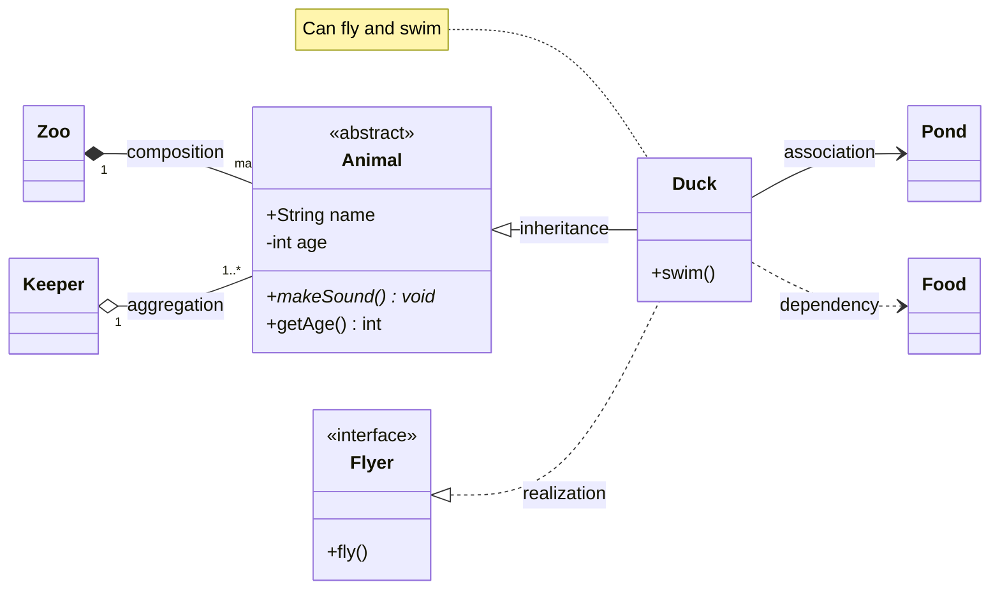

# classDiagram (UML classes)

Visibility: `+` public, `-` private, `#` protected, `~` package. `*` abstract, `$` static
(after the method). Generics: `class List~T~`. Annotations: `<<interface>>`, `<<abstract>>`,
`<<enumeration>>`, `<<service>>`.
Relations: `<|--` inheritance, `*--` composition, `o--` aggregation, `-->` association,
`..>` dependency, `..|>` realization, `--` link. Cardinality in quotes: `"1" --> "*"`.
