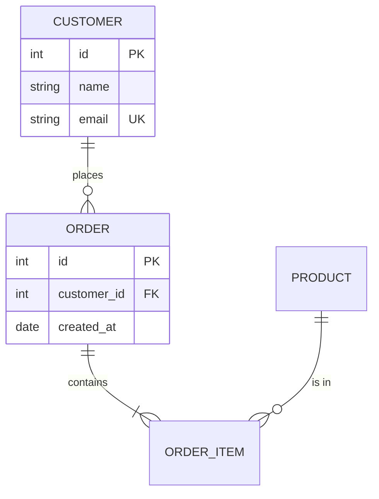

# erDiagram

Cardinality (left/right): `|o` zero or one, `||` exactly one, `}o` zero or more, `}|` one or more.
`--` identifying (solid), `..` non-identifying (dashed). The label after `:` is required;
quote it when it has spaces.
