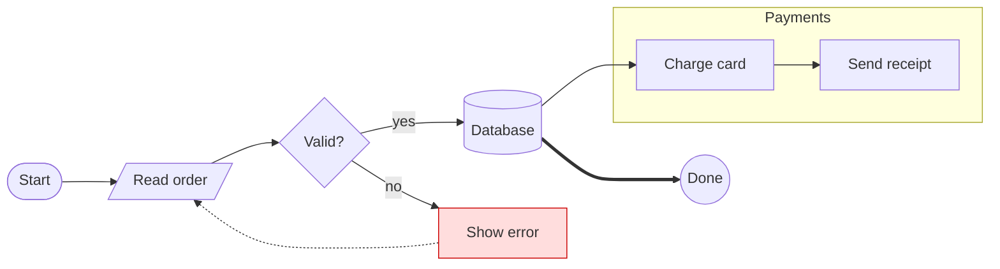

# flowchart

Shapes: `A[rect]` `A(round)` `A([stadium])` `A[[subroutine]]` `A[(database)]` `A((circle))`
`A>flag]` `A{decision}` `A{{hexagon}}` `A[/parallelogram/]` `A[\alt\]` `A[/trapezoid\]`.

Edges: `-->` arrow, `---` line, `-.->` dotted, `==>` thick, `--o` circle end, `--x` cross end,
`<-->` both ways. Labels: `A -->|text| B` or `A -- text --> B`. Longer edge: `A ---> B`.

Common errors:
- `A -- > B` (space inside the arrow) → `A --> B`.
- Unclosed shape `B --> (C` → `B --> C(text)`.
- Parentheses/brackets in text must be quoted: `A["f(x)"]`.
- `end` as a node id breaks subgraphs; use `finish[end]`.
