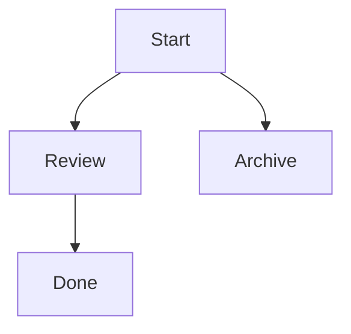
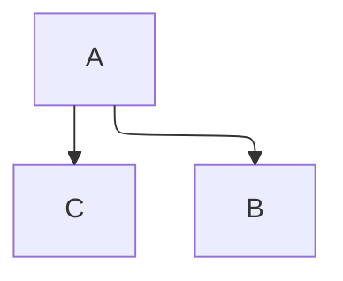

# Layout control (ODiagramador)

Graph diagrams (flowchart, state, class, ER, requirement) accept layout comments. They are Mermaid
comments, so GitHub, Mermaid Live and other renderers ignore them and use automatic layout.

| Comment | Effect |
|---|---|
| `%% @odg layout auto` | Mermaid's default layout (same as no comment) |
| `%% @odg layout elk` | ELK layered layout, automatic; usually fewer crossings in large graphs |
| `%% @odg layout elk-interactive` | Positions are **hints**: ELK keeps the node's layer and order, aligns it and routes every edge |
| `%% @odg layout exact` | Nodes with a position stay **exactly** there; the others come from ELK; edges become orthogonal connectors |
| `%% @odg pos <id> <x>,<y>` | Node centre, in the same coordinates as `inspect_diagram` bounding boxes (`x + w/2`, `y + h/2`) |
| `%% @odg layer <id> first\|last` | Pin a node to the first or last layer |
| `%% @odg layer <id> <n>` | Order of layers: nodes or subgraphs numbered 0, 1, 2… always come in that order, even when some arrows point backwards (ELK partitions) |

Prefer `arrange_diagram` over writing the comments by hand. Typical fixes:

- Two nodes in the wrong order in a row → `arrange_diagram(mode: "elk-interactive", positions: [{id, x, y}])` with the swapped x values.
- A node should sit at the bottom → `layers: [{id, layer: "last"}]`.
- Layered architecture whose layers come out of order because of arrows that go back up →
  `layers: [{id: "canais", layer: 0}, {id: "orquestrador", layer: 1}, {id: "agentes", layer: 2}]`
  (subgraph ids work; keep the arrows' real direction).
- Large diagram with many crossings → `mode: "elk"`.
- Start over → `reset_positions: true, mode: "auto"`.

Without ODiagramador you can still control order with ELK's model order (works in any Mermaid with ELK):

