<!-- Digest of Mermaid 12.2.0 docs/syntax/block.md — MIT © Mermaid contributors (render-kit/vendor/mermaid.LICENSE). Regenerate with scripts/sync-mermaid-docs.py -->
# Block Diagrams Documentation

## Introduction to Block Diagrams
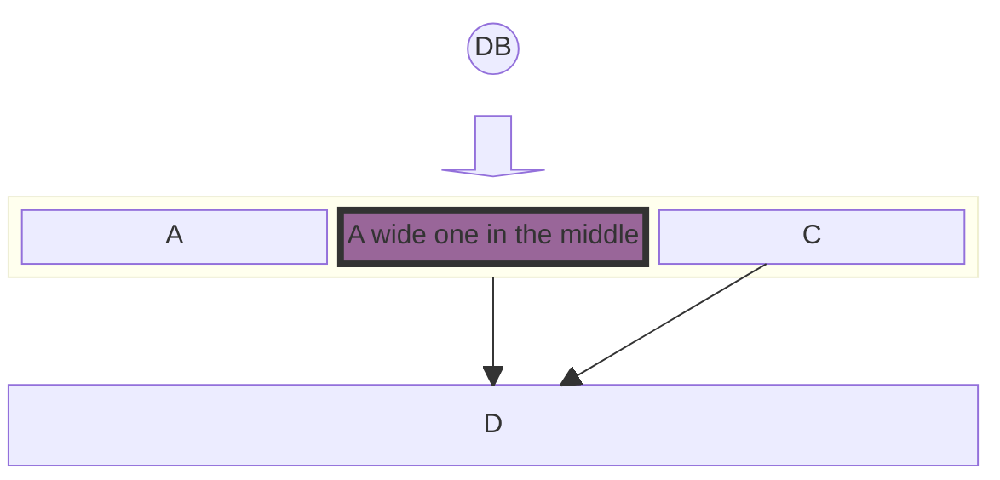

### Definition and Purpose
Block diagrams are an intuitive and efficient way to represent complex systems, processes, or architectures visually. They are composed of blocks and connectors, where blocks represent the fundamental components or functions, and connectors show the relationship or flow between these components. This method of diagramming is essential in various fields such as engineering, software development, an…

### General Use Cases
Block diagrams have a wide range of applications across various industries and disciplines. Some of the key use cases include:
- **Software Architecture**: In software development, block diagrams can be used to illustrate the architecture of a software application. This includes showing how different modules or services interact, data flow, and high-level component interaction.
- **Network Diagrams**: Block diagrams are ideal for representing network architectures in IT and telecommunications. They can depict how different network devices and services are interconnected, including routers, switches, firewalls, and the flow of data across the network.
- **Process Flowcharts**: In business and manufacturing, block diagrams can be employed to create process flowcharts. These flowcharts represent various stages of a business or manufacturing process, helping to visualize the sequence of steps, decision points, and the flow of control.
- **Electrical Systems**: Engineers use block diagrams to represent electrical systems and circuitry. They can illustrate the high-level structure of an electrical system, the interaction between different electrical components, and the flow of electrical currents.
- **Educational Purposes**: Block diagrams are also extensively used in educational materials to explain complex concepts and systems in a simplified manner. They help in breaking down and visualizing scientific theories, engineering principles, and technological systems.

### Simple Block Diagrams

#### Basic Structure
At its core, a block diagram consists of blocks representing different entities or components. In Mermaid, these blocks are easily created using simple text labels. The most basic form of a block diagram can be a series of blocks without any connectors.
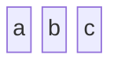

### Defining the number of columns to use

#### Column Usage
While simple block diagrams are linear and straightforward, more complex systems may require a structured layout. Mermaid allows for the organization of blocks into multiple columns, facilitating the creation of more intricate and detailed diagrams.
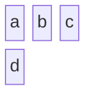

## 3. Advanced Block Configuration
Building upon the basics, this section delves into more advanced features of block diagramming in Mermaid. These features allow for greater flexibility and complexity in diagram design, accommodating a wider range of use cases and scenarios.

### Setting Block Width

#### Spanning Multiple Columns
In more complex diagrams, you may need blocks that span multiple columns to emphasize certain components or to represent larger entities. Mermaid allows for the adjustment of block widths to cover multiple columns, enhancing the diagram's readability and structure.
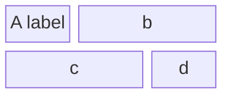

### Creating Composite Blocks

#### Nested Blocks
Composite blocks, or blocks within blocks, are an advanced feature in Mermaid's block diagram syntax. They allow for the representation of nested or hierarchical systems, where one component encompasses several subcomponents.
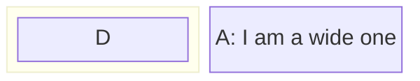

### Column Width Dynamics

#### Adjusting Widths
Mermaid also allows for dynamic adjustment of column widths based on the content of the blocks. The width of the columns is determined by the widest block in the column, ensuring that the diagram remains balanced and readable.
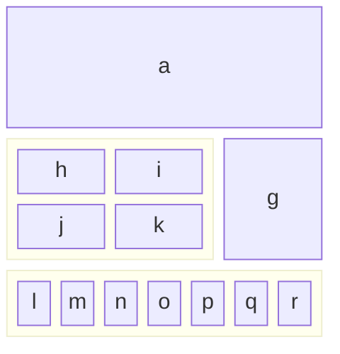
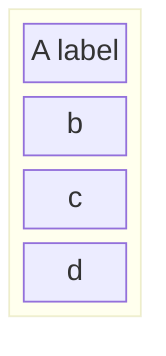

## 4. Block Varieties and Shapes
Mermaid's block diagrams are not limited to standard rectangular shapes. A variety of block shapes are available, allowing for a more nuanced and tailored representation of different types of information or entities. This section outlines the different block shapes you can use in Mermaid and their specific applications.

### Standard and Special Block Shapes
Mermaid supports a range of block shapes to suit different diagramming needs, from basic geometric shapes to more specialized forms.

#### Example - Round Edged Block
To create a block with round edges, which can be used to represent a softer or more flexible component:
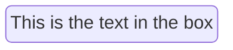

#### Example - Stadium-Shaped Block
A stadium-shaped block, resembling an elongated circle, can be used for components that are process-oriented:
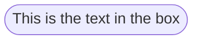

#### Example - Subroutine Shape
For representing subroutines or contained processes, a block with double vertical lines is useful:
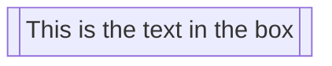

#### Example - Cylindrical Shape
The cylindrical shape is ideal for representing databases or storage components:
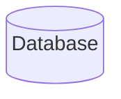

#### Example - Circle Shape
A circle can be used for centralized or pivotal components:
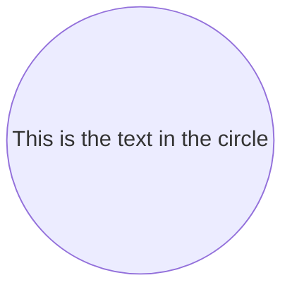

#### Example - Asymmetric, Rhombus, and Hexagon Shapes
For decision points, use a rhombus, and for unique or specialized processes, asymmetric and hexagon shapes can be utilized:
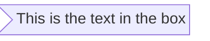
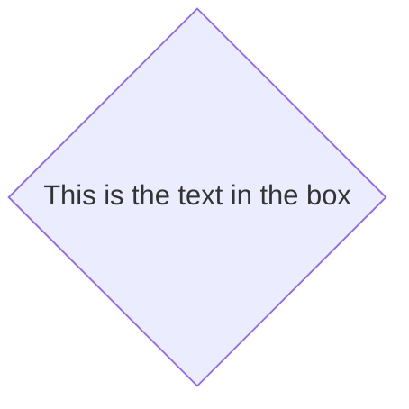
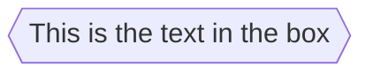

#### Example - Parallelogram and Trapezoid Shapes
Parallelogram and trapezoid shapes are perfect for inputs/outputs and transitional processes:
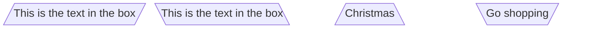

#### Example - Double Circle
For highlighting critical or high-priority components, a double circle can be effective:
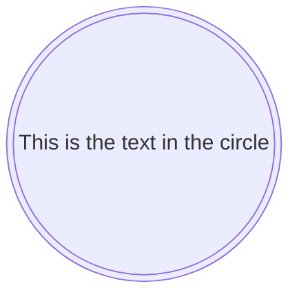

### Block Arrows and Space Blocks
Mermaid also offers unique shapes like block arrows and space blocks for directional flow and spacing.

#### Example - Block Arrows
Block arrows can visually indicate direction or flow within a process:
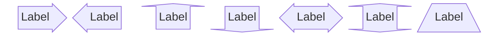

#### Example - Space Blocks
Space blocks can be used to create intentional empty spaces in the diagram, which is useful for layout and readability:
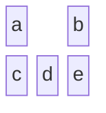
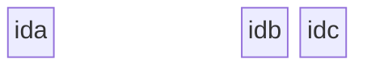

### Standard and Special Block Shapes
Discuss the various shapes available for blocks, including standard shapes and special forms like block arrows and space blocks.

## 5. Connecting Blocks with Edges
One of the key features of block diagrams in Mermaid is the ability to connect blocks using various types of edges or links. This section explores the different ways blocks can be interconnected to represent relationships and flows between components.

### Basic Linking and Arrow Types
The most fundamental aspect of connecting blocks is the use of arrows or links. These connectors depict the relationships or the flow of information between the blocks. Mermaid offers a range of arrow types to suit different diagramming needs.
```mermaid
block
  A space B
  A-->B
```

### Text on Links
In addition to connecting blocks, it's often necessary to describe or label the relationship. Mermaid allows for the inclusion of text on links, providing context to the connections.
```mermaid
block
  A space:2 B
  A-- "X" -->B
```
```mermaid
block
columns 1
  db(("DB"))
  blockArrowId6<["&nbsp;&nbsp;&nbsp;"]>(down)
  block:ID
    A
    B["A wide one in the middle"]
    C
  end
  space
  D
  ID --> D
  C --> D
  style B fill:#939,stroke:#333,stroke-width:4px
```

## 6. Styling and Customization
Beyond the structure and layout of block diagrams, Mermaid offers extensive styling options. These customization features allow for the creation of more visually distinctive and informative diagrams. This section covers how to apply individual styles to blocks and how to use classes for consistent styling across multiple elements.

### Individual Block Styling
Mermaid enables detailed styling of individual blocks, allowing you to apply various CSS properties such as color, stroke, and border thickness. This feature is especially useful for highlighting specific parts of a diagram or for adhering to certain visual themes.

#### Example - Styling a Single Block
To apply custom styles to a block, you can use the `style` keyword followed by the block identifier and the desired CSS properties:
```mermaid
block
  id1 space id2
  id1("Start")-->id2("Stop")
  style id1 fill:#636,stroke:#333,stroke-width:4px
  style id2 fill:#bbf,stroke:#f66,stroke-width:2px,color:#fff,stroke-dasharray: 5 5
```

### Class Styling
Mermaid enables applying styling to classes, which could make styling easier if you want to apply a certain set of styles to multiple elements, as you could just link those elements to a class.

#### Example - Styling a Single Class
```mermaid
block
  A space B
  A-->B
  classDef blue fill:#6e6ce6,stroke:#333,stroke-width:4px;
  class A blue
  style B fill:#bbf,stroke:#f66,stroke-width:2px,color:#fff,stroke-dasharray: 5 5
```
In this example, a class named 'blue' is defined and applied to block 'A', while block 'B' receives individual styling. This demonstrates the flexibility of Mermaid in applying both shared and unique styles within the same diagram.

### 7. Practical Examples and Use Cases
The versatility of Mermaid's block diagrams becomes evident when applied to real-world scenarios. This section provides practical examples demonstrating the application of various features discussed in previous sections. These examples showcase how block diagrams can be used to represent complex systems and processes in an accessible and informative manner.

### Detailed Examples Illustrating Various Features
Combining the elements of structure, linking, and styling, we can create comprehensive diagrams that serve specific purposes in different contexts.

#### Example - System Architecture
Illustrating a simple software system architecture with interconnected components:
```mermaid
block
  columns 3
  Frontend blockArrowId6<[" "]>(right) Backend
  space:2 down<[" "]>(down)
  Disk left<[" "]>(left) Database[("Database")]

  classDef front fill:#696,stroke:#333;
  classDef back fill:#969,stroke:#333;
  class Frontend front
  class Backend,Database back
```

#### Example - Business Process Flow
Representing a business process flow with decision points and multiple stages:
```mermaid
block
  columns 3
  Start(("Start")) space:2
  down<[" "]>(down) space:2
  Decision{{"Make Decision"}} right<["Yes"]>(right) Process1["Process A"]
  downAgain<["No"]>(down) space r3<["Done"]>(down)
  Process2["Process B"] r2<["Done"]>(right) End(("End"))

  style Start fill:#969;
  style End fill:#696;
```

## 8. Troubleshooting and Common Issues
Working with Mermaid block diagrams can sometimes present challenges, especially as the complexity of the diagrams increases. This section aims to provide guidance on resolving common issues and offers tips for managing more intricate diagram structures.

### Common Syntax Errors
Understanding and avoiding common syntax errors is key to a smooth experience with Mermaid diagrams.

#### Example - Incorrect Linking
A common mistake is incorrect linking syntax, which can lead to unexpected results or broken diagrams:
```
block
  A - B
```
```mermaid
block
  A space B
  A --> B
```

#### Example - Misplaced Styling
Applying styles in the wrong context or with incorrect syntax can lead to blocks not being styled as intended:
```mermaid
  block
    A
    style A fill#969;
```
```mermaid
block
  A
  style A fill:#969,stroke:#333;

```

### Tips for Complex Diagram Structures
Managing complexity in Mermaid diagrams involves planning and employing best practices.

#### Modular Design
Break down complex diagrams into smaller, more manageable components. This approach not only makes the diagram easier to understand but also simplifies the creation and maintenance process.

#### Consistent Styling
Use classes to maintain consistent styling across similar elements. This not only saves time but also ensures a cohesive and professional appearance.

#### Comments and Documentation
Use comments with `%%` within the Mermaid syntax to document the purpose of various parts of the diagram. This practice is invaluable for maintaining clarity, especially when working in teams or returning to a diagram after some time.
