<!-- Digest of Mermaid 12.2.0 docs/syntax/classDiagram.md — MIT © Mermaid contributors (render-kit/vendor/mermaid.LICENSE). Regenerate with scripts/sync-mermaid-docs.py -->
# Class diagrams
The class diagram is the main building block of object-oriented modeling. It is used for general conceptual modeling of the structure of the application, and for detailed modeling to translate the models into programming code. Class diagrams can also be used for data modeling. The classes in a class diagram represent both the main elements, interactions in the application, and the classes to be pr…
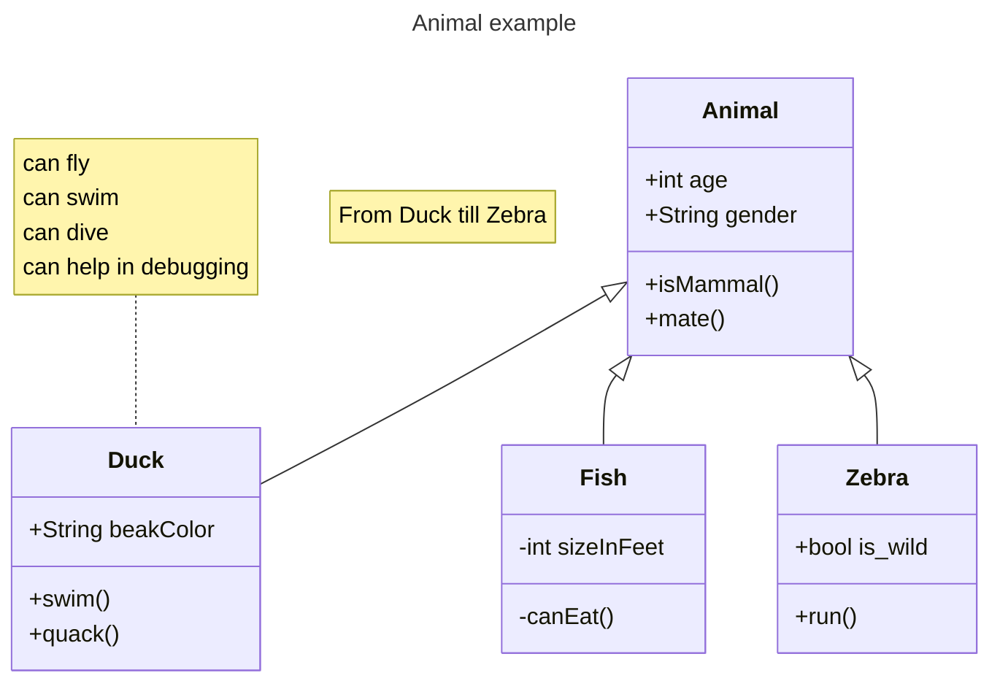

## Default theme, look and layout (v12.0.0+)
Class diagrams use the `redux-color` theme and the `neo` look by default, and are laid out by [ELK](https://www.eclipse.org/elk/) rather than Dagre. Not every diagram type

### With the defaults
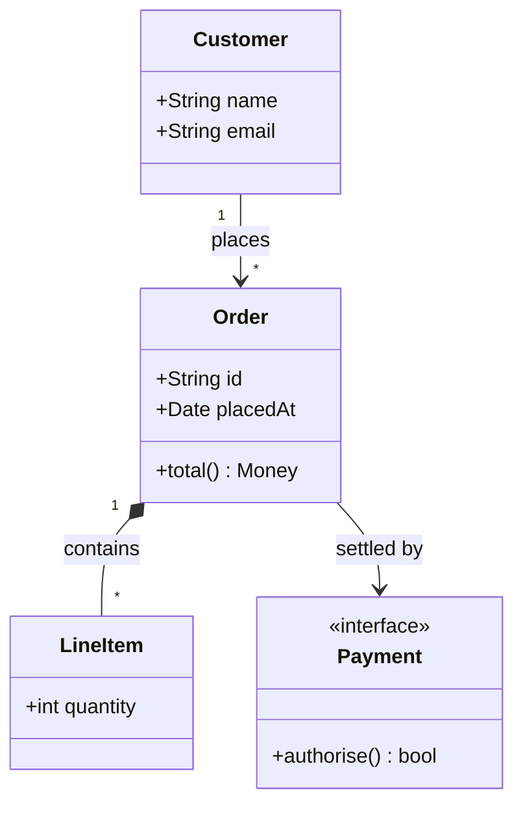

### The previous appearance
Both are only defaults, so anything you set yourself wins. Naming the previous theme and look


## Syntax

### Class
UML provides mechanisms to represent class members, such as attributes and methods, and additional information about them.
- The top compartment contains the name of the class. It is printed in bold and centered, and the first letter is capitalized. It may also contain optional annotation text describing the nature of the class.
- The middle compartment contains the attributes of the class. They are left-aligned and the first letter is lowercase.
- The bottom compartment contains the operations the class can execute. They are also left-aligned and the first letter is lowercase.
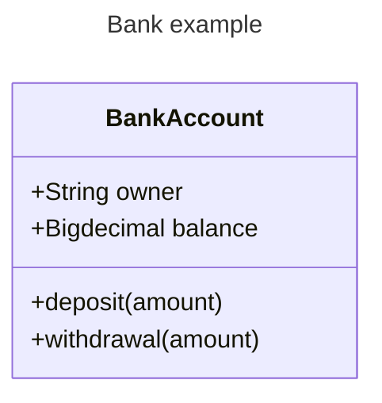

## Define a class
There are two ways to define a class:
- Explicitly using keyword **class** like `class Animal` which would define the Animal class.
- Via a **relationship** which defines two classes at a time along with their relationship. For instance, `Vehicle <|-- Car`.
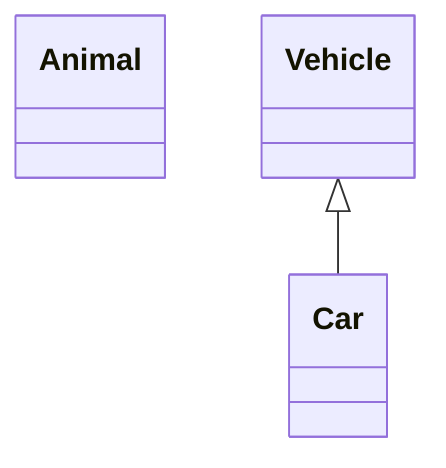

### Class labels
In case you need to provide a label for a class, you can use the following syntax:
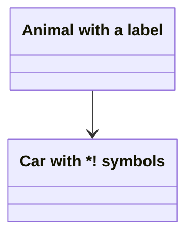
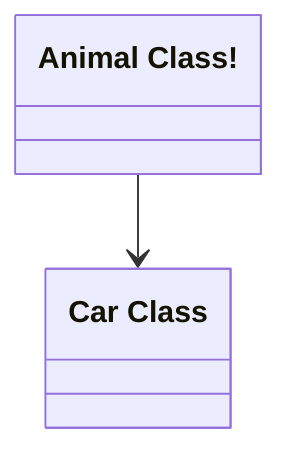

## Defining Members of a class
UML provides mechanisms to represent class members such as attributes and methods, as well as additional information about them.
- Associate a member of a class using **:** (colon) followed by member name, useful to define one member at a time. For example:
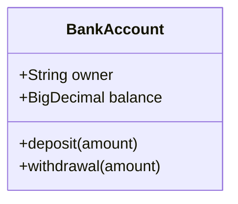
- Associate members of a class using **{}** brackets, where members are grouped within curly brackets. Suitable for defining multiple members at once. For example:


#### Return Type
Optionally you can end a method/function definition with the data type that will be returned (note: there must be a space between the final `)` and the return type). An example:
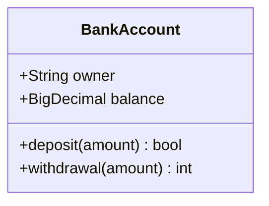

#### Generic Types
Generics can be represented as part of a class definition, and for class members/return types. In order to denote an item as generic, you enclose that type within `~` (**tilde**). **Nested** type declarations such as `List<List<int>>` are supported, though generics that include a comma are currently not supported. (such as `List<List<K, V>>`)
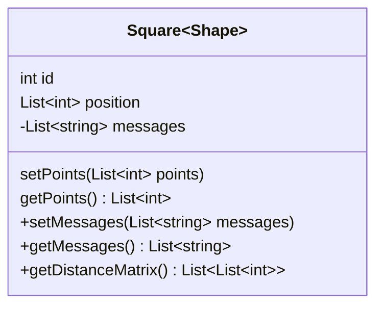

#### Visibility
To describe the visibility (or encapsulation) of an attribute or method/function that is a part of a class (i.e. a class member), optional notation may be placed before that members' name:
- `+` Public
- `-` Private
- `#` Protected
- `~` Package/Internal

## Defining Relationship
A relationship is a general term covering the specific types of logical connections found on class and object diagrams.
```
[classA][Arrow][ClassB]
```
| Type    | Description   |
| ------- | ------------- |
| `<\|--` | Inheritance   |
| `*--`   | Composition   |
| `o--`   | Aggregation   |
| `-->`   | Association   |
| `--`    | Link (Solid)  |
| `..>`   | Dependency    |
| `..\|>` | Realization   |
| `..`    | Link (Dashed) |
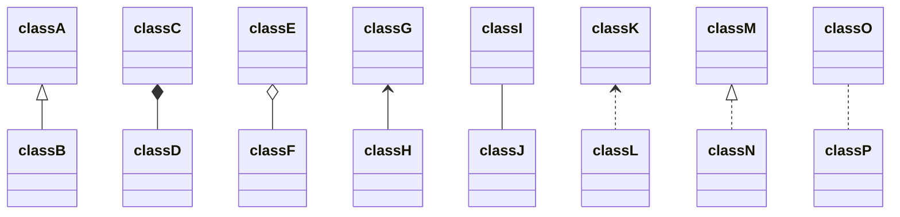
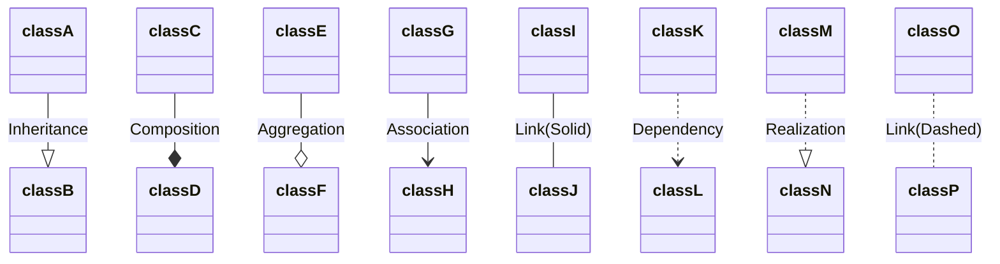

### Labels on Relations
It is possible to add label text to a relation:
```
[classA][Arrow][ClassB]:LabelText
```
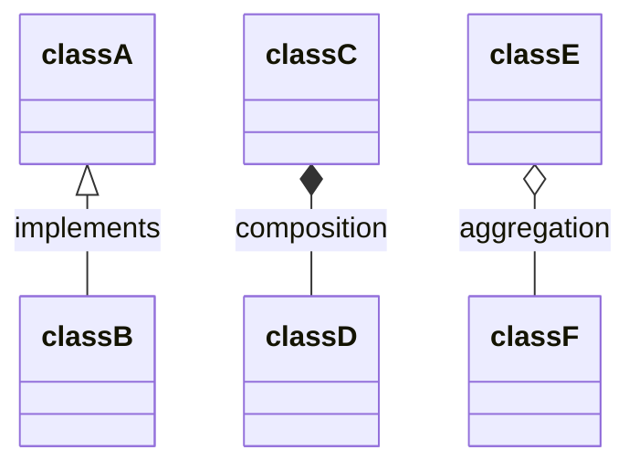

### Two-way relations
Relations can logically represent an N:M association:
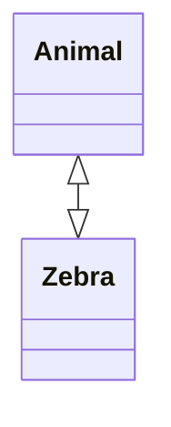
```
[Relation Type][Link][Relation Type]
```
| Type  | Description |
| ----- | ----------- |
| `<\|` | Inheritance |
| `\*`  | Composition |
| `o`   | Aggregation |
| `>`   | Association |
| `<`   | Association |
| `\|>` | Realization |
| Type | Description |
| ---- | ----------- |
| --   | Solid       |
| ..   | Dashed      |

### Lollipop Interfaces
Classes can also be given a special relation type that defines a lollipop interface on the class. A lollipop interface is defined using the following syntax:
- `bar ()-- foo`
- `foo --() bar`
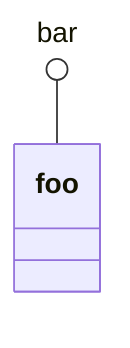
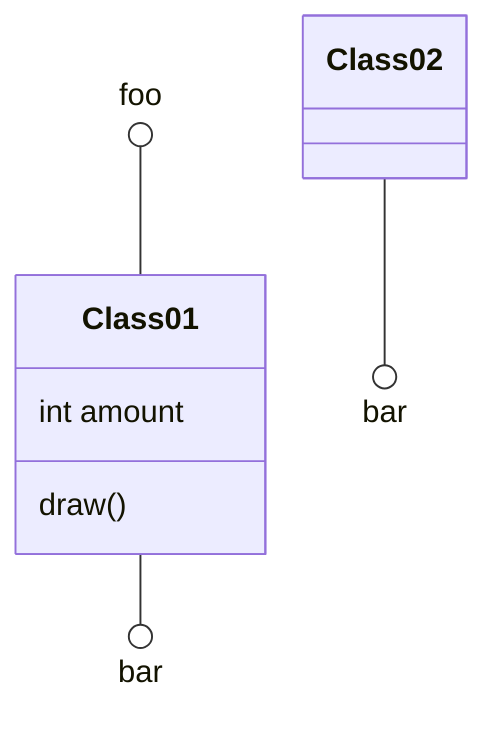

## Define Namespace
A namespace groups classes.
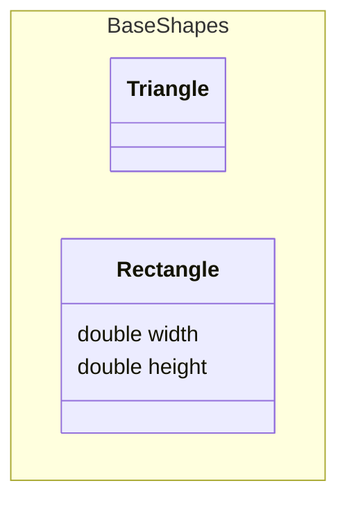

### Namespace Labels (v11.15.0+)
A namespace can be given a display label using square bracket syntax, similar to class labels:
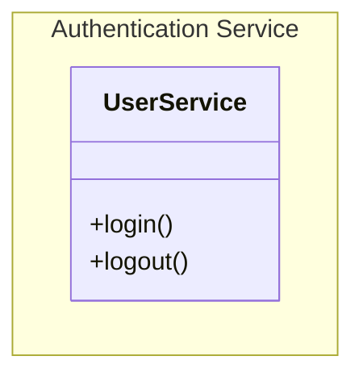

### Nested Namespaces (v11.15.0+)
Namespaces can be nested to represent hierarchical groupings. There are two ways to define nested namespaces:
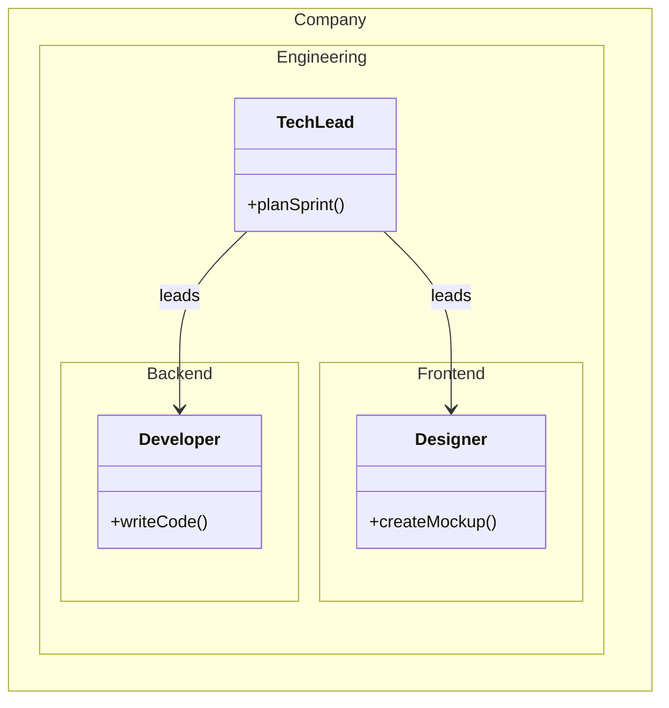
```mermaid
classDiagram
    namespace Platform {
        namespace Auth {
            class UserService {
                +login()
                +logout()
            }
        }
        namespace Data {
            class Repository {
                +find()
                +save()
            }
        }
        class Gateway {
            +route()
        }
    }
    Gateway --> UserService : delegates
    Gateway --> Repository : delegates
```

#### Compact rendering (`hierarchicalNamespaces: false`)
By default (`hierarchicalNamespaces: true`), each segment of a dotted or syntactically-nested namespace name renders as its own cluster, producing a nested layout.
```mermaid
---
config:
  class:
    hierarchicalNamespaces: false
---
classDiagram
    namespace Company.Engineering.Backend {
        class Developer {
            +writeCode()
        }
    }
    namespace Company.Engineering.Frontend {
        class Designer {
            +createMockup()
        }
    }
    namespace Company {
        class CEO {
            +makeDecisions()
        }
    }
    CEO --> Developer : oversees
    CEO --> Designer : oversees
```

## Cardinality / Multiplicity on relations
Multiplicity or cardinality in class diagrams indicates the number of instances of one class that can be linked to an instance of the other class. For example, each company will have one or more employees (not zero), and each employee currently works for zero or one companies.
- `1` Only 1
- `0..1` Zero or One
- `1..*` One or more
- `*` Many
- `n` n (where n>1)
- `0..n` zero to n (where n>1)
- `1..n` one to n (where n>1)
```
[classA] "cardinality1" [Arrow] "cardinality2" [ClassB]:LabelText
```
```mermaid
classDiagram
    Customer "1" --> "*" Ticket
    Student "1" --> "1..*" Course
    Galaxy --> "many" Star : Contains
```

## Annotations on classes
It is possible to annotate classes with markers to provide additional metadata about the class. This can give a clearer indication about its nature. Some common annotations include:
- `<<Interface>>` To represent an Interface class
- `<<Abstract>>` To represent an abstract class
- `<<Service>>` To represent a service class
- `<<Enumeration>>` To represent an enum
- **Inline** with the class definition:
```mermaid
classDiagram
  class Shape <<interface>>
```
- In a **_separate line_** after a class is defined:
```mermaid
classDiagram
class Shape
<<interface>> Shape
Shape : noOfVertices
Shape : draw()
```
- In a **_nested structure_** along with the class definition:
```mermaid
classDiagram
class Shape{
    <<interface>>
    noOfVertices
    draw()
}
class Color{
    <<enumeration>>
    RED
    BLUE
    GREEN
    WHITE
    BLACK
}

```

## Comments
Comments can be entered within a class diagram, which will be ignored by the parser. Comments need to be on their own line, and must be prefaced with `%%` (double percent signs). Any text until the next newline will be treated as a comment, including any class diagram syntax.
```mermaid
classDiagram
%% This whole line is a comment classDiagram class Shape <<interface>>
class Shape{
    <<interface>>
    noOfVertices
    draw()
}
```

## Setting the direction of the diagram
With class diagrams you can use the direction statement to set the direction in which the diagram will render:
```mermaid
classDiagram
  direction RL
  class Student {
    -idCard : IdCard
  }
  class IdCard{
    -id : int
    -name : string
  }
  class Bike{
    -id : int
    -name : string
  }
  Student "1" --o "1" IdCard : carries
  Student "1" --o "1" Bike : rides
```

## Interaction
It is possible to bind a click event to a node. The click can lead to either a javascript callback or to a link which will be opened in a new browser tab. **Note**: This functionality is disabled when using `securityLevel='strict'` and enabled when using `securityLevel='loose'`.
```
action className "reference" "tooltip"
click className call callback() "tooltip"
click className href "url" "tooltip"
```
- _action_ is either `link` or `callback`, depending on which type of interaction you want to have called
- _className_ is the id of the node that the action will be associated with
- _reference_ is either the url link, or the function name for callback.
- (_optional_) tooltip is a string to be displayed when hovering over element (note: The styles of the tooltip are set by the class .mermaidTooltip.)
- note: callback function will be called with the nodeId as parameter.

## Notes
It is possible to add notes on the diagram using `note "line1\nline2"`. A note can be added for a specific class using `note for <CLASS NAME> "line1\nline2"`.

### Examples
```mermaid
classDiagram
    note "This is a general note"
    note for MyClass "This is a note for a class"
    class MyClass{
    }
```
_URL Link:_
```mermaid
classDiagram
class Shape
link Shape "https://www.github.com" "This is a tooltip for a link"
class Shape2
click Shape2 href "https://www.github.com" "This is a tooltip for a link"
```
```mermaid
classDiagram
class Shape
callback Shape "callbackFunction" "This is a tooltip for a callback"
class Shape2
click Shape2 call callbackFunction() "This is a tooltip for a callback"
```
```html
<script>
  const callbackFunction = function () {
    alert('A callback was triggered');
  };
</script>
```
```mermaid
classDiagram
    class Class01
    class Class02
    callback Class01 "callbackFunction" "Callback tooltip"
    link Class02 "https://www.github.com" "This is a link"
    class Class03
    class Class04
    click Class03 call callbackFunction() "Callback tooltip"
    click Class04 href "https://www.github.com" "This is a link"
```

## Styling

### Styling a node
It is possible to apply specific styles such as a thicker border or a different background color to an individual node using the `style` keyword.
```mermaid
classDiagram
  class Animal
  class Mineral
  style Animal fill:#f9f,stroke:#333,stroke-width:4px
  style Mineral fill:#bbf,stroke:#f66,stroke-width:2px,color:#fff,stroke-dasharray: 5 5
```

#### Classes
More convenient than defining the style every time is to define a class of styles and attach this class to the nodes that
```
classDef className fill:#f9f,stroke:#333,stroke-width:4px;
```
```
classDef firstClassName,secondClassName font-size:12pt;
```
```
cssClass "nodeId1" className;
```
```
cssClass "nodeId1,nodeId2" className;
```
```mermaid
classDiagram
    class Animal:::someclass
    classDef someclass fill:#f96
```
```mermaid
classDiagram
    class Animal:::someclass {
        -int sizeInFeet
        -canEat()
    }
    classDef someclass fill:#f96
```

### Default class
If a class is named default it will be applied to all nodes. Specific styles and classes should be defined afterwards to override the applied default styling.
```
classDef default fill:#f9f,stroke:#333,stroke-width:4px;
```
```mermaid
classDiagram
  class Animal:::pink
  class Mineral

  classDef default fill:#f96,color:red
  classDef pink color:#f9f
```

### CSS Classes
It is also possible to predefine classes in CSS styles that can be applied from the graph definition as in the example
```html
<style>
  .styleClass > * > g {
    fill: #ff0000;
    stroke: #ffff00;
    stroke-width: 4px;
  }
</style>
```
```mermaid
classDiagram
    class Animal:::styleClass
```

## Configuration

### Members Box
It is possible to hide the empty members box of a class node.

### Possible configuration parameters:
| Parameter           | Description                                                  | Default value |
| ------------------- | ------------------------------------------------------------ | ------------- |
| hideEmptyMembersBox | Hides the empty members box of a class node when set to true | false         |
```mermaid
---
  config:
    class:
      hideEmptyMembersBox: true
---
classDiagram
  class Duck
```
