<!-- Digest of Mermaid 12.2.0 docs/syntax/entityRelationshipDiagram.md — MIT © Mermaid contributors (render-kit/vendor/mermaid.LICENSE). Regenerate with scripts/sync-mermaid-docs.py -->
# Entity Relationship Diagrams
Note that practitioners of ER modelling almost always refer to _entity types_ simply as _entities_. For example the `CUSTOMER` entity _type_ would be referred to simply as the `CUSTOMER` entity. This is so common it would be inadvisable to do anything else, but technically an entity is an abstract _instance_ of an entity type, and this is what an ER diagram shows - abstract instances, and the rela…
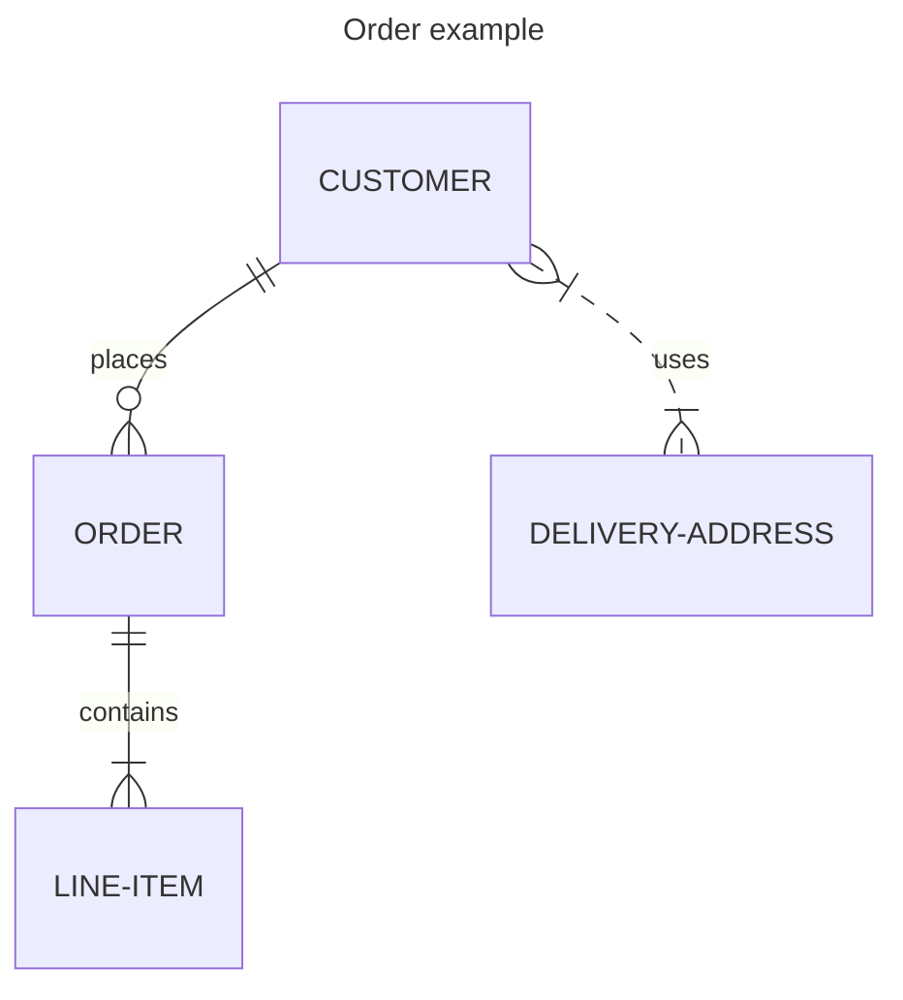
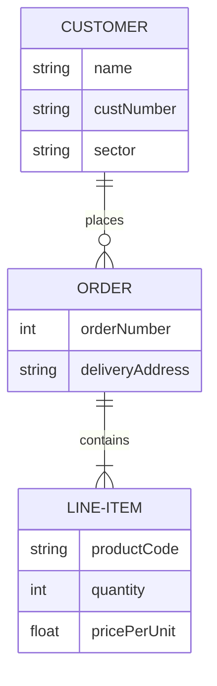

## Default theme, look and layout (v12.0.0+)
Entity relationship diagrams use the `redux-color` theme and the `neo` look by default, and are laid out by [ELK](https://www.eclipse.org/elk/) rather than Dagre. Not every diagram type

### With the defaults
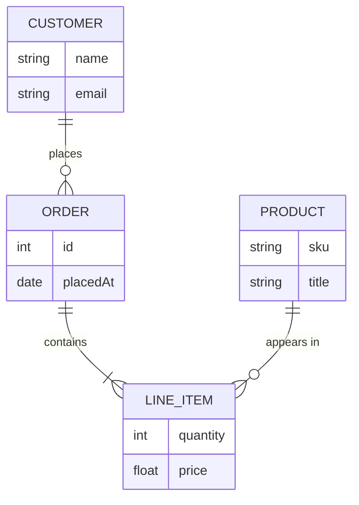

### The previous appearance
Both are only defaults, so anything you set yourself wins. Naming the previous theme and look


## Syntax

### Entities and Relationships
Mermaid syntax for ER diagrams is compatible with PlantUML, with an extension to label the relationship. Each statement consists of the following parts:
```
    <first-entity> [<relationship> <second-entity> : <relationship-label>]
```
- `first-entity` is the name of an entity. Names support any unicode characters and can include spaces if surrounded by double quotes (e.g. "name with space").
- `relationship` describes the way that both entities inter-relate. See below.
- `second-entity` is the name of the other entity.
- `relationship-label` describes the relationship from the perspective of the first entity.
```
    PROPERTY ||--|{ ROOM : contains
```

#### Unicode text
Entity names, relationships, and attributes all support unicode text.
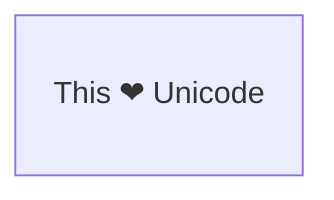

#### Markdown formatting
Markdown formatting and text is also supported.
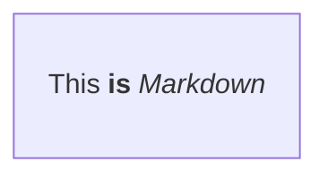

### Relationship Syntax
The `relationship` part of each statement can be broken down into three sub-components:
- the cardinality of the first entity with respect to the second
- whether the relationship confers identity on a 'child' entity
- the cardinality of the second entity with respect to the first
| Value (left) | Value (right) | Meaning                       |
| :----------: | :-----------: | ----------------------------- |
|    `\|o`     |     `o\|`     | Zero or one                   |
|    `\|\|`    |    `\|\|`     | Exactly one                   |
|     `}o`     |     `o{`      | Zero or more (no upper limit) |
|    `}\|`     |     `\|{`     | One or more (no upper limit)  |
| Value (left) | Value (right) | Alias for    |
| :----------: | :-----------: | ------------ |
| one or zero  |  one or zero  | Zero or one  |
| zero or one  |  zero or one  | Zero or one  |
| one or more  |  one or more  | One or more  |
| one or many  |  one or many  | One or more  |
|   many(1)    |    many(1)    | One or more  |
|      1+      |      1+       | One or more  |
| zero or more | zero or more  | Zero or more |
| zero or many | zero or many  | Zero or more |
|   many(0)    |    many(0)    | Zero or more |
|      0+      |      0+       | Zero or more |
|   only one   |   only one    | Exactly one  |
|      1       |       1       | Exactly one  |

### Identification
Relationships may be classified as either _identifying_ or _non-identifying_ and these are rendered with either solid or dashed lines respectively. This is relevant when one of the entities in question cannot have independent existence without the other. For example a firm that insures people to drive cars might need to store data on `NAMED-DRIVER`s. In modelling this we might start out by observi…
| Value |     Alias for     |
| :---: | :---------------: |
|  --   |   _identifying_   |
|  ..   | _non-identifying_ |
|     Value     |     Alias for     |
| :-----------: | :---------------: |
|      to       |   _identifying_   |
| optionally to | _non-identifying_ |
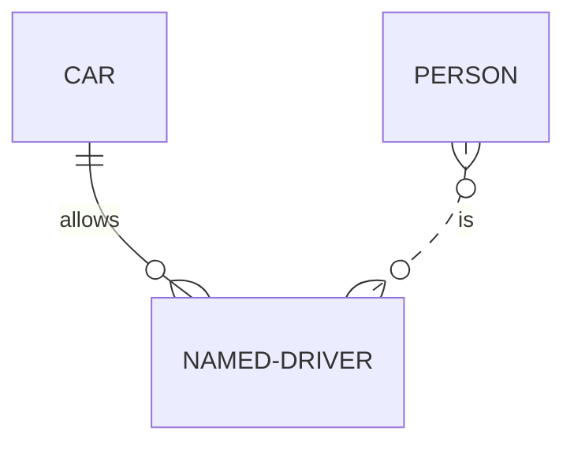


### Attributes
Attributes can be defined for entities by specifying the entity name followed by a block containing multiple `type name` pairs, where a block is delimited by an opening `{` and a closing `}`. The attributes are rendered inside the entity boxes. For example:
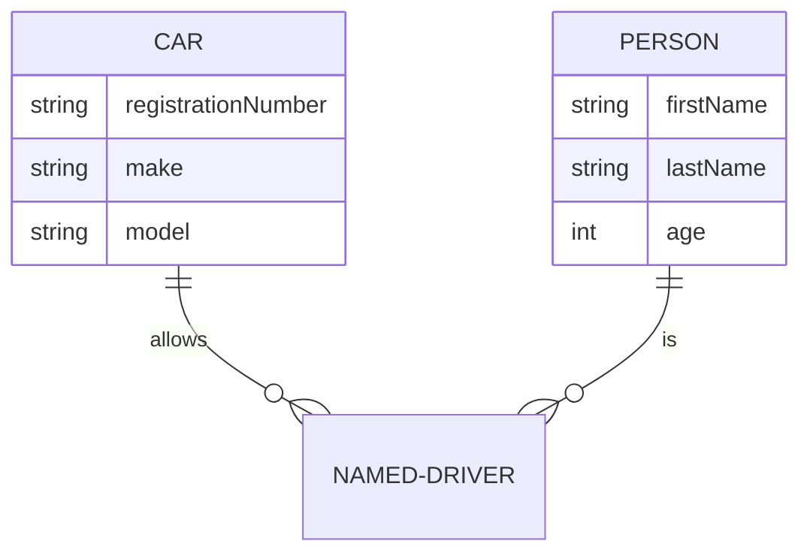

#### Optional attribute types (v11.16.0+)
Attribute `type` values may end with `?` to indicate an optional or nullable type.
```mermaid
erDiagram
    PERSON {
        string firstName
        string? middleName
        string lastName
    }
```

### Entity Name Aliases
An alias can be added to an entity using square brackets. If provided, the alias will be showed in the diagram instead of the entity name. Alias names follow all of the same rules as entity names.
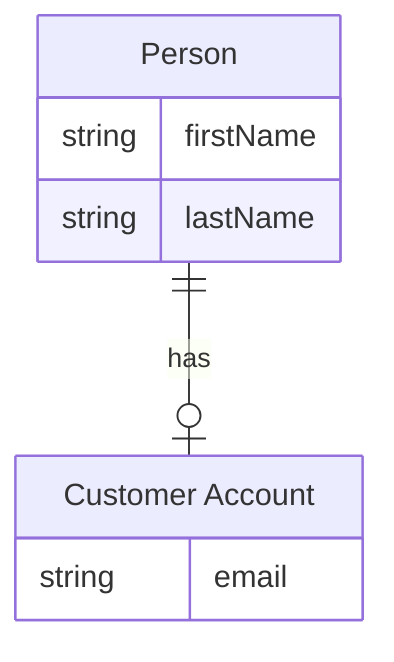

#### Attribute Keys and Comments
Attributes may also have a `key` or comment defined. Keys can be `PK`, `FK` or `UK`, for Primary Key, Foreign Key or Unique Key (markdown formatting and unicode is not supported for keys). To specify multiple key constraints on a single attribute, separate them with a comma (e.g., `PK, FK`). A `comment` is defined by double quotes at the end of an attribute. Comments themselves cannot have double-…
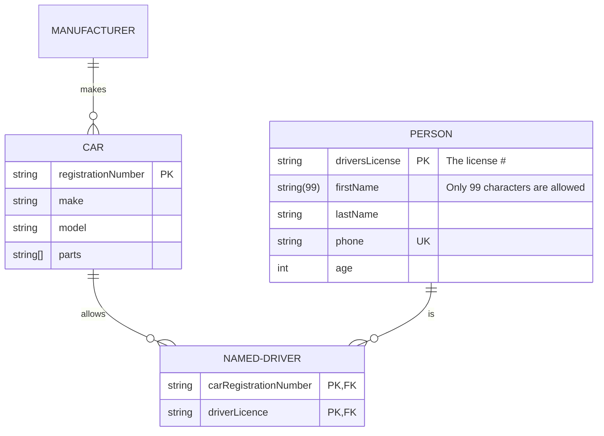

### Direction
The direction statement declares the direction of the diagram.

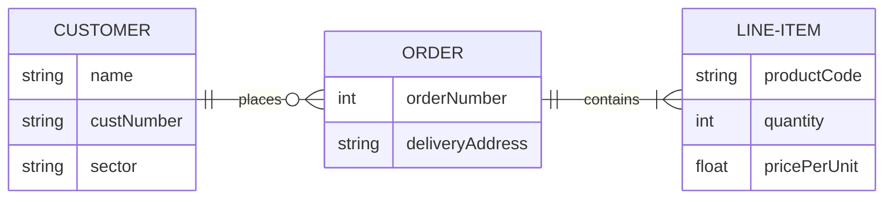
- TB - Top to bottom
- BT - Bottom to top
- RL - Right to left
- LR - Left to right

### Subgraphs (v11.17.0+)
Subgraphs allow grouping entities into logical sections within an ER diagram. They are useful for organizing
```
subgraph title
    graph definition
end
```
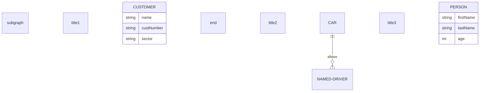
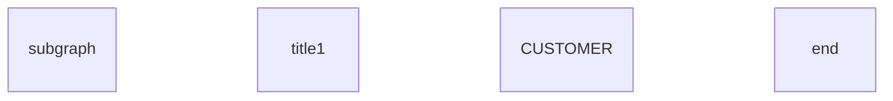
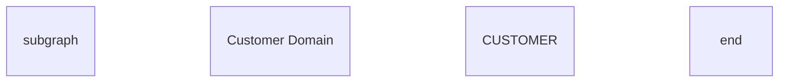
```mermaid
erDiagram
    subgraph id1 [title 1]
        CUSTOMER
    end
```

#### Relationships involving subgraphs
It is also possible to define relationships to and from subgraphs.
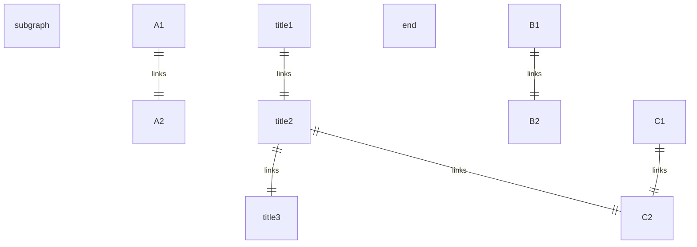

#### Direction in subgraphs
A subgraph can define its own layout direction.
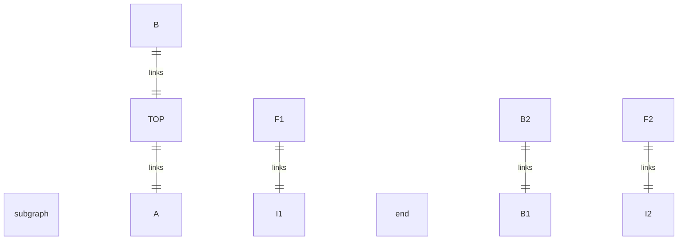

### Styling a node
It is possible to apply specific styles such as a thicker border or a different background color to a node.
```mermaid
erDiagram
    id1||--||id2 : label
    style id1 fill:#f9f,stroke:#333,stroke-width:4px
    style id2 fill:#bbf,stroke:#f66,stroke-width:2px,color:#fff,stroke-dasharray: 5 5
```
```
    style nodeId1,nodeId2 styleList
```

#### Classes
More convenient than defining the style every time is to define a class of styles and attach this class to the nodes that
```
    classDef className fill:#f9f,stroke:#333,stroke-width:4px
```
```
    classDef firstClassName,secondClassName font-size:12pt
```
```
    class nodeId1 className
```
```
    class nodeId1,nodeId2 className
```
```
    class nodeId1,nodeId2 className1,className2
```
```mermaid
erDiagram
    direction TB
    CAR:::someclass {
        string registrationNumber
        string make
        string model
    }
    PERSON:::someclass {
        string firstName
        string lastName
        int age
    }
    HOUSE:::someclass

    classDef someclass fill:#f96
```
```mermaid
erDiagram
    CAR {
        string registrationNumber
        string make
        string model
    }
    PERSON {
        string firstName
        string lastName
        int age
    }
    PERSON:::foo ||--|| CAR : owns
    PERSON o{--|| HOUSE:::bar : has

    classDef foo stroke:#f00
    classDef bar stroke:#0f0
    classDef foobar stroke:#00f
```
```
    nodeId:::className1,className2
```

### Default class
If a class is named default it will be assigned to all classes without specific class definitions.
```
    classDef default fill:#f9f,stroke:#333,stroke-width:4px;
```
```mermaid
erDiagram
    CAR {
        string registrationNumber
        string make
        string model
    }
    PERSON {
        string firstName
        string lastName
        int age
    }
    PERSON:::foo ||--|| CAR : owns
    PERSON o{--|| HOUSE:::bar : has

    classDef default fill:#f9f,stroke-width:4px
    classDef foo stroke:#f00
    classDef bar stroke:#0f0
    classDef foobar stroke:#00f
```

## Configuration

### Layout
The layout of the diagram is handled by [`render()`](../config/setup/mermaid/interfaces/Mermaid.md#render). The default layout is the ELK (Eclipse Layout Kernel) layout, which suits larger and more-complex diagrams. For more information, see [Customizing ELK Layout](../intro/syntax-reference.md#customizing-elk-layout).
```yaml
---
config:
  layout: dagre
---
```
```mermaid
---
title: Order example
config:
    layout: dagre
---
erDiagram
    CUSTOMER ||--o{ ORDER : places
    ORDER ||--|{ LINE-ITEM : contains
    CUSTOMER }|..|{ DELIVERY-ADDRESS : uses
```
