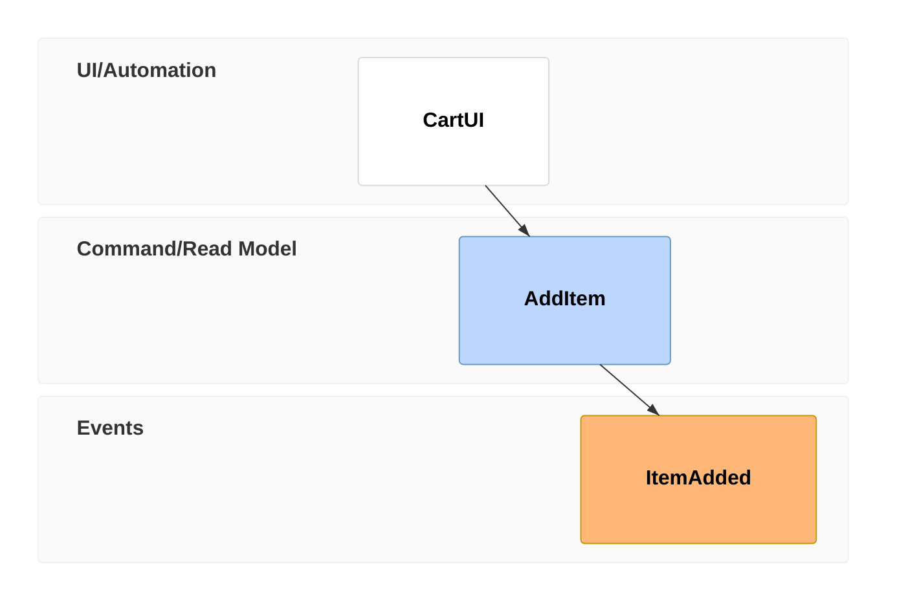
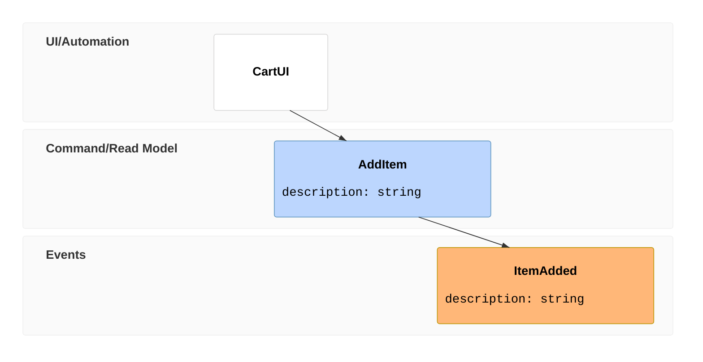
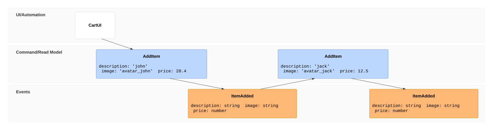
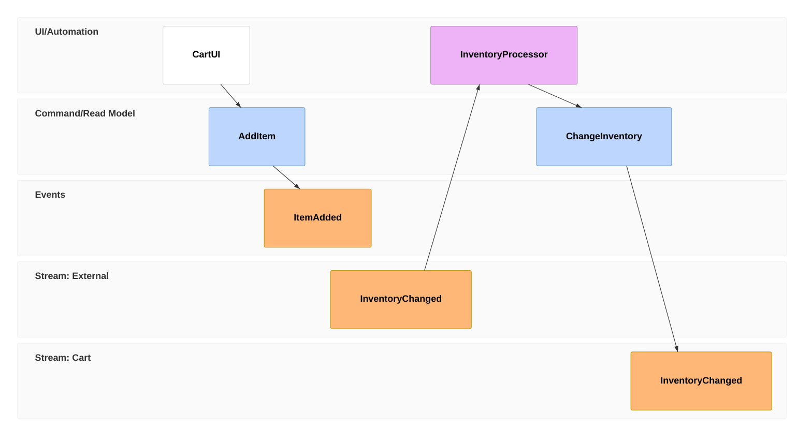
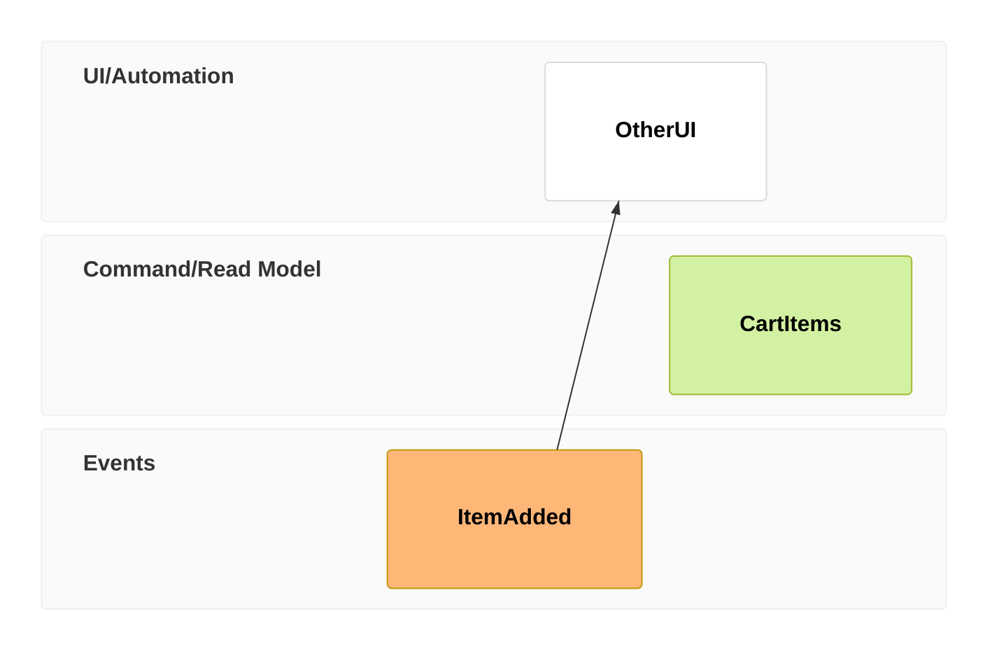
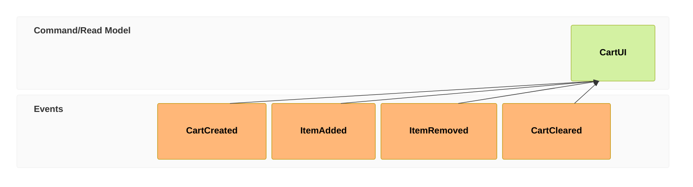
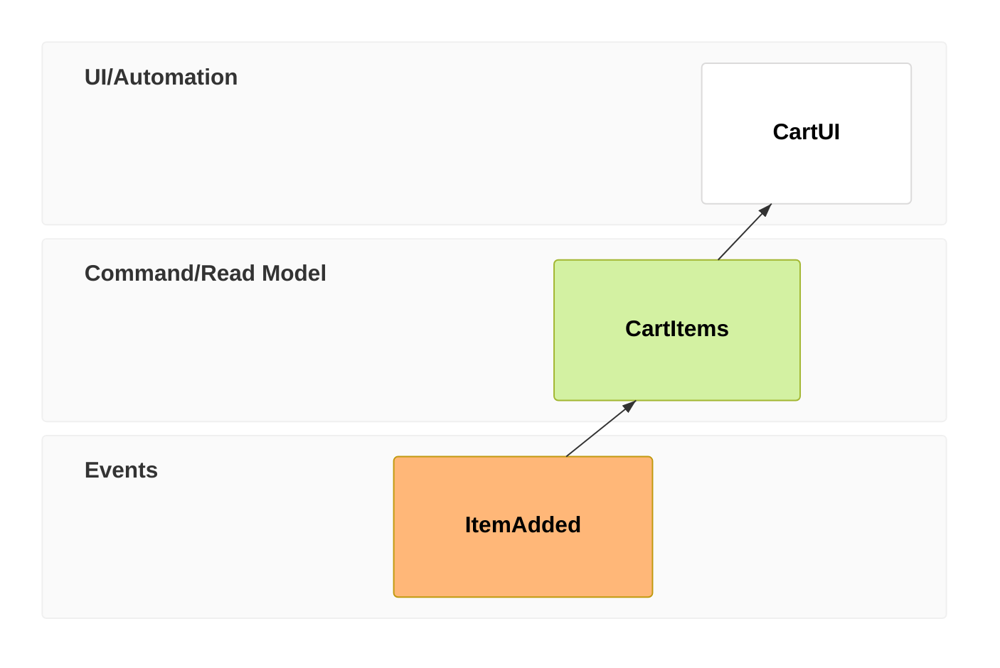
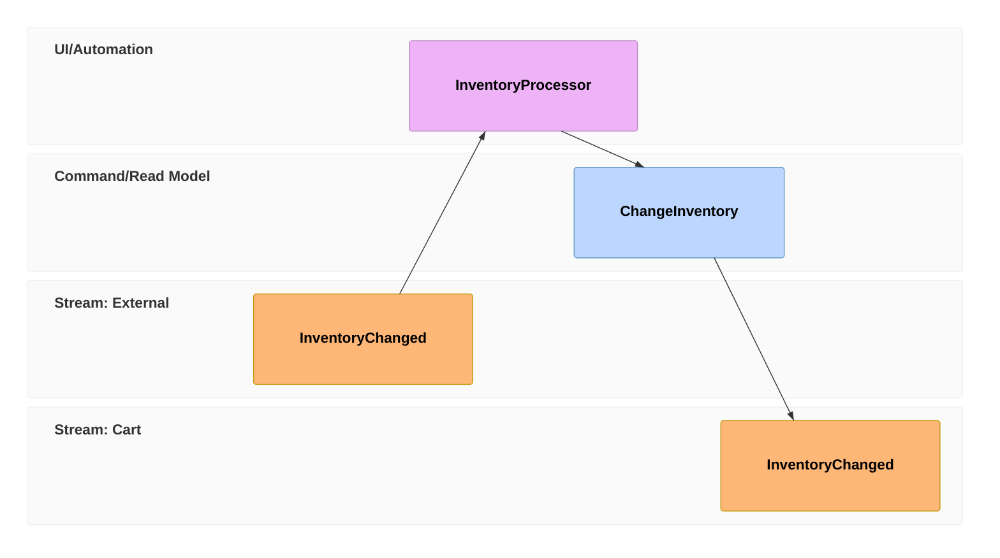
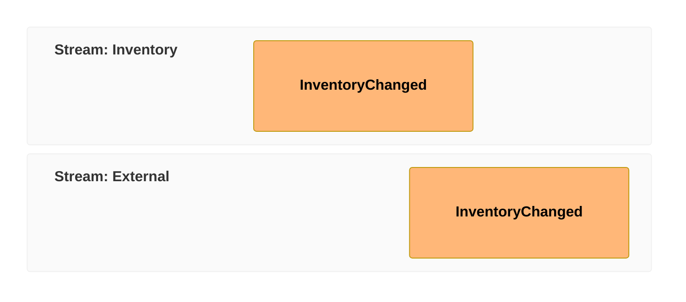

<!-- Digest of Mermaid 12.2.0 docs/syntax/eventmodeling.md — MIT © Mermaid contributors (render-kit/vendor/mermaid.LICENSE). Regenerate with scripts/sync-mermaid-docs.py -->
# Event Modeling Diagram (v11.15.0+)

## Introduction
You can read more at [Event Modeling web page](https://eventmodeling.org/).
- Trigger - UI and Processor
- Command
- View / Read Model
- Event
- State View
- State Change
- Translation
- Automation

## Basic Syntax
The DSL supports two types of syntaxes - compact and relaxed one. Both will be mentioned in the examples and both can be used interchangeably.

### Timeline
The timeline is the key part of the diagram and it is composed of **Time Frame** definitions. Speedy Time Frame typing is the key of the compact notation. For compact notation you type the `tf` token. For the relaxed notation you type `timeframe` token.
```md
eventmodeling

tf 01 ui CartUI
tf 02 cmd AddItem
tf 03 evt ItemAdded
```

```md
eventmodeling

timeframe 01 ui CartUI
timeframe 02 command AddItem
timeframe 03 event ItemAdded
```

### Inline data
It is possible to provide data examples for individual Time Frames. An Inline Data is wrapped in curly brackets on the same line as the Time Frame.



### Data block
If you need to provide more complex data description, you can define the **Data Block** separately. Data Block is referenced from a Time Frame by providing the identifier inside of double-square brackets `[[identifier]]`, similar to wiki links convention in Markdown.



### Resetting the flow
By default the diagram builds the relations based on the inference. But modeling a more complex business flow requires to break such inference from time to time. For that you can use a different type of Time Frame called **Reset Frame**. It is represented by a `rf` / `resetframe` token.




### Multiple relations
There are situations where you need to specify multiple relations for an entity. For example when a **Read Model** is built of multiple **Events**. You can use `->>` token for that.


## Event Modeling patterns
This chapter briefly summarizes each Event Modeling pattern.

### State Change


### State View


### Translation


## Details of the Syntax

### Entity types
Entity type is determined by the third column in the Time Frame grammar.
```md
tf 01 pcr InventoryProcessor
```
```md
timeframe 01 processor InventoryProcessor
```
- `ui`: UI - belongs to UI/Automation swimlane
- `pcr` / `processor`: Processor - belongs to UI/Automation swimlane
- `cmd` / `command`: Command - belongs to Command/Read Model swimlane
- `rmo` / `readmodel`: Read Model - belongs to Command/Read Model swimlane
- `evt` / `event`: Event - belongs to Events swimlane

### Swimlanes and Namespaces
There are three basic **Swimlanes** inferred from the Entity Type.
- UI/Automation
- Command/Read Model
- Events
```md
Inventory.InventoryChanged
```


### Data block data types
A **Data** is always wrapped in curly brackets. It can be prepended by a data type in backticks. The pattern applies for **Inline Data** as well as for **Data Block**.
```md
tf 01 rmo UserAdded `json`{ "name": "foo" }
```
```md
data UserAdded01 `json`{
"name": "foo"
}
```
- `json`
- `jsobj`
- `figma`
- `salt`
- `uri`
- `md`
- `html`
- `text`
