<!-- Digest of Mermaid 12.2.0 docs/syntax/flowchart.md — MIT © Mermaid contributors (render-kit/vendor/mermaid.LICENSE). Regenerate with scripts/sync-mermaid-docs.py -->
# Flowcharts - Basic Syntax
Flowcharts are composed of **nodes** (geometric shapes) and **edges** (arrows or lines). The Mermaid code defines how nodes and edges are made and accommodates different arrow types, multi-directional arrows, and any linking to and from subgraphs.

### A node (default)
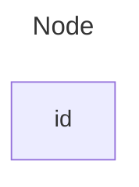

### A node with text
It is also possible to set text in the box that differs from the id. If this is done several times, it is the last text
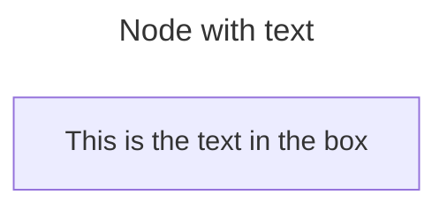

#### Unicode text
Use `"` to enclose the unicode text.
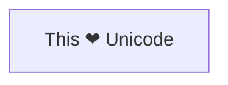

#### Markdown formatting
Use double quotes and backticks "\` text \`" to enclose the markdown text.
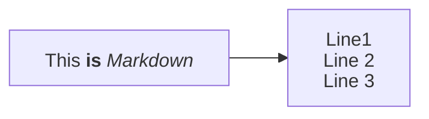

### Direction
This statement declares the direction of the Flowchart.
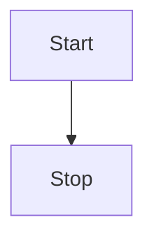
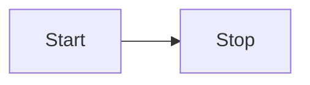
- TB - Top to bottom
- TD - Top-down/ same as top to bottom
- BT - Bottom to top
- RL - Right to left
- LR - Left to right

## Default theme, look and layout (v12.0.0+)
Flowcharts use the `redux-color` theme and the `neo` look by default, and are laid out by [ELK](https://www.eclipse.org/elk/) rather than Dagre. Not every diagram type

### With the defaults
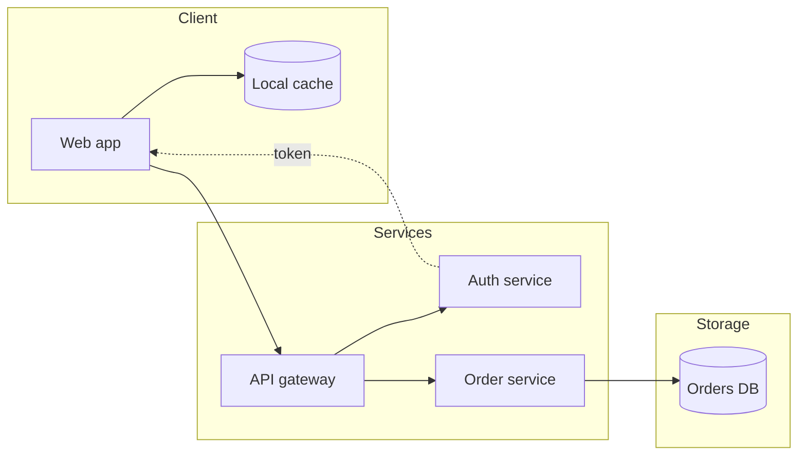

### The previous appearance
Both are only defaults, so anything you set yourself wins. Naming the previous theme and look


## Node shapes

### A node with round edges
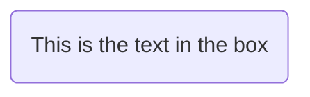

### A stadium-shaped node
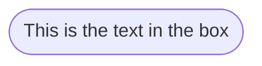

### A node in a subroutine shape
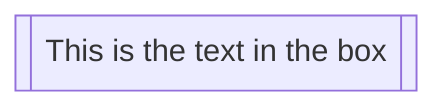

### A node in a cylindrical shape
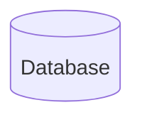

### A node in the form of a circle
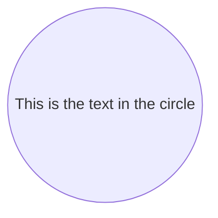

### A node in an asymmetric shape
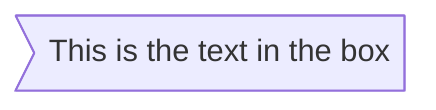
Currently only the shape above is possible and not its mirror. _This might change with future releases._

### A node (rhombus)
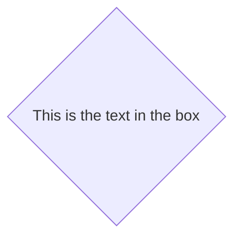

### A hexagon node
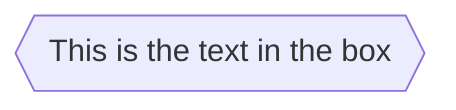

### Parallelogram
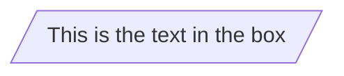

### Parallelogram alt
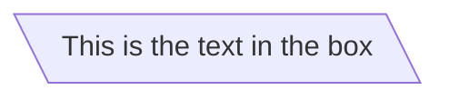

### Trapezoid
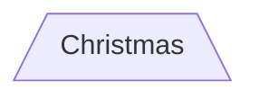

### Trapezoid alt
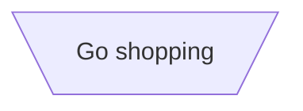

### Double circle
```mermaid
flowchart TD
    id1(((This is the text in the circle)))
```

## Expanded Node Shapes in Mermaid Flowcharts (v11.3.0+)
Mermaid introduces 30 new shapes to enhance the flexibility and precision of flowchart creation. These new shapes provide more options to represent processes, decisions, events, data storage visually, and other elements within your flowcharts, improving clarity and semantic meaning.
```
A@{ shape: rect }
```

### Complete List of New Shapes
Below is a comprehensive list of the newly introduced shapes and their corresponding semantic meanings, short names, and aliases:
| **Semantic Name**                 | **Shape Name**            | **Short Name** | **Description**                             | **Alias Supported**                                              |
| --------------------------------- | ------------------------- | -------------- | ------------------------------------------- | ---------------------------------------------------------------- |
| Bang                              | Bang                      | `bang`         | Bang                                        | `bang`                                                           |
| Browser                           | Browser                   | `browser`      | Browser window                              |                                                                  |
| Bucket                            | Bucket                    | `bucket`       | Object storage bucket                       |                                                                  |
| Card                              | Notched Rectangle         | `notch-rect`   | Represents a card                           | `card`, `notched-rectangle`                                      |
| Cloud                             | Cloud                     | `cloud`        | cloud                                       | `cloud`                                                          |
| Collate                           | Hourglass                 | `hourglass`    | Represents a collate operation              | `collate`, `hourglass`                                           |
| Com Link                          | Lightning Bolt            | `bolt`         | Communication link                          | `com-link`, `lightning-bolt`                                     |
| Comment                           | Curly Brace               | `brace`        | Adds a comment                              | `brace-l`, `comment`                                             |
| Comment Right                     | Curly Brace               | `brace-r`      | Adds a comment                              |                                                                  |
| Comment with braces on both sides | Curly Braces              | `braces`       | Adds a comment                              |                                                                  |
| Console                           | Console (terminal window) | `console`      | Terminal or console window                  |                                                                  |
| Data Input/Output                 | Lean Right                | `lean-r`       | Represents input or output                  | `in-out`, `lean-right`                                           |
| Data Input/Output                 | Lean Left                 | `lean-l`       | Represents output or input                  | `lean-left`, `out-in`                                            |
| Data Store                        | Data Store                | `datastore`    | Data flow diagram data store                | `data-store`                                                     |
| Database                          | Cylinder                  | `cyl`          | Database storage                            | `cylinder`, `database`, `db`                                     |
| Decision                          | Diamond                   | `diam`         | Decision-making step                        | `decision`, `diamond`, `question`                                |
| Delay                             | Half-Rounded Rectangle    | `delay`        | Represents a delay                          | `half-rounded-rectangle`                                         |
| Direct Access Storage             | Horizontal Cylinder       | `h-cyl`        | Direct access storage                       | `das`, `horizontal-cylinder`                                     |
| Disk Storage                      | Lined Cylinder            | `lin-cyl`      | Disk storage                                | `disk`, `lined-cylinder`                                         |
| Display                           | Curved Trapezoid          | `curv-trap`    | Represents a display                        | `curved-trapezoid`, `display`                                    |
| Divided Process                   | Divided Rectangle         | `div-rect`     | Divided process shape                       | `div-proc`, `divided-process`, `divided-rectangle`               |
| Document                          | Document                  | `doc`          | Represents a document                       | `doc`, `document`                                                |
| Event                             | Rounded Rectangle         | `rounded`      | Represents an event                         | `event`                                                          |
| Extract                           | Triangle                  | `tri`          | Extraction process                          | `extract`, `triangle`                                            |
| Folder                            | Folder                    | `folder`       | Folder or directory                         | `directory`                                                      |
| Fork/Join                         | Filled Rectangle          | `fork`         | Fork or join in process flow                | `join`                                                           |
| Internal Storage                  | Window Pane               | `win-pane`     | Internal storage                            | `internal-storage`, `window-pane`                                |
| Junction                          | Filled Circle             | `f-circ`       | Junction point                              | `filled-circle`, `junction`                                      |
| Lined Document                    | Lined Document            | `lin-doc`      | Lined document                              | `lined-document`                                                 |
| Lined/Shaded Process              | Lined Rectangle           | `lin-rect`     | Lined process shape                         | `lin-proc`, `lined-process`, `lined-rectangle`, `shaded-process` |
| Loop Limit                        | Trapezoidal Pentagon      | `notch-pent`   | Loop limit step                             | `loop-limit`, `notched-pentagon`                                 |
| Manual File                       | Flipped Triangle          | `flip-tri`     | Manual file operation                       | `flipped-triangle`, `manual-file`                                |
| Manual Input                      | Sloped Rectangle          | `sl-rect`      | Manual input step                           | `manual-input`, `sloped-rectangle`                               |
| Manual Operation                  | Trapezoid Base Top        | `trap-t`       | Represents a manual task                    | `inv-trapezoid`, `manual`, `trapezoid-top`                       |
| Multi-Document                    | Stacked Document          | `docs`         | Multiple documents                          | `documents`, `st-doc`, `stacked-document`                        |
| Multi-Process                     | Stacked Rectangle         | `st-rect`      | Multiple processes                          | `processes`, `procs`, `stacked-rectangle`                        |
| Odd                               | Odd                       | `odd`          | Odd shape                                   |                                                                  |
| Paper Tape                        | Flag                      | `flag`         | Paper tape                                  | `paper-tape`                                                     |
| Person                            | Person                    | `person`       | Person (circular head above a rounded body) |                                                                  |
| Prepare Conditional               | Hexagon                   | `hex`          | Preparation or condition step               | `hexagon`, `prepare`                                             |
| Priority Action                   | Trapezoid Base Bottom     | `trap-b`       | Priority action                             | `priority`, `trapezoid`, `trapezoid-bottom`                      |
| Process                           | Rectangle                 | `rect`         | Standard process shape                      | `proc`, `process`, `rectangle`                                   |
| Start                             | Circle                    | `circle`       | Starting point                              | `circ`                                                           |
| Start                             | Small Circle              | `sm-circ`      | Small starting point                        | `small-circle`, `start`                                          |
| Stop                              | Double Circle             | `dbl-circ`     | Represents a stop point                     | `double-circle`                                                  |
| Stop                              | Framed Circle             | `fr-circ`      | Stop point                                  | `framed-circle`, `stop`                                          |
| Stored Data                       | Bow Tie Rectangle         | `bow-rect`     | Stored data                                 | `bow-tie-rectangle`, `stored-data`                               |
| Subprocess                        | Framed Rectangle          | `fr-rect`      | Subprocess                                  | `framed-rectangle`, `subproc`, `subprocess`, `subroutine`        |
| Summary                           | Crossed Circle            | `cross-circ`   | Summary                                     | `crossed-circle`, `summary`                                      |
| Tagged Document                   | Tagged Document           | `tag-doc`      | Tagged document                             | `tag-doc`, `tagged-document`                                     |
| Tagged Process                    | Tagged Rectangle          | `tag-rect`     | Tagged process                              | `tag-proc`, `tagged-process`, `tagged-rectangle`                 |
| Terminal Point                    | Stadium                   | `stadium`      | Terminal point                              | `pill`, `terminal`                                               |
| Text Block                        | Text Block                | `text`         | Text block                                  |                                                                  |

### Example Flowchart with New Shapes
Here’s an example flowchart that utilizes some of the newly introduced shapes:
```mermaid
flowchart RL
    A@{ shape: manual-file, label: "File Handling"}
    B@{ shape: manual-input, label: "User Input"}
    C@{ shape: docs, label: "Multiple Documents"}
    D@{ shape: procs, label: "Process Automation"}
    E@{ shape: paper-tape, label: "Paper Records"}
```

### Process
```mermaid
flowchart TD
    A@{ shape: rect, label: "This is a process" }
```

### Event
```mermaid
flowchart TD
    A@{ shape: rounded, label: "This is an event" }
```

### Terminal Point (Stadium)
```mermaid
flowchart TD
    A@{ shape: stadium, label: "Terminal point" }
```

### Subprocess
```mermaid
flowchart TD
    A@{ shape: subproc, label: "This is a subprocess" }
```

### Database (Cylinder)
```mermaid
flowchart TD
    A@{ shape: cyl, label: "Database" }
```

### Start (Circle)
```mermaid
flowchart TD
    A@{ shape: circle, label: "Start" }
```

### Odd
```mermaid
flowchart TD
    A@{ shape: odd, label: "Odd shape" }
```

### Decision (Diamond)
```mermaid
flowchart TD
    A@{ shape: diamond, label: "Decision" }
```

### Prepare Conditional (Hexagon)
```mermaid
flowchart TD
    A@{ shape: hex, label: "Prepare conditional" }
```

### Data Input/Output (Lean Right)
```mermaid
flowchart TD
    A@{ shape: lean-r, label: "Input/Output" }
```

### Data Input/Output (Lean Left)
```mermaid
flowchart TD
    A@{ shape: lean-l, label: "Output/Input" }
```

### Datastore (Top and bottom border)
```mermaid
flowchart TD
    A@{ shape: datastore, label: "Datastore" }
```

### Priority Action (Trapezoid Base Bottom)
```mermaid
flowchart TD
    A@{ shape: trap-b, label: "Priority action" }
```

### Manual Operation (Trapezoid Base Top)
```mermaid
flowchart TD
    A@{ shape: trap-t, label: "Manual operation" }
```

### Stop (Double Circle)
```mermaid
flowchart TD
    A@{ shape: dbl-circ, label: "Stop" }
```

### Text Block
```mermaid
flowchart TD
    A@{ shape: text, label: "This is a text block" }
```

### Card (Notched Rectangle)
```mermaid
flowchart TD
    A@{ shape: notch-rect, label: "Card" }
```

### Lined/Shaded Process
```mermaid
flowchart TD
    A@{ shape: lin-rect, label: "Lined process" }
```

### Start (Small Circle)
```mermaid
flowchart TD
    A@{ shape: sm-circ, label: "Small start" }
```

### Stop (Framed Circle)
```mermaid
flowchart TD
    A@{ shape: framed-circle, label: "Stop" }
```

### Fork/Join (Long Rectangle)
```mermaid
flowchart TD
    A@{ shape: fork, label: "Fork or Join" }
```

### Collate (Hourglass)
```mermaid
flowchart TD
    A@{ shape: hourglass, label: "Collate" }
```

### Comment (Curly Brace)
```mermaid
flowchart TD
    A@{ shape: comment, label: "Comment" }
```

### Comment Right (Curly Brace Right)
```mermaid
flowchart TD
    A@{ shape: brace-r, label: "Comment" }
```

### Comment with braces on both sides
```mermaid
flowchart TD
    A@{ shape: braces, label: "Comment" }
```

### Com Link (Lightning Bolt)
```mermaid
flowchart TD
    A@{ shape: bolt, label: "Communication link" }
```

### Document
```mermaid
flowchart TD
    A@{ shape: doc, label: "Document" }
```

### Delay (Half-Rounded Rectangle)
```mermaid
flowchart TD
    A@{ shape: delay, label: "Delay" }
```

### Direct Access Storage (Horizontal Cylinder)
```mermaid
flowchart TD
    A@{ shape: das, label: "Direct access storage" }
```

### Disk Storage (Lined Cylinder)
```mermaid
flowchart TD
    A@{ shape: lin-cyl, label: "Disk storage" }
```

### Display (Curved Trapezoid)
```mermaid
flowchart TD
    A@{ shape: curv-trap, label: "Display" }
```

### Divided Process (Divided Rectangle)
```mermaid
flowchart TD
    A@{ shape: div-rect, label: "Divided process" }
```

### Extract (Small Triangle)
```mermaid
flowchart TD
    A@{ shape: tri, label: "Extract" }
```

### Internal Storage (Window Pane)
```mermaid
flowchart TD
    A@{ shape: win-pane, label: "Internal storage" }
```

### Junction (Filled Circle)
```mermaid
flowchart TD
    A@{ shape: f-circ, label: "Junction" }
```

### Lined Document
```mermaid
flowchart TD
    A@{ shape: lin-doc, label: "Lined document" }
```

### Loop Limit (Notched Pentagon)
```mermaid
flowchart TD
    A@{ shape: notch-pent, label: "Loop limit" }
```

### Manual File (Flipped Triangle)
```mermaid
flowchart TD
    A@{ shape: flip-tri, label: "Manual file" }
```

### Manual Input (Sloped Rectangle)
```mermaid
flowchart TD
    A@{ shape: sl-rect, label: "Manual input" }
```

### Multi-Document (Stacked Document)
```mermaid
flowchart TD
    A@{ shape: docs, label: "Multiple documents" }
```

### Multi-Process (Stacked Rectangle)
```mermaid
flowchart TD
    A@{ shape: processes, label: "Multiple processes" }
```

### Paper Tape (Flag)
```mermaid
flowchart TD
    A@{ shape: flag, label: "Paper tape" }
```

### Stored Data (Bow Tie Rectangle)
```mermaid
flowchart TD
    A@{ shape: bow-rect, label: "Stored data" }
```

### Summary (Crossed Circle)
```mermaid
flowchart TD
    A@{ shape: cross-circ, label: "Summary" }
```

### Tagged Document
```mermaid
flowchart TD
    A@{ shape: tag-doc, label: "Tagged document" }
```

### Tagged Process (Tagged Rectangle)
```mermaid
flowchart TD
    A@{ shape: tag-rect, label: "Tagged process" }
```

## Special shapes in Mermaid Flowcharts (v11.3.0+)
Mermaid also introduces 2 special shapes to enhance your flowcharts: **icon** and **image**. These shapes allow you to include icons and images directly within your flowcharts, providing more visual context and clarity.

### Icon Shape
You can use the `icon` shape to include an icon in your flowchart. To use icons, you need to register the icon pack first. Follow the instructions to [add custom icons](../config/icons.md). The syntax for defining an icon shape is as follows:
```mermaid
flowchart TD
    A@{ icon: "fa:user", form: "square", label: "User Icon", pos: "t", h: 60 }
```

#### Parameters
- **icon**: The name of the icon from the registered icon pack.
- **form**: Specifies the background shape of the icon. If not defined there will be no background to icon. Options include:
  - `square`
  - `circle`
  - `rounded`
- **label**: The text label associated with the icon. This can be any string. If not defined, no label will be displayed.
- **pos**: The position of the label. If not defined label will default to bottom of icon. Possible values are:
  - `t`
  - `b`
- **h**: The height of the icon. If not defined this will default to 48 which is minimum.

### Image Shape
You can use the `image` shape to include an image in your flowchart. The syntax for defining an image shape is as follows:
```
flowchart TD
    A@{ img: "https://example.com/image.png", label: "Image Label", pos: "t", w: 60, h: 60, constraint: "off" }
```

#### Parameters
- **img**: The URL of the image to be displayed.
- **label**: The text label associated with the image. This can be any string. If not defined, no label will be displayed.
- **pos**: The position of the label. If not defined, the label will default to the bottom of the image. Possible values are:
  - `t`
  - `b`
- **w**: The width of the image. If not defined, this will default to the natural width of the image.
- **h**: The height of the image. If not defined, this will default to the natural height of the image.
- **constraint**: Determines if the image should constrain the node size. This setting also ensures the image maintains its original aspect ratio, adjusting the width (`w`) accordingly to the height (`h`). If not defined, this will default to `off` Possible values are:
  - `on`
  - `off`
If you want to resize an image, but keep the same aspect ratio, set `h`, and set `constraint: on` to constrain the aspect ratio. E.g.
```mermaid
flowchart TD
  %% My image with a constrained aspect ratio
  A@{ img: "https://mermaid.js.org/favicon.svg", label: "My example image label", pos: "t", h: 60, constraint: "on" }
```

## Links between nodes
Nodes can be connected with links/edges. It is possible to have different types of links or attach a text string to a link.

### A link with arrow head
```mermaid
flowchart LR
    A-->B
```

### An open link
```mermaid
flowchart LR
    A --- B
```

### Text on links
```mermaid
flowchart LR
    A-- This is the text! ---B
```
or
```mermaid
flowchart LR
    A---|This is the text|B
```

### A link with arrow head and text
```mermaid
flowchart LR
    A-->|text|B
```
or
```mermaid
flowchart LR
    A-- text -->B
```

### Dotted link
```mermaid
flowchart LR
   A-.->B;
```

### Dotted link with text
```mermaid
flowchart LR
   A-. text .-> B
```

### Thick link
```mermaid
flowchart LR
   A ==> B
```

### Thick link with text
```mermaid
flowchart LR
   A == text ==> B
```

### An invisible link
This can be a useful tool in some instances where you want to alter the default positioning of a node.
```mermaid
flowchart LR
    A ~~~ B
```

### Chaining of links
It is possible declare many links in the same line as per below:
```mermaid
flowchart LR
   A -- text --> B -- text2 --> C
```
```mermaid
flowchart LR
   a --> b & c--> d
```
```mermaid
flowchart TB
    A & B--> C & D
```
```mermaid
flowchart TB
    A --> C
    A --> D
    B --> C
    B --> D
```

### Attaching an ID to Edges
Mermaid now supports assigning IDs to edges, similar to how IDs and metadata can be attached to nodes. This feature lays the groundwork for more advanced styling, classes, and animation capabilities on edges.
```mermaid
flowchart LR
  A e1@--> B
```

### Turning an Animation On
Once you have assigned an ID to an edge, you can turn on animations for that edge by defining the edge’s properties:
```mermaid
flowchart LR
  A e1@==> B
  e1@{ animate: true }
```

### Selecting Type of Animation
In the initial version, two animation speeds are supported: `fast` and `slow`. Selecting a specific animation type is a shorthand for enabling animation and setting the animation speed in one go.
```mermaid
flowchart LR
  A e1@--> B
  e1@{ animation: fast }
```

### Using classDef Statements for Animations
You can also animate edges by assigning a class to them and then defining animation properties in a `classDef` statement. For example:
```mermaid
flowchart LR
  A e1@--> B
  classDef animate stroke-dasharray: 9,5,stroke-dashoffset: 900,animation: dash 25s linear infinite;
  class e1 animate
```
- `e1@-->` creates an edge with ID `e1`.
- `classDef animate` defines a class named `animate` with styling and animation properties.
- `class e1 animate` applies the `animate` class to the edge `e1`.

## New arrow types
There are new types of arrows supported:
- circle edge
- cross edge

### Circle edge example
```mermaid
flowchart LR
    A --o B
```

### Cross edge example
```mermaid
flowchart LR
    A --x B
```

## Multi directional arrows
There is the possibility to use multidirectional arrows.
```mermaid
flowchart LR
    A o--o B
    B <--> C
    C x--x D
```

### Minimum length of a link
Each node in the flowchart is ultimately assigned to a rank in the rendered
```mermaid
flowchart TD
    A[Start] --> B{Is it?}
    B -->|Yes| C[OK]
    C --> D[Rethink]
    D --> B
    B ---->|No| E[End]
```
```mermaid
flowchart TD
    A[Start] --> B{Is it?}
    B -- Yes --> C[OK]
    C --> D[Rethink]
    D --> B
    B -- No ----> E[End]
```
| Length            |   1    |    2    |    3     |
| ----------------- | :----: | :-----: | :------: |
| Normal            | `---`  | `----`  | `-----`  |
| Normal with arrow | `-->`  | `--->`  | `---->`  |
| Thick             | `===`  | `====`  | `=====`  |
| Thick with arrow  | `==>`  | `===>`  | `====>`  |
| Dotted            | `-.-`  | `-..-`  | `-...-`  |
| Dotted with arrow | `-.->` | `-..->` | `-...->` |

## Special characters that break syntax
It is possible to put text within quotes in order to render more troublesome characters. As in the example below:
```mermaid
flowchart LR
    id1["This is the (text) in the box"]
```

### Entity codes to escape characters
It is possible to escape characters using the syntax exemplified here.
```mermaid
    flowchart LR
        A["A double quote:#quot;"] --> B["A dec char:#9829;"]
```

## Subgraphs
```
subgraph title
    graph definition
end
```
An example below:
```mermaid
flowchart TB
    c1-->a2
    subgraph one
    a1-->a2
    end
    subgraph two
    b1-->b2
    end
    subgraph three
    c1-->c2
    end
```
```mermaid
flowchart TB
    c1-->a2
    subgraph ide1 [one]
    a1-->a2
    end
```

### flowcharts
With the graphtype flowchart it is also possible to set edges to and from subgraphs as in the flowchart below.
```mermaid
flowchart TB
    c1-->a2
    subgraph one
    a1-->a2
    end
    subgraph two
    b1-->b2
    end
    subgraph three
    c1-->c2
    end
    one --> two
    three --> two
    two --> c2
```

### Direction in subgraphs
With the graphtype flowcharts you can use the direction statement to set the direction which the subgraph will render like in this example.
```mermaid
flowchart LR
  subgraph TOP
    direction TB
    subgraph B1
        direction RL
        i1 -->f1
    end
    subgraph B2
        direction BT
        i2 -->f2
    end
  end
  A --> TOP --> B
  B1 --> B2
```

#### Limitation
If any of a subgraph's nodes are linked to the outside, subgraph direction will be ignored. Instead the subgraph will inherit the direction of the parent graph:
```mermaid
flowchart LR
    subgraph subgraph1
        direction TB
        top1[top] --> bottom1[bottom]
    end
    subgraph subgraph2
        direction TB
        top2[top] --> bottom2[bottom]
    end
    %% ^ These subgraphs are identical, except for the links to them:

    %% Link *to* subgraph1: subgraph1 direction is maintained
    outside --> subgraph1
    %% Link *within* subgraph2:
    %% subgraph2 inherits the direction of the top-level graph (LR)
    outside ---> top2
```

### Collapsible subgraphs (v11.17.0+)
A subgraph can be collapsed into a single compact node by attaching the metadata
```mermaid
flowchart TD
    Start --> one
    subgraph one [My Group]
        A --> B
        B --> C
    end
    one --> End
    one@{ view: collapsed }
```
- Its internal nodes are hidden and it is drawn as a single node carrying the
- Edges that cross the subgraph boundary are **redirected to the collapsed node**.
- Edges that are entirely internal to the collapsed subgraph are dropped (they
- For nested subgraphs, a collapse resolves to the **outermost** collapsed

## Markdown Strings
The "Markdown Strings" feature enhances flowcharts and mind maps by offering a more versatile string type, which supports text formatting options such as bold and italics, and automatically wraps text within labels.
```mermaid
---
config:
  htmlLabels: false
---
flowchart LR
subgraph "One"
  a("`The **cat**
  in the hat`") -- "edge label" --> b{{"`The **dog** in the hog`"}}
end
subgraph "`**Two**`"
  c("`The **cat**
  in the hat`") -- "`Bold **edge label**`" --> d("The dog in the hog")
end
```
- For bold text, use double asterisks (`**`) before and after the text.
- For italics, use single asterisks (`*`) before and after the text.
- With traditional strings, you needed to add `<br>` tags for text to wrap in nodes. However, markdown strings automatically wrap text when it becomes too long and allows you to start a new line by simply using a newline character instead of a `<br>` tag.
```
---
config:
  markdownAutoWrap: false
---
graph LR
```

## Interaction
It is possible to bind a click event to a node, the click can lead to either a javascript callback or to a link which will be opened in a new browser tab.
```
click nodeId callback
click nodeId call callback()
```
- nodeId is the id of the node
- callback is the name of a javascript function defined on the page displaying the graph, the function will be called with the nodeId as parameter.
```html
<script>
  window.callback = function () {
    alert('A callback was triggered');
  };
</script>
```
```mermaid
flowchart LR
    A-->B
    B-->C
    C-->D
    click A callback "Tooltip for a callback"
    click B "https://www.github.com" "This is a tooltip for a link"
    click C call callback() "Tooltip for a callback"
    click D href "https://www.github.com" "This is a tooltip for a link"
```
```mermaid
flowchart LR
    A-->B
    B-->C
    C-->D
    D-->E
    click A "https://www.github.com" _blank
    click B "https://www.github.com" "Open this in a new tab" _blank
    click C href "https://www.github.com" _blank
    click D href "https://www.github.com" "Open this in a new tab" _blank
```

### Comments
Comments can be entered within a flow diagram, which will be ignored by the parser. Comments need to be on their own line, and must be prefaced with `%%` (double percent signs). Any text after the start of the comment to the next newline will be treated as a comment, including any flow syntax
```mermaid
flowchart LR
%% this is a comment A -- text --> B{node}
   A -- text --> B -- text2 --> C
```

## Styling and classes

### Styling links
It is possible to style links. For instance, you might want to style a link that is going backwards in the flow. As links
```
linkStyle 3 stroke:#ff3,stroke-width:4px,color:red;
```
```
linkStyle 1,2,7 color:blue;
```

### Styling line curves
It is possible to style the type of curve used for lines between items, if the default method does not meet your needs.
1. Change the curve style of all the lines
2. Change the curve style of a particular line

#### Diagram level curve style
In this example, a left-to-right graph uses the `stepBefore` curve style:
```
---
config:
  flowchart:
    curve: stepBefore
---
graph LR
```

#### Edge level curve style using Edge IDs (v11.10.0+)
You can assign IDs to [edges](#attaching-an-id-to-edges). After assigning an ID you can modify the line style by modifying the edge's `curve` property using the following syntax:
```mermaid
flowchart LR
    A e1@==> B
    A e2@--> C
    e1@{ curve: linear }
    e2@{ curve: natural }
```
```info
Any edge curve style modified at the edge level overrides the diagram level style.
```
```info
If the same edge is modified multiple times the last modification will be rendered.
```

### Styling a node
It is possible to apply specific styles such as a thicker border or a different background color to a node.
```mermaid
flowchart LR
    id1(Start)-->id2(Stop)
    style id1 fill:#f9f,stroke:#333,stroke-width:4px
    style id2 fill:#bbf,stroke:#f66,stroke-width:2px,color:#fff,stroke-dasharray: 5 5
```

#### Classes
More convenient than defining the style every time is to define a class of styles and attach this class to the nodes that
```
    classDef className fill:#f9f,stroke:#333,stroke-width:4px;
```
```
    classDef firstClassName,secondClassName font-size:12pt;
```
```
    class nodeId1 className;
```
```
    class nodeId1,nodeId2 className;
```
```mermaid
flowchart LR
    A:::someclass --> B
    classDef someclass fill:#f96
```
```mermaid
flowchart LR
    A:::foo & B:::bar --> C:::foobar
    classDef foo stroke:#f00
    classDef bar stroke:#0f0
    classDef foobar stroke:#00f
```

### CSS classes
**Working approach — use `classDef` instead:**
```mermaid
flowchart LR
    A:::myStyle --> B
    classDef myStyle fill:#ff0000,stroke:#ffff00,stroke-width:4px
```

### Default class
If a class is named default it will be assigned to all classes without specific class definitions.
```
    classDef default fill:#f9f,stroke:#333,stroke-width:4px;
```

## Basic support for fontawesome
It is possible to add icons from fontawesome.
```mermaid
flowchart TD
    B["fa:fa-twitter for peace"]
    B-->C[fa:fa-ban forbidden]
    B-->D(fa:fa-spinner)
    B-->E(A fa:fa-camera-retro perhaps?)
```

### Register FontAwesome icon packs (v11.7.0+)
You can register your own FontAwesome icon pack following the ["Registering icon packs" instructions](../config/icons.md).

### Register FontAwesome CSS
Mermaid supports Font Awesome if the CSS is included on the website.
```html
<link
  href="https://cdnjs.cloudflare.com/ajax/libs/font-awesome/6.5.1/css/all.min.css"
  rel="stylesheet"
/>
```

### Custom icons
It is possible to use custom icons served from Font Awesome as long as the website imports the corresponding kit.
```
flowchart TD
    B[fa:fa-twitter] %% standard icon
    B-->E(fak:fa-custom-icon-name) %% custom icon
```
```mermaid
flowchart TD
    B["fa:fa-twitter for peace"]
    B-->C["fab:fa-truck-bold a custom icon"]
```

## Graph declarations with spaces between vertices and link and without semicolon
- In graph declarations, the statements also can now end without a semicolon. After release 0.2.16, ending a graph statement with semicolon is just optional. So the below graph declaration is also valid along with the old declarations of the graph.
- A single space is allowed between vertices and the link. However there should not be any space between a vertex and its text and a link and its text. The old syntax of graph declaration will also work and hence this new feature is optional and is introduced to improve readability.
Below is the new declaration of the graph edges which is also valid along with the old declaration of the graph edges.
```mermaid
flowchart LR
    A[Hard edge] -->|Link text| B(Round edge)
    B --> C{Decision}
    C -->|One| D[Result one]
    C -->|Two| E[Result two]
```

## Configuration

### Renderer
The layout of the diagram is done with the layout algorithm. The default is
```
config:
  layout: dagre
```

### Width
It is possible to adjust the width of the rendered flowchart.
```javascript
mermaid.flowchartConfig = {
    width: 100%
}
```
