<!-- Digest of Mermaid 12.2.0 docs/syntax/gitgraph.md — MIT © Mermaid contributors (render-kit/vendor/mermaid.LICENSE). Regenerate with scripts/sync-mermaid-docs.py -->
# GitGraph Diagrams
These kind of diagram are particularly helpful to developers and devops teams to share their Git branching strategies. For example, it makes it easier to visualize how git flow works.
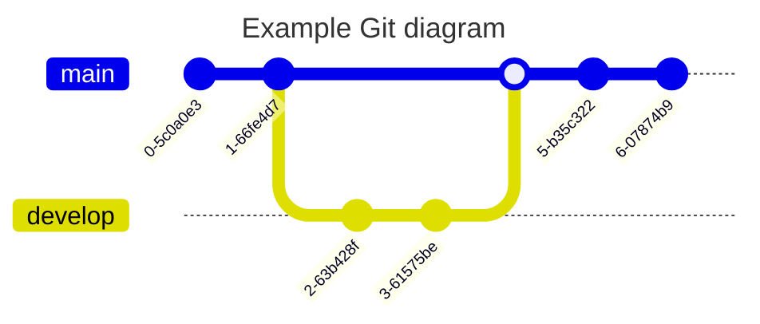
- _commit_ : Representing a new commit on the current branch.
- _branch_ : To create & switch to a new branch, setting it as the current branch.
- _checkout_ : To checking out an existing branch and setting it as the current branch.
- _merge_ : To merge an existing branch onto the current branch.

## Syntax
Mermaid syntax for a gitgraph is very straight-forward and simple. It follows a declarative-approach, where each commit is drawn on the timeline in the diagram, in order of its occurrences/presence in code. Basically, it follows the insertion order for each command.
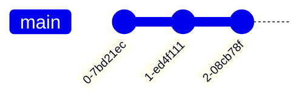

### Adding custom commit id
For a given commit you may specify a custom ID at the time of declaring it using the `id` attribute, followed by `:` and your custom value within a `""` quote. For example: `commit id: "your_custom_id"`
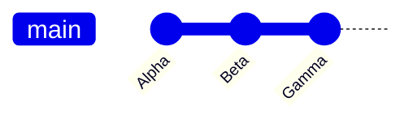

### Modifying commit type
In Mermaid, a commit can be of three type, which render a bit different in the diagram. These types are:
- `NORMAL` : Default commit type. Represented by a solid circle in the diagram
- `REVERSE` : To emphasize a commit as a reverse commit. Represented by a crossed solid circle in the diagram.
- `HIGHLIGHT` : To highlight a particular commit in the diagram. Represented by a filled rectangle in the diagram.
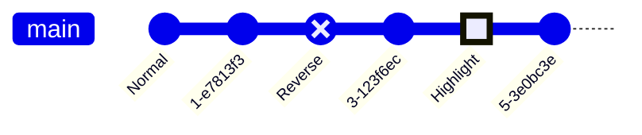

### Adding Tags
For a given commit you may decorate it as a **tag**, similar to the concept of tags or release version in git world.
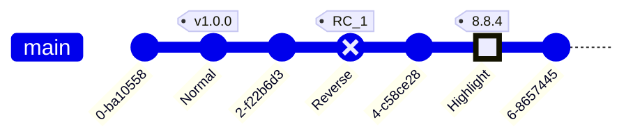

### Create a new branch
In Mermaid, in-order to create a new branch, you make use of the `branch` keyword. You also need to provide a name of the new branch. The name has to be unique and cannot be that of an existing branch. A branch name that could be confused for a keyword must be quoted within `""`. Usage examples: `branch develop`, `branch "cherry-pick"`
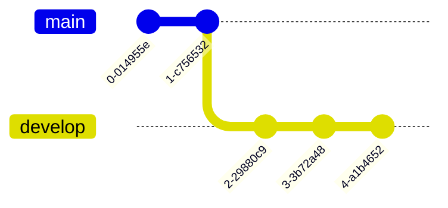

### Checking out an existing branch
In Mermaid, in order to switch to an existing branch, you make use of the `checkout` keyword. You also need to provide a name of an existing branch. If no branch is found with the given name, it will result in console error. Usage example: `checkout develop`
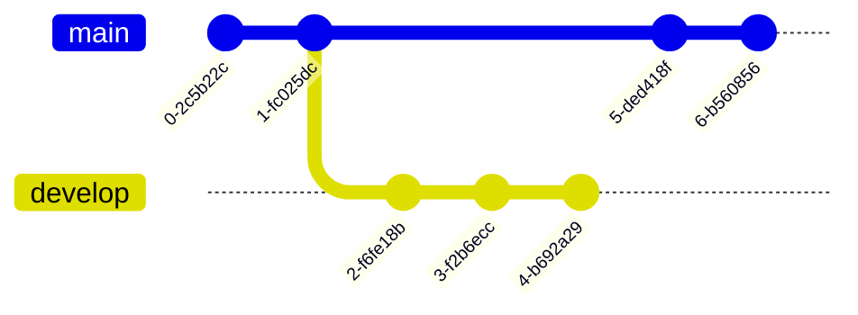

### Merging two branches
In Mermaid, in order to merge or join to an existing branch, you make use of the `merge` keyword. You also need to provide the name of an existing branch to merge from. If no branch is found with the given name, it will result in console error. Also, you can only merge two separate branches, and cannot merge a branch with itself. In such case an error is throw.
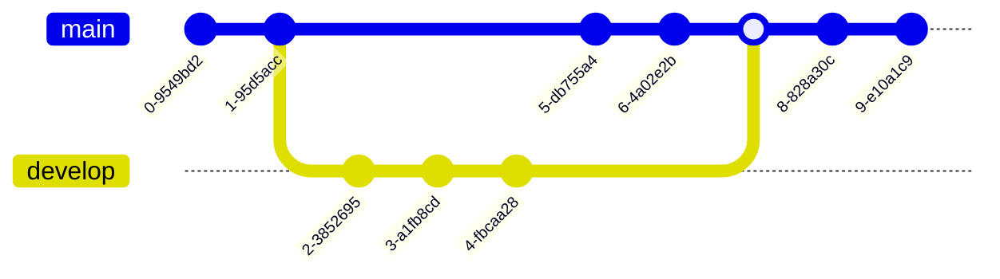
- `id`--> To override the default ID with custom ID
- `tag`--> To add a custom tag to your merge commit
- `type`--> To override the default shape of merge commit. Here you can use other commit type mentioned earlier.
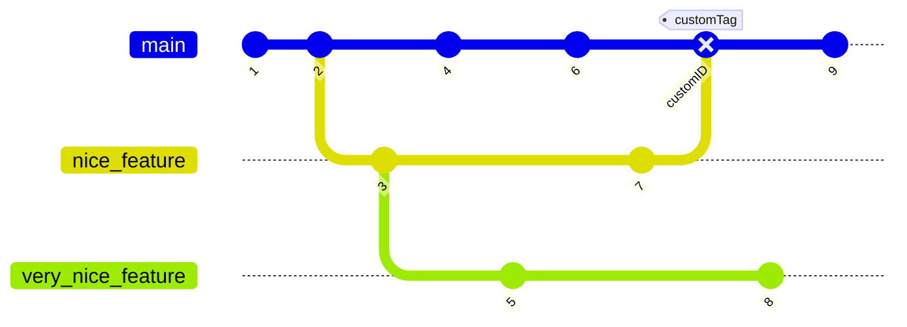

### Cherry Pick commit from another branch
Similar to how 'git' allows you to cherry-pick a commit from **another branch** onto the **current** branch, Mermaid also supports this functionality. You can also cherry-pick a commit from another branch using the `cherry-pick` keyword.
1. You need to provide the `id` for an existing commit to be cherry-picked. If given commit id does not exist it will result in an error. For this, make use of the `commit id:$value` format of declaring commits. See the examples from above.
2. The given commit must not exist on the current branch. The cherry-picked commit must always be a different branch than the current branch.
3. Current branch must have at least one commit, before you can cherry-pick, otherwise it will cause an error is throw.
4. When cherry-picking a merge commit, providing a parent commit ID is mandatory. If the parent attribute is omitted or an invalid parent commit ID is provided, an error will be thrown.
5. The specified parent commit must be an immediate parent of the merge commit being cherry-picked.
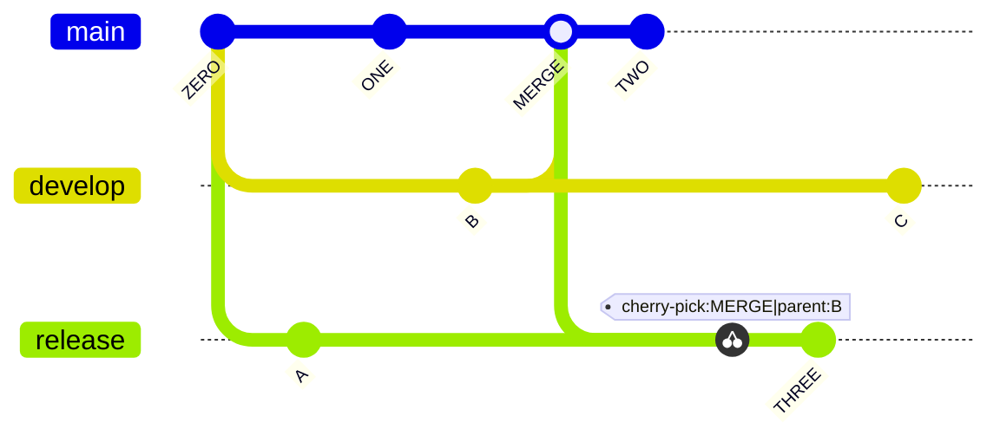

## GitGraph specific configuration options
In Mermaid, you have the option to configure the gitgraph diagram. You can configure the following options:
- `showBranches` : Boolean, default is `true`. If set to `false`, the branches are not shown in the diagram.
- `showCommitLabel` : Boolean, default is `true`. If set to `false`, the commit labels are not shown in the diagram.
- `mainBranchName` : String, default is `main`. The name of the default/root branch.
- `mainBranchOrder` : Position of the main branch in the list of branches. default is `0`, meaning, by default `main` branch is the first in the order.
- `parallelCommits`: Boolean, default is `false`. If set to `true`, commits x distance away from the parent are shown at the same level in the diagram.

## Hiding Branch names and lines
Sometimes you may want to hide the branch names and lines from the diagram. You can do this by using the `showBranches` keyword. By default its value is `true`. You can set it to `false` using directives.
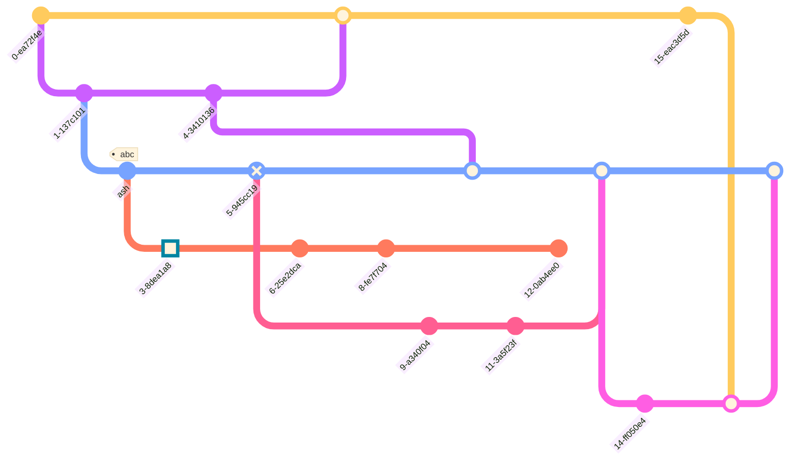

## Commit labels Layout: Rotated or Horizontal
Mermaid supports two types of commit labels layout. The default layout is **rotated**, which means the labels are placed below the commit circle, rotated at 45 degrees for better readability. This is particularly useful for commits with long labels.
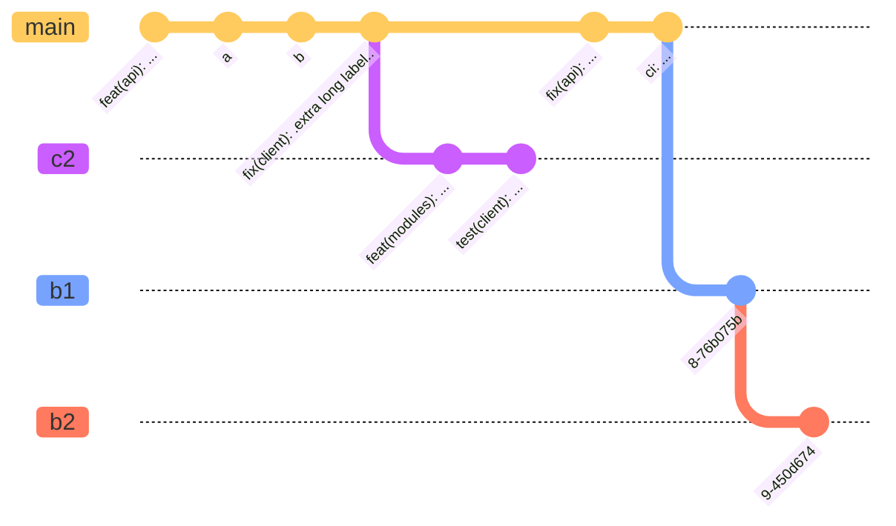
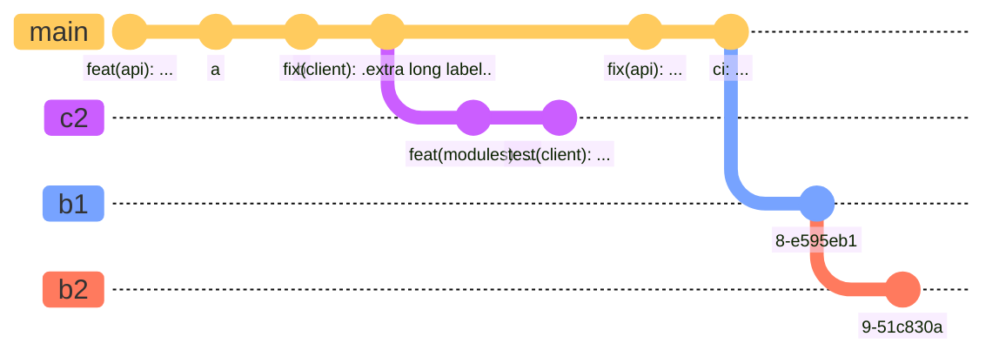

## Hiding commit labels
Sometimes you may want to hide the commit labels from the diagram. You can do this by using the `showCommitLabel` keyword. By default its value is `true`. You can set it to `false` using directives.
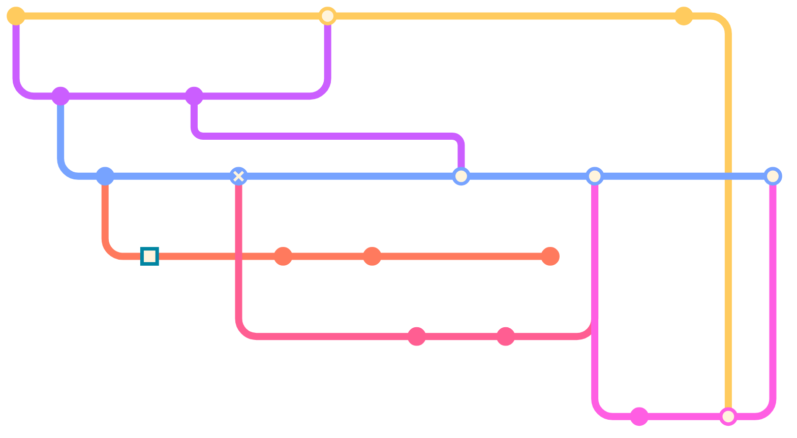

## Customizing main branch name
Sometimes you may want to customize the name of the main/default branch. You can do this by using the `mainBranchName` keyword. By default its value is `main`. You can set it to any string using directives.
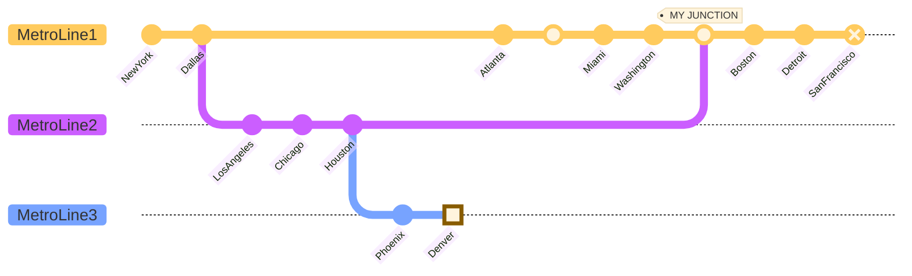

## Customizing branch ordering
In Mermaid, by default the branches are shown in the order of their definition or appearance in the diagram code.
- Main branch is always shown first as it has default order value of `0`. (unless its order is modified and changed from `0` using the `mainBranchOrder` keyword in the config)
- Next, All branches without an `order` are shown in the order of their appearance in the diagram code.
- Next, All branches with an `order` are shown in the order of their `order` value.
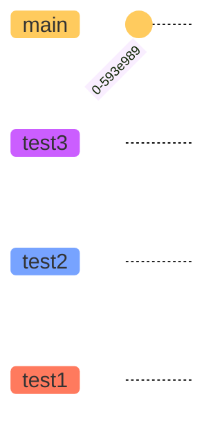
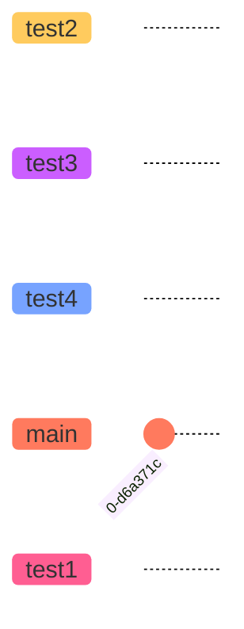

## Orientation (v10.3.0+)
Mermaid supports three graph orientations: **Left-to-Right** (default), **Top-to-Bottom**, and **Bottom-to-Top**.

### Left to Right (default, `LR:`)
In Mermaid, the default orientation is for commits to run from left to right and for branches to be stacked on top of one another.
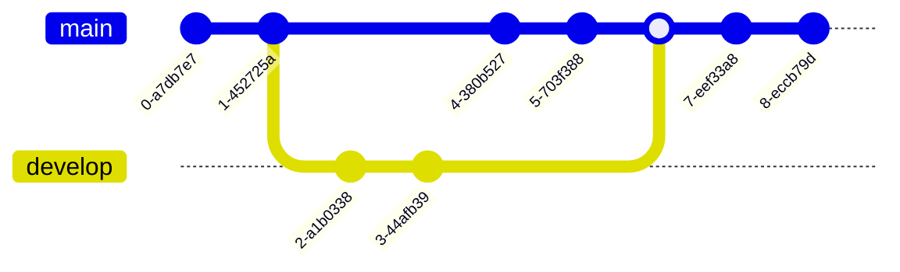

### Top to Bottom (`TB:`)
In `TB` (**Top-to-Bottom**) orientation, the commits run from top to bottom of the graph and branches are arranged side-by-side.
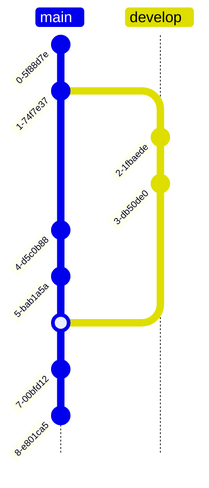

### Bottom to Top (`BT:`) (v11.0.0+)
In `BT` (**Bottom-to-Top**) orientation, the commits run from bottom to top of the graph and branches are arranged side-by-side.
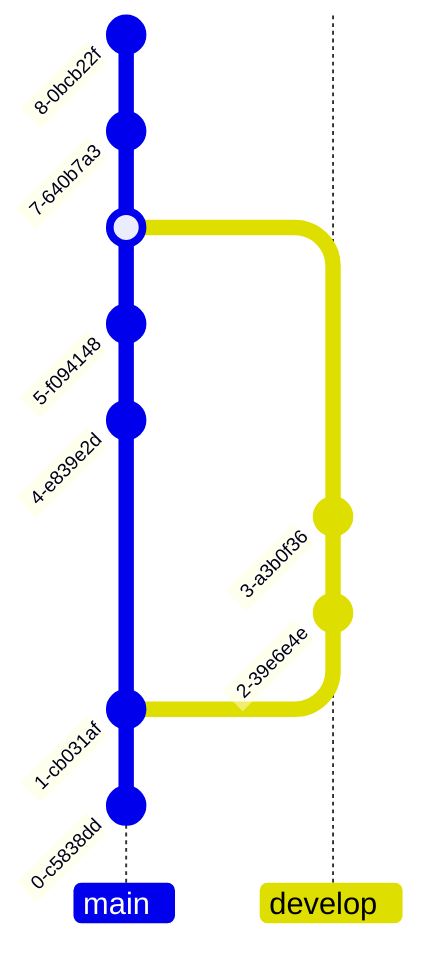

## Parallel commits (v10.8.0+)
Commits in Mermaid display temporal information in gitgraph by default. For example if two commits are one commit away from its parent, the commit that was made earlier is rendered closer to its parent. You can turn this off by enabling the `parallelCommits` flag.

### Temporal Commits (default, `parallelCommits: false`)
```mermaid
---
config:
  gitGraph:
    parallelCommits: false
---
gitGraph:
  commit
  branch develop
  commit
  commit
  checkout main
  commit
  commit
```

### Parallel commits (`parallelCommits: true`)
```mermaid
---
config:
  gitGraph:
    parallelCommits: true
---
gitGraph:
  commit
  branch develop
  commit
  commit
  checkout main
  commit
  commit
```

## Themes
Mermaid supports a bunch of pre-defined themes which you can use to find the right one for you. PS: you can actually override an existing theme's variable to get your own custom theme going. Learn more about [theming your diagram](../config/theming.md).
- `redux-color` (the default)
- `redux-dark-color`
- `redux`
- `redux-dark`
- `default`
- `neutral`
- `dark`
- `forest`
- `neo`
- `neo-dark`
- `base`

### Base Theme
```mermaid
---
config:
  logLevel: 'debug'
  theme: 'base'
---
      gitGraph
        commit
        branch hotfix
        checkout hotfix
        commit
        branch develop
        checkout develop
        commit id:"ash" tag:"abc"
        branch featureB
        checkout featureB
        commit type:HIGHLIGHT
        checkout main
        checkout hotfix
        commit type:NORMAL
        checkout develop
        commit type:REVERSE
        checkout featureB
        commit
        checkout main
        merge hotfix
        checkout featureB
        commit
        checkout develop
        branch featureA
        commit
        checkout develop
        merge hotfix
        checkout featureA
        commit
        checkout featureB
        commit
        checkout develop
        merge featureA
        branch release
        checkout release
        commit
        checkout main
        commit
        checkout release
        merge main
        checkout develop
        merge release
```

### Forest Theme
```mermaid
---
config:
  logLevel: 'debug'
  theme: 'forest'
---
      gitGraph
        commit
        branch hotfix
        checkout hotfix
        commit
        branch develop
        checkout develop
        commit id:"ash" tag:"abc"
        branch featureB
        checkout featureB
        commit type:HIGHLIGHT
        checkout main
        checkout hotfix
        commit type:NORMAL
        checkout develop
        commit type:REVERSE
        checkout featureB
        commit
        checkout main
        merge hotfix
        checkout featureB
        commit
        checkout develop
        branch featureA
        commit
        checkout develop
        merge hotfix
        checkout featureA
        commit
        checkout featureB
        commit
        checkout develop
        merge featureA
        branch release
        checkout release
        commit
        checkout main
        commit
        checkout release
        merge main
        checkout develop
        merge release
```

### The `default` Theme
```mermaid
---
config:
  logLevel: 'debug'
  theme: 'default'
---
      gitGraph
        commit type:HIGHLIGHT
        branch hotfix
        checkout hotfix
        commit
        branch develop
        checkout develop
        commit id:"ash" tag:"abc"
        branch featureB
        checkout featureB
        commit type:HIGHLIGHT
        checkout main
        checkout hotfix
        commit type:NORMAL
        checkout develop
        commit type:REVERSE
        checkout featureB
        commit
        checkout main
        merge hotfix
        checkout featureB
        commit
        checkout develop
        branch featureA
        commit
        checkout develop
        merge hotfix
        checkout featureA
        commit
        checkout featureB
        commit
        checkout develop
        merge featureA
        branch release
        checkout release
        commit
        checkout main
        commit
        checkout release
        merge main
        checkout develop
        merge release
```

### Dark Theme
```mermaid
---
config:
  logLevel: 'debug'
  theme: 'dark'
---
      gitGraph
        commit
        branch hotfix
        checkout hotfix
        commit
        branch develop
        checkout develop
        commit id:"ash" tag:"abc"
        branch featureB
        checkout featureB
        commit type:HIGHLIGHT
        checkout main
        checkout hotfix
        commit type:NORMAL
        checkout develop
        commit type:REVERSE
        checkout featureB
        commit
        checkout main
        merge hotfix
        checkout featureB
        commit
        checkout develop
        branch featureA
        commit
        checkout develop
        merge hotfix
        checkout featureA
        commit
        checkout featureB
        commit
        checkout develop
        merge featureA
        branch release
        checkout release
        commit
        checkout main
        commit
        checkout release
        merge main
        checkout develop
        merge release
```

### Neutral Theme
```mermaid
---
config:
  logLevel: 'debug'
  theme: 'neutral'
---
      gitGraph
        commit
        branch hotfix
        checkout hotfix
        commit
        branch develop
        checkout develop
        commit id:"ash" tag:"abc"
        branch featureB
        checkout featureB
        commit type:HIGHLIGHT
        checkout main
        checkout hotfix
        commit type:NORMAL
        checkout develop
        commit type:REVERSE
        checkout featureB
        commit
        checkout main
        merge hotfix
        checkout featureB
        commit
        checkout develop
        branch featureA
        commit
        checkout develop
        merge hotfix
        checkout featureA
        commit
        checkout featureB
        commit
        checkout develop
        merge featureA
        branch release
        checkout release
        commit
        checkout main
        commit
        checkout release
        merge main
        checkout develop
        merge release
```

## Customize using Theme Variables
Mermaid allows you to customize your diagram using theme variables which govern the look and feel of various elements of the diagram.
```mermaid
---
config:
  logLevel: 'debug'
  theme: 'default'
---
       gitGraph
       commit
       branch develop
       commit tag:"v1.0.0"
       commit
       checkout main
       commit type: HIGHLIGHT
       commit
       merge develop
       commit
       branch featureA
       commit
```

### Customizing branch colors
You can customize the branch colors using the `git0` to `git7` theme variables. Mermaid allows you to set the colors for up-to 8 branches, where `git0` variable will drive the value of the first branch, `git1` will drive the value of the second branch and so on.
```mermaid
---
config:
  logLevel: 'debug'
  theme: 'default'
  themeVariables:
      'git0': '#ff0000'
      'git1': '#00ff00'
      'git2': '#0000ff'
      'git3': '#ff00ff'
      'git4': '#00ffff'
      'git5': '#ffff00'
      'git6': '#ff00ff'
      'git7': '#00ffff'
---
       gitGraph
       commit
       branch develop
       commit tag:"v1.0.0"
       commit
       checkout main
       commit type: HIGHLIGHT
       commit
       merge develop
       commit
       branch featureA
       commit

```

### Customizing branch label colors
You can customize the branch label colors using the `gitBranchLabel0` to `gitBranchLabel7` theme variables. Mermaid allows you to set the colors for up-to 8 branches, where `gitBranchLabel0` variable will drive the value of the first branch label, `gitBranchLabel1` will drive the value of the second branch label and so on.
```mermaid
---
config:
  logLevel: 'debug'
  theme: 'default'
  themeVariables:
    'gitBranchLabel0': '#ffffff'
    'gitBranchLabel1': '#ffffff'
    'gitBranchLabel2': '#ffffff'
    'gitBranchLabel3': '#ffffff'
    'gitBranchLabel4': '#ffffff'
    'gitBranchLabel5': '#ffffff'
    'gitBranchLabel6': '#ffffff'
    'gitBranchLabel7': '#ffffff'
    'gitBranchLabel8': '#ffffff'
    'gitBranchLabel9': '#ffffff'
---
  gitGraph
    checkout main
    branch branch1
    branch branch2
    branch branch3
    branch branch4
    branch branch5
    branch branch6
    branch branch7
    branch branch8
    branch branch9
    checkout branch1
    commit
```

### Customizing Commit colors
You can customize commit using the `commitLabelColor` and `commitLabelBackground` theme variables for changes in the commit label color and background color respectively.
```mermaid
---
config:
  logLevel: 'debug'
  theme: 'default'
  themeVariables:
    commitLabelColor: '#ff0000'
    commitLabelBackground: '#00ff00'
---
       gitGraph
       commit
       branch develop
       commit tag:"v1.0.0"
       commit
       checkout main
       commit type: HIGHLIGHT
       commit
       merge develop
       commit
       branch featureA
       commit

```

### Customizing Commit Label Font Size
You can customize commit using the `commitLabelFontSize` theme variables for changing in the font size of the commit label .
```mermaid
---
config:
  logLevel: 'debug'
  theme: 'default'
  themeVariables:
    commitLabelColor: '#ff0000'
    commitLabelBackground: '#00ff00'
    commitLabelFontSize: '16px'
---
       gitGraph
       commit
       branch develop
       commit tag:"v1.0.0"
       commit
       checkout main
       commit type: HIGHLIGHT
       commit
       merge develop
       commit
       branch featureA
       commit

```

### Customizing Tag Label Font Size
You can customize commit using the `tagLabelFontSize` theme variables for changing in the font size of the tag label .
```mermaid
---
config:
  logLevel: 'debug'
  theme: 'default'
  themeVariables:
    commitLabelColor: '#ff0000'
    commitLabelBackground: '#00ff00'
    tagLabelFontSize: '16px'
---
       gitGraph
       commit
       branch develop
       commit tag:"v1.0.0"
       commit
       checkout main
       commit type: HIGHLIGHT
       commit
       merge develop
       commit
       branch featureA
       commit

```

### Customizing Tag colors
You can customize tag using the `tagLabelColor`,`tagLabelBackground` and `tagLabelBorder` theme variables for changes in the tag label color,tag label background color and tag label border respectively.
```mermaid
---
config:
  logLevel: 'debug'
  theme: 'default'
  themeVariables:
    tagLabelColor: '#ff0000'
    tagLabelBackground: '#00ff00'
    tagLabelBorder: '#0000ff'
---
       gitGraph
       commit
       branch develop
       commit tag:"v1.0.0"
       commit
       checkout main
       commit type: HIGHLIGHT
       commit
       merge develop
       commit
       branch featureA
       commit

```

### Customizing Highlight commit colors
You can customize the highlight commit colors in relation to the branch it is on using the `gitInv0` to `gitInv7` theme variables. Mermaid allows you to set the colors for up-to 8 branches specific highlight commit, where `gitInv0` variable will drive the value of the first branch's highlight commits, `gitInv1` will drive the value of the second branch's highlight commit label and so on.
```mermaid
---
config:
  logLevel: 'debug'
  theme: 'default'
  themeVariables:
    'gitInv0': '#ff0000'
---
       gitGraph
       commit
       branch develop
       commit tag:"v1.0.0"
       commit
       checkout main
       commit type: HIGHLIGHT
       commit
       merge develop
       commit
       branch featureA
       commit

```
