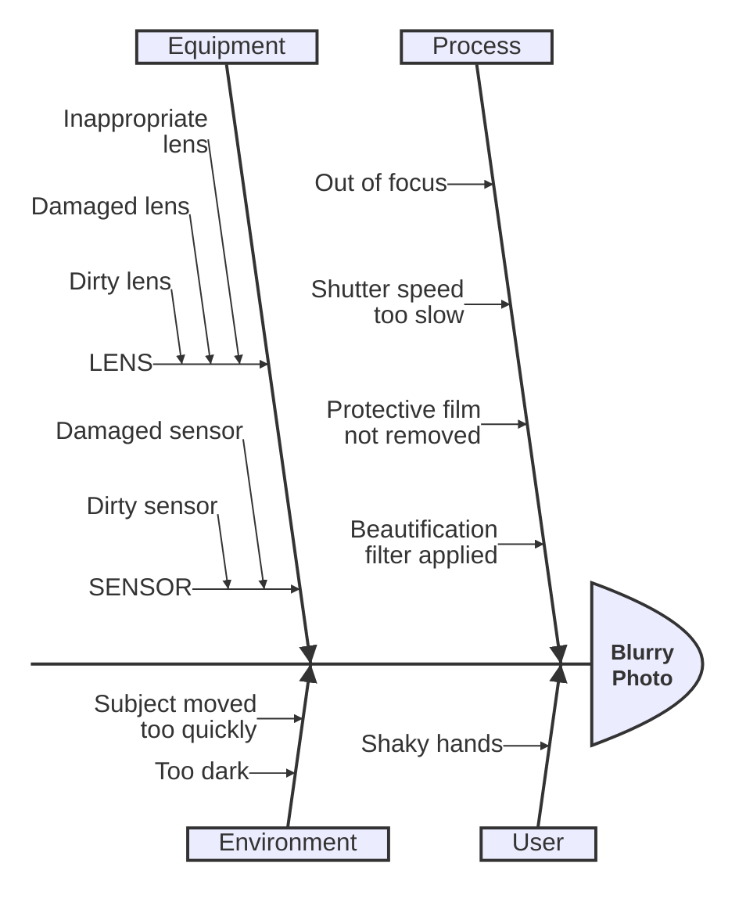

<!-- Digest of Mermaid 12.2.0 docs/syntax/ishikawa.md — MIT © Mermaid contributors (render-kit/vendor/mermaid.LICENSE). Regenerate with scripts/sync-mermaid-docs.py -->
# Ishikawa diagram (v11.12.3+)
Ishikawa diagrams are used to represent causes of a specific event (or a problem).

## Syntax

- The first line is the event (problem) of the diagram.
- Subsequent lines are causes of the event.
- "Fishbone" structure is indicated by indentation.
