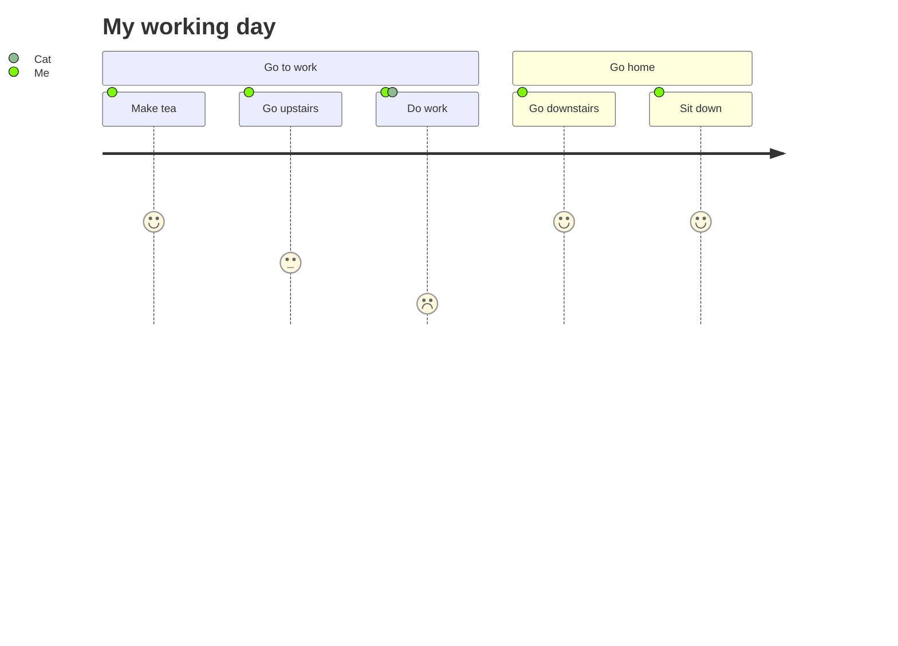

<!-- Digest of Mermaid 12.2.0 docs/syntax/userJourney.md — MIT © Mermaid contributors (render-kit/vendor/mermaid.LICENSE). Regenerate with scripts/sync-mermaid-docs.py -->
# User Journey Diagram
Mermaid can render user journey diagrams:

