<!-- Digest of Mermaid 12.2.0 docs/syntax/mindmap.md — MIT © Mermaid contributors (render-kit/vendor/mermaid.LICENSE). Regenerate with scripts/sync-mermaid-docs.py -->
# Mindmap
"A mind map is a diagram used to visually organize information into a hierarchy, showing relationships among pieces of the whole. It is often created around a single concept, drawn as an image in the center of a blank page, to which associated representations of ideas such as images, words and parts of words are added. Major ideas are connected directly to the central concept, and other ideas bran…

### An example of a mindmap.
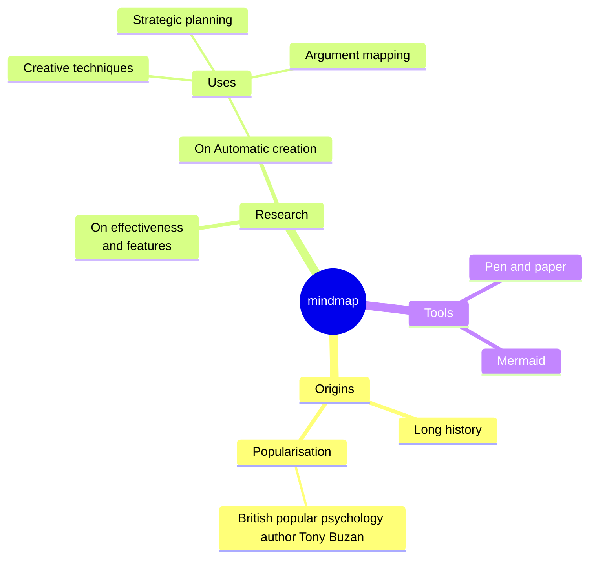

## Syntax
The syntax for creating Mindmaps is simple and relies on indentation for setting the levels in the hierarchy.
```
mindmap
    Root
        A
            B
            C
```
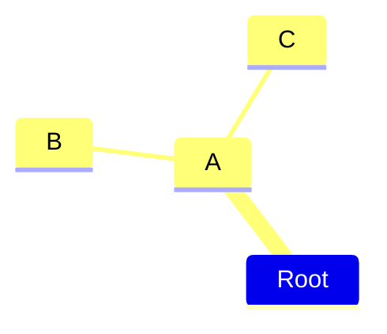

## Different shapes
Mermaid mindmaps can show nodes using different shapes. When specifying a shape for a node the syntax is similar to flowchart nodes, with an id followed by the shape definition and with the text within the shape delimiters. Where possible we try/will try to keep the same shapes as for flowcharts, even though they are not all supported from the start.

### Square
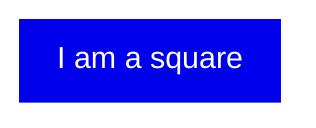

### Rounded square
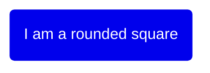

### Circle
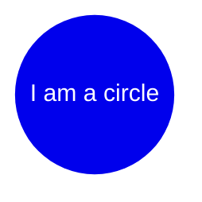

### Bang
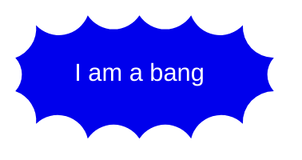

### Cloud
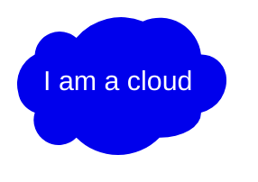

### Hexagon
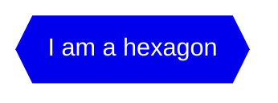

### Default
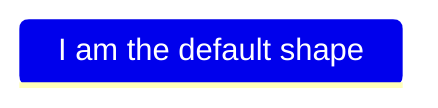
More shapes will be added, beginning with the shapes available in flowcharts.

## Coloring by depth (v12.2.0+)
By default, mindmaps use a different color for each top-level branch. Descendants inherit their branch's color. Set `mindmap.colorBy` to `depth` to give all nodes at the same hierarchy level the same color, across every branch:
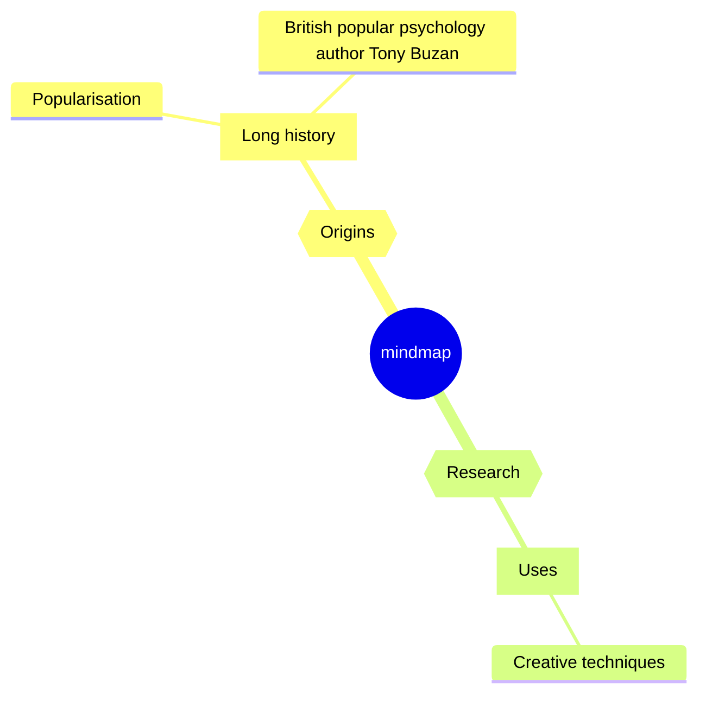
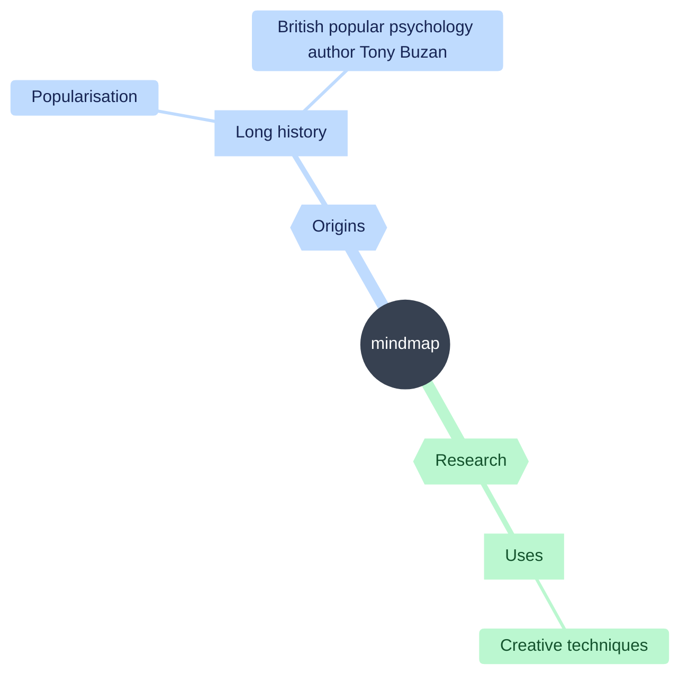
- Themes with `useGradient` enabled paint every node, including the root, with `mainBkg`. It is on by default in `base`, `dark`, `forest`, `neo`, `neo-dark` and `neutral`. Set `themeVariables.useGradient: false` to show depth colors on node backgrounds.
- `neutral`, `redux` and `redux-dark` paint every node below the root with `mainBkg` even without the gradient, and use one label color for all of them.

# Icons and classes

## Icons
As with flowcharts you can add icons to your nodes but with an updated syntax. The styling for the font based icons are added during the integration so that they are available for the web page. _This is not something a diagram author can do but has to be done with the site administrator or the integrator_. Once the icon fonts are in place you add them to the mind map nodes using the `::icon()` syn…
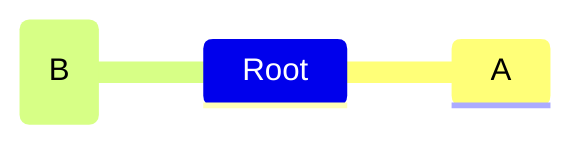

## Classes
Again the syntax for adding classes is similar to flowcharts. You can add classes using a triple colon following a number of css classes separated by space. In the following example one of the nodes has two custom classes attached urgent turning the background red and the text white and large increasing the font size:
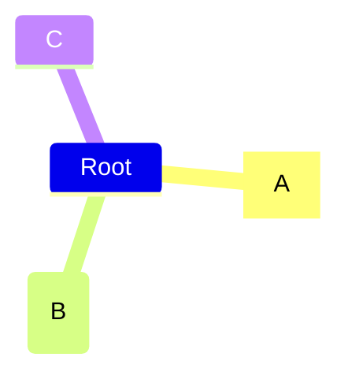

## Unclear indentation
The actual indentation does not really matter only compared with the previous rows. If we take the previous example and disrupt it a little we can see how the calculations are performed. Let us start with placing C with a smaller indentation than `B` but larger then `A`.
```
mindmap
    Root
        A
            B
          C
```


## Markdown Strings
The "Markdown Strings" feature enhances mind maps by offering a more versatile string type, which supports text formatting options such as bold and italics, and automatically wraps text within labels.
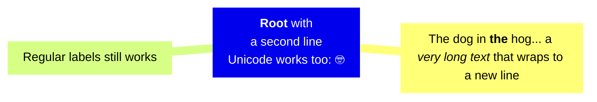
- For bold text, use double asterisks \*\* before and after the text.
- For italics, use single asterisks \* before and after the text.
- With traditional strings, you needed to add <br> tags for text to wrap in nodes. However, markdown strings automatically wrap text when it becomes too long and allows you to start a new line by simply using a newline character instead of a <br> tag.

## Integrating with your library/website.
Mindmap uses the experimental lazy loading & async rendering features which could change in the future. From version 9.4.0 this diagram is included in mermaid but use lazy loading in order to keep the size of mermaid down. This is important in order to be able to add additional diagrams going forward.
```html
<script type="module">
  import mermaid from 'https://cdn.jsdelivr.net/npm/mermaid@9.3.0/dist/mermaid.esm.min.mjs';
  import mindmap from 'https://cdn.jsdelivr.net/npm/@mermaid-js/mermaid-mindmap@9.3.0/dist/mermaid-mindmap.esm.min.mjs';
  await mermaid.registerExternalDiagrams([mindmap]);
</script>
```
```html
<script type="module">
  import mermaid from 'https://cdn.jsdelivr.net/npm/mermaid@12/dist/mermaid.esm.min.mjs';
</script>
```

## Layouts
Mermaid also supports a Tidy Tree layout for mindmaps.
```
---
config:
  layout: tidy-tree
---
mindmap
root((mindmap is a long thing))
  A
  B
  C
  D
```
