<!-- Digest of Mermaid 12.2.0 docs/syntax/stateDiagram.md — MIT © Mermaid contributors (render-kit/vendor/mermaid.LICENSE). Regenerate with scripts/sync-mermaid-docs.py -->
# State diagrams
Mermaid can render state diagrams. The syntax tries to be compliant with the syntax used in plantUml as this will make
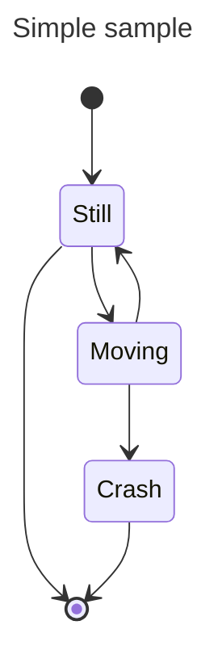
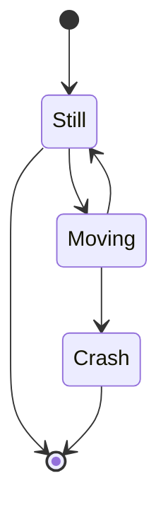

## Default theme, look and layout (v12.0.0+)
State diagrams use the `redux-color` theme and the `neo` look by default, and are laid out by [ELK](https://www.eclipse.org/elk/) rather than Dagre. Not every diagram type

### With the defaults
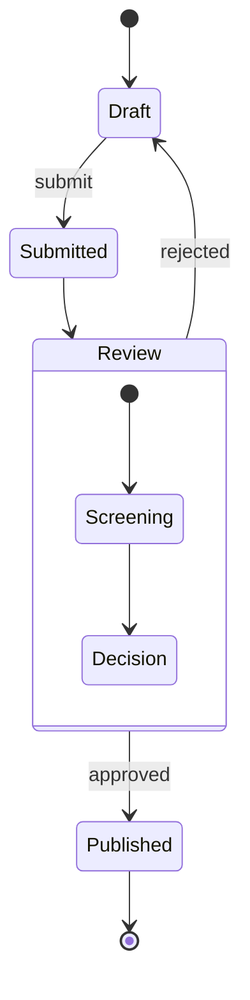

### The previous appearance
Both are only defaults, so anything you set yourself wins. Naming the previous theme and look


## States
A state can be declared in multiple ways. The simplest way is to define a state with just an id:
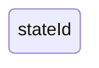
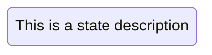


## Transitions
Transitions are path/edges when one state passes into another. This is represented using text arrow, "-->".
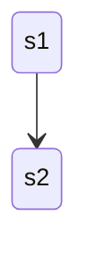
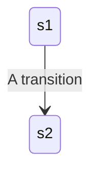

## Start and End
There are two special states indicating the start and stop of the diagram. These are written with the \[\*] syntax and
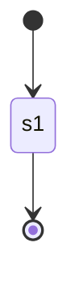

## Composite states
In a real world use of state diagrams you often end up with diagrams that are multidimensional as one state can
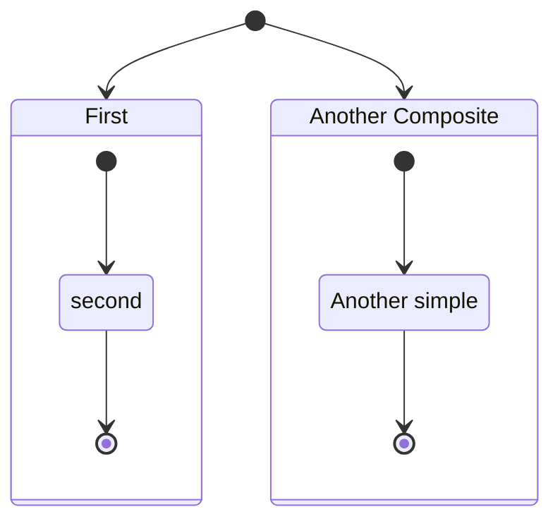
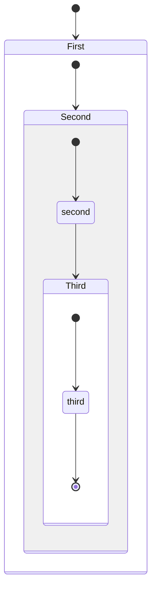
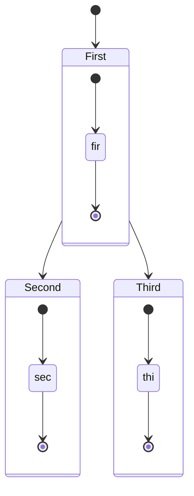

## Choice
Sometimes you need to model a choice between two or more paths, you can do so using <\<choice>>.
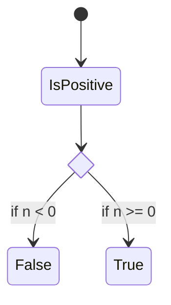

## Forks
It is possible to specify a fork in the diagram using <\<fork>> <\<join>>.
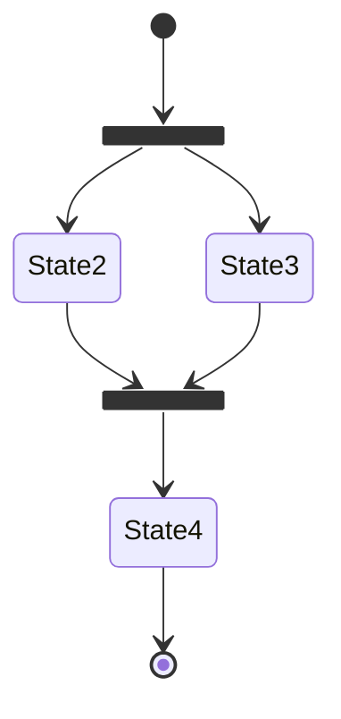

## Notes
Sometimes nothing says it better than a Post-it note. That is also the case in state diagrams.
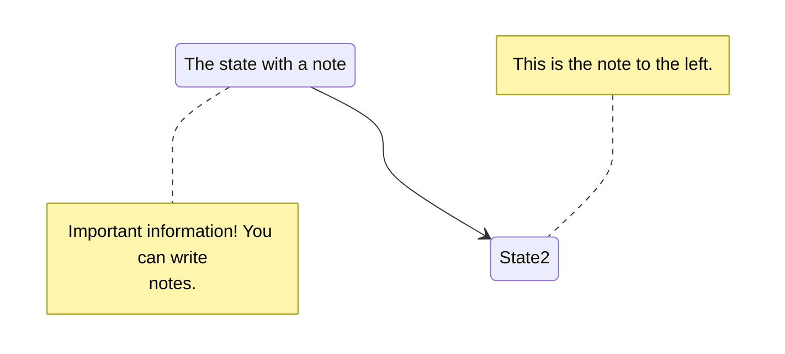

## Concurrency
As in plantUml you can specify concurrency using the -- symbol.
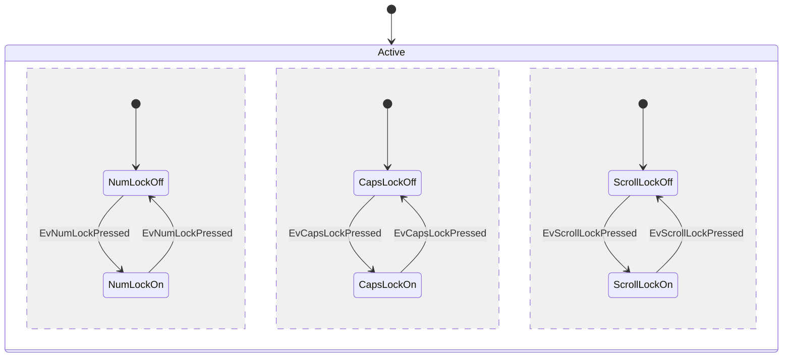

## Setting the direction of the diagram
With state diagrams you can use the direction statement to set the direction which the diagram will render like in this
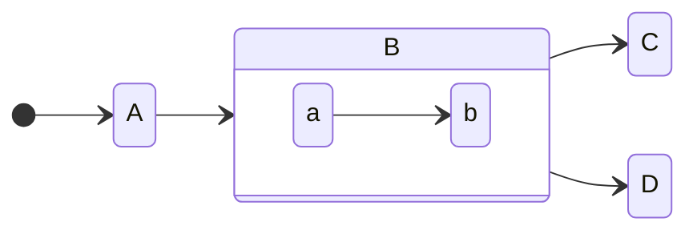

## Comments
Comments can be entered within a state diagram chart, which will be ignored by the parser. Comments must be prefaced with `%%` (double percent signs) and any text after their start to the next newline will be treated as a comment, including any diagram syntax. They can be on their own line or at the end of a statement.


## Styling with classDefs
As with other diagrams (like flowcharts), you can define a style in the diagram itself and apply that named style to a
1. Cannot be applied to start or end states
2. Cannot be applied to or within composite states
```txt
classDef movement font-style:italic;
```
- the _name_ of the style is `movement`
- the only _property_ is `font-style` and its _value_ is `italic`
```txt
classDef badBadEvent fill:#f00,color:white,font-weight:bold,stroke-width:2px,stroke:yellow
```
- the _name_ of the style is `badBadEvent`
- the first _property_ is `fill` and its _value_ is `#f00`
- the second _property_ is `color` and its _value_ is `white`
- the third _property_ is `font-weight` and its _value_ is `bold`
- the fourth _property_ is `stroke-width` and its _value_ is `2px`
- the fifth _property_ is `stroke` and its _value_ is `yellow`

### Apply classDef styles to states
There are two ways to apply a `classDef` style to a state:
1. use the `class` keyword to apply a classDef style to one or more states in a single statement, or
2. use the `:::` operator to apply a classDef style to a state as it is being used in a transition statement (e.g. with an arrow

#### 1. `class` statement
A `class` statement tells Mermaid to apply the named classDef to one or more classes. The form is:
```txt
class [one or more state names, separated by commas] [name of a style defined with classDef]
```
```txt
class Crash badBadEvent
```
```txt
class Moving, Crash movement
```
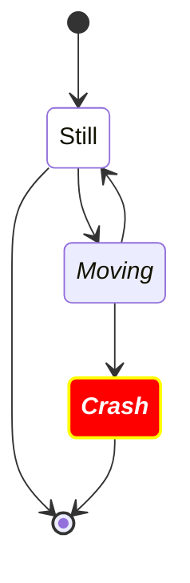

#### 2. `:::` operator to apply a style to a state
You can apply a classDef style to a state using the `:::` (three colons) operator. The syntax is
```txt
[state]:::[style name]
```
```mermaid
stateDiagram
   direction TB

   accTitle: This is the accessible title
   accDescr: This is an accessible description

   classDef notMoving fill:white
   classDef movement font-style:italic;
   classDef badBadEvent fill:#f00,color:white,font-weight:bold,stroke-width:2px,stroke:yellow

   [*] --> Still:::notMoving
   Still --> [*]
   Still --> Moving:::movement
   Moving --> Still
   Moving --> Crash:::movement
   Crash:::badBadEvent --> [*]
```

## Spaces in state names
Spaces can be added to a state by first defining the state with an id and then referencing the id later.
```mermaid
stateDiagram
    classDef yourState font-style:italic,font-weight:bold,fill:white

    yswsii: Your state with spaces in it
    [*] --> yswsii:::yourState
    [*] --> SomeOtherState
    SomeOtherState --> YetAnotherState
    yswsii --> YetAnotherState
    YetAnotherState --> [*]
```
