<!-- Digest of Mermaid 12.2.0 docs/syntax/timeline.md — MIT © Mermaid contributors (render-kit/vendor/mermaid.LICENSE). Regenerate with scripts/sync-mermaid-docs.py -->
# Timeline Diagram
"A timeline is a type of diagram used to illustrate a chronology of events, dates, or periods of time. It is usually presented graphically to indicate the passing of time, and it is usually organized chronologically. A basic timeline presents a list of events in chronological order, usually using dates as markers. A timeline can also be used to show the relationship between events, such as the rel…

### An example of a timeline
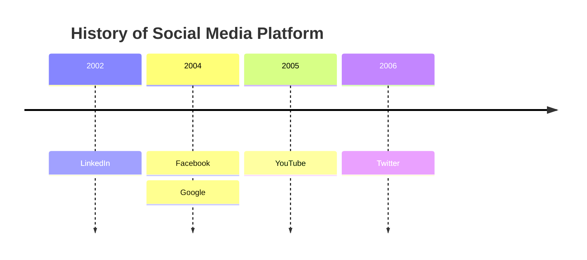

## Syntax
The syntax for creating Timeline diagram is simple. You always start with the `timeline` keyword to let mermaid know that you want to create a timeline diagram.
```json
{time period} : {event}
```
```json
{time period} : {event} : {event}
```
```json
{time period} : {event}
              : {event}
              : {event}
```


## Grouping of time periods in sections/ages
You can group time periods in sections/ages. This is done by adding a line with the keyword `section` followed by the section name.
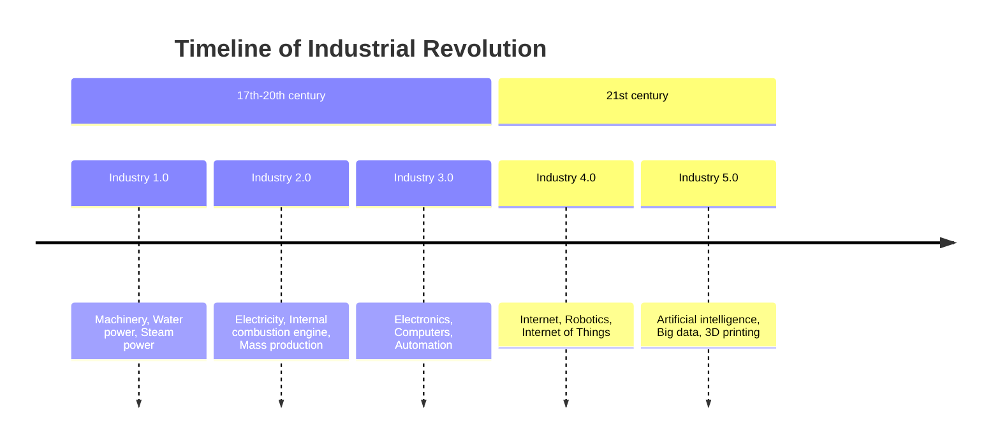

## Wrapping of text for long time-periods or events
By default, the text for time-periods and events will be wrapped if it is too long. This is done to avoid that the text is drawn outside the diagram.
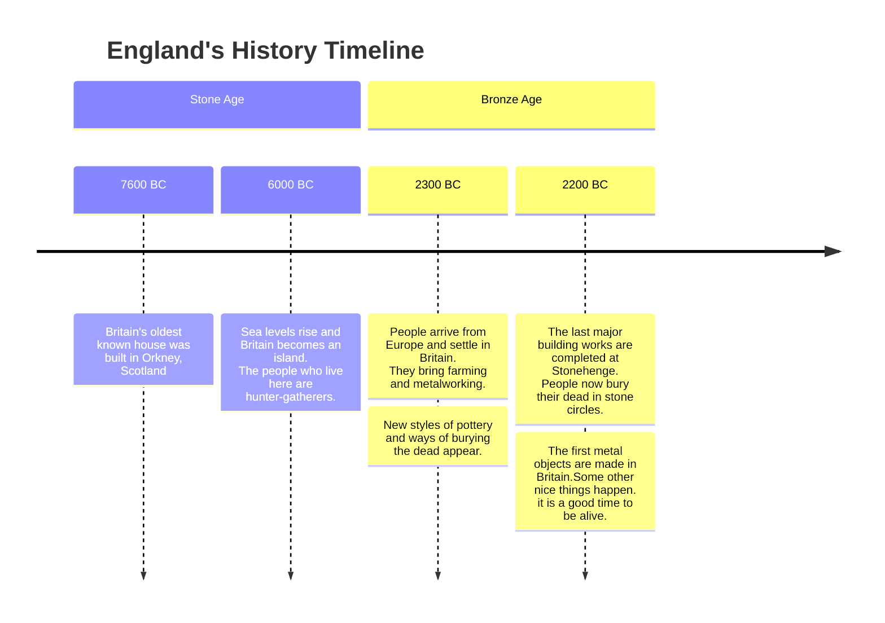
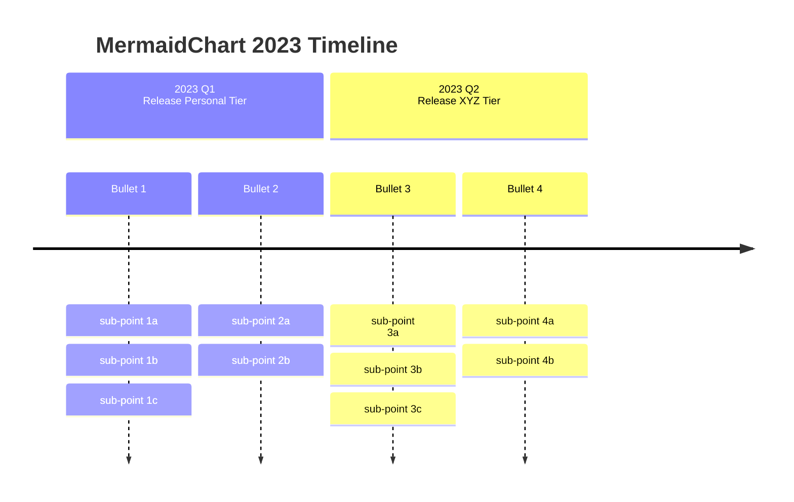

### Direction (v11.14.0+)
Timeline can change its direction by the keyword after `timeline`.
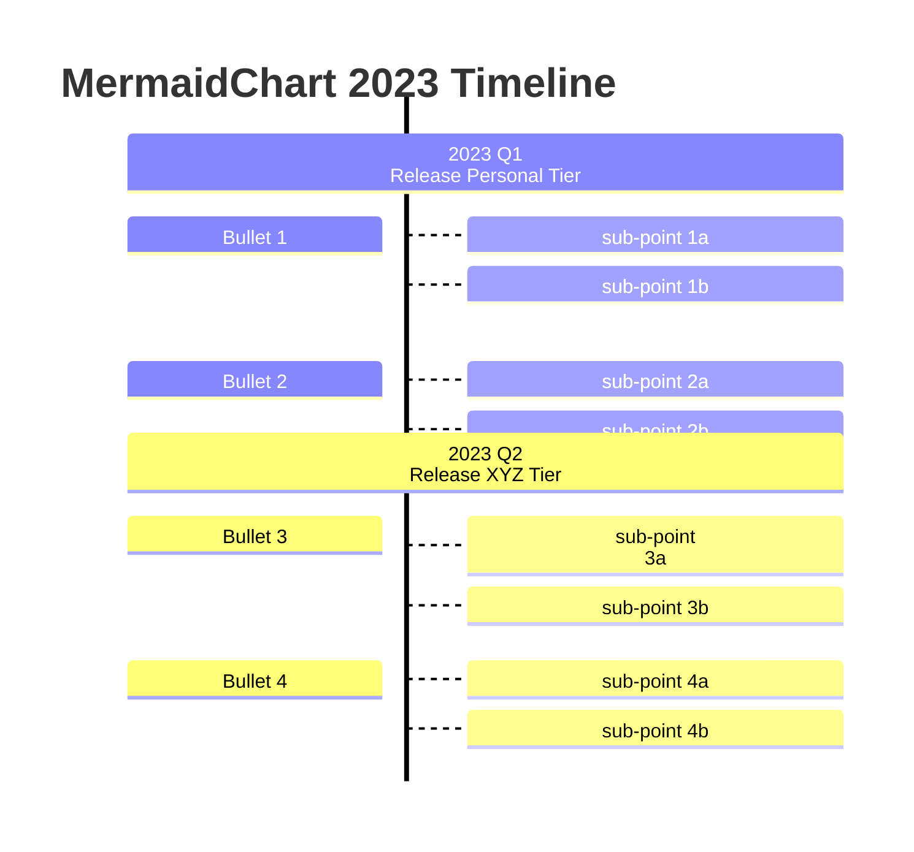
- `LR`: Left to right (default)
- `TD`: Top top down.

## Styling of time periods and events
As explained earlier, each section has a color scheme, and each time period and event under a section follow the similar color scheme.
1. Style time periods individually, i.e. each time period(and its corresponding events) will have its own color scheme. This is the DEFAULT behavior.

2. Disable the multiColor option using the `disableMultiColor` option. This will make all time periods and events follow the same color scheme.
```javascript
mermaid.initialize({
        theme: 'base',
        startOnLoad: true,
        logLevel: 0,
        timeline: {
          disableMulticolor: false,
        },
        ...
        ...
```
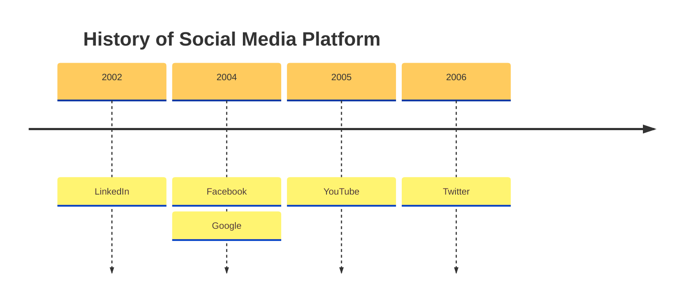

### Customizing Color scheme
You can customize the color scheme using the `cScale0` to `cScale11` theme variables, which will change the background colors. Mermaid allows you to set unique colors for up-to 12 sections, where `cScale0` variable will drive the value of the first section or time-period, `cScale1` will drive the value of the second section and so on.
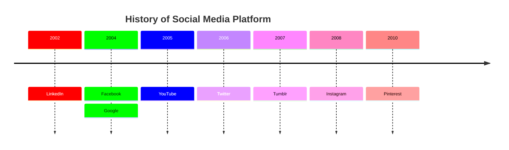

## Themes
Mermaid supports a bunch of pre-defined themes which you can use to find the right one for you. PS: you can actually override an existing theme's variable to get your own custom theme going. Learn more about [theming your diagram](../config/theming.md).
- `redux-color` (the default)
- `redux-dark-color`
- `redux`
- `redux-dark`
- `default`
- `neutral`
- `dark`
- `forest`
- `neo`
- `neo-dark`
- `base`

### Base Theme
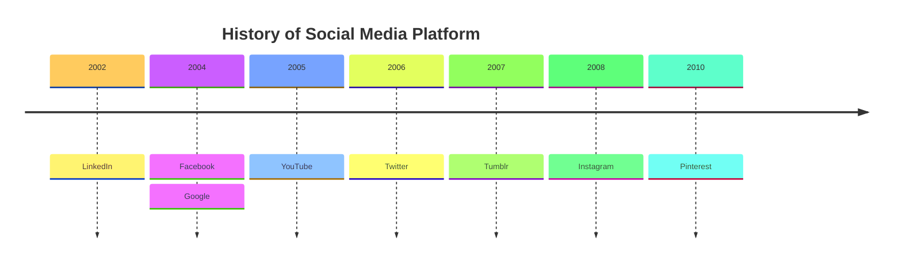

### Forest Theme
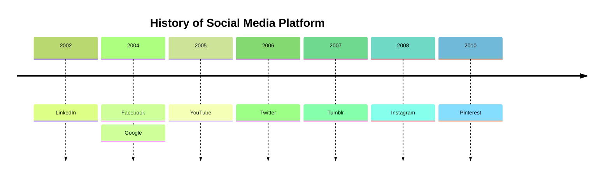

### Dark Theme
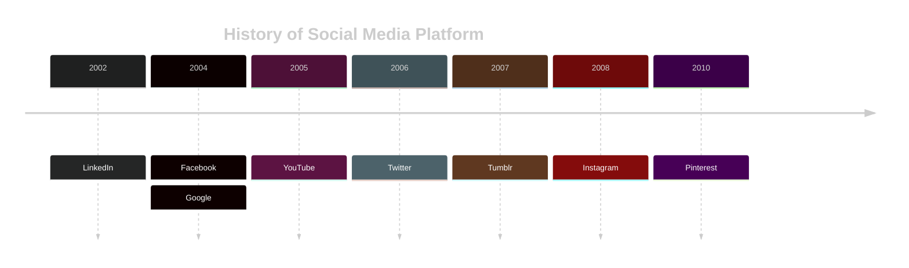

### The `default` Theme
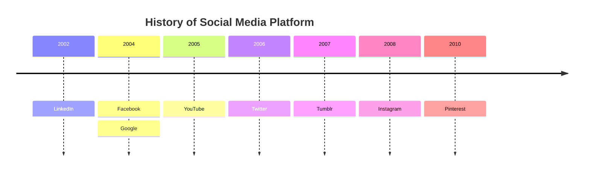

### Neutral Theme
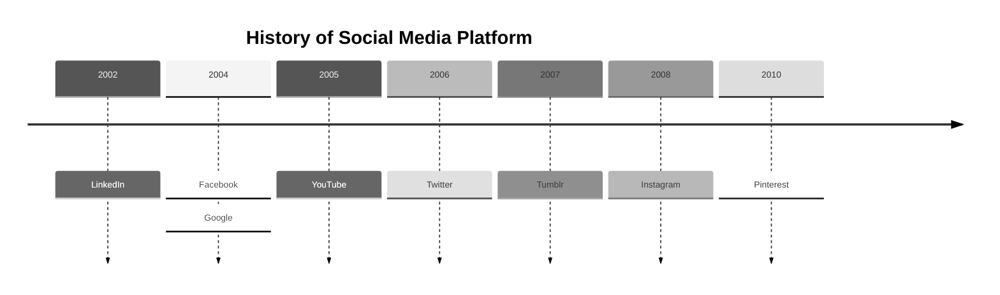

## Integrating with your library/website
Timeline uses experimental lazy loading & async rendering features which could change in the future.The lazy loading is important in order to be able to add additional diagrams going forward.
```html
<script type="module">
  import mermaid from 'https://cdn.jsdelivr.net/npm/mermaid@12/dist/mermaid.esm.min.mjs';
</script>
```
