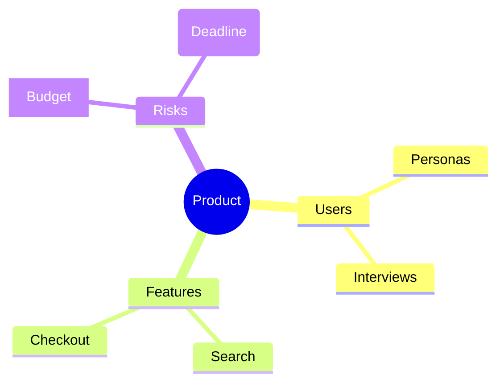

# mindmap

Hierarchy is defined only by indentation (use spaces consistently). Shapes: `[square]`,
`(rounded)`, `((circle))`, `))bang((`, `)cloud(`, `{{hexagon}}`.
Note: mindmaps use HTML labels, so prefer the SVG preview.
