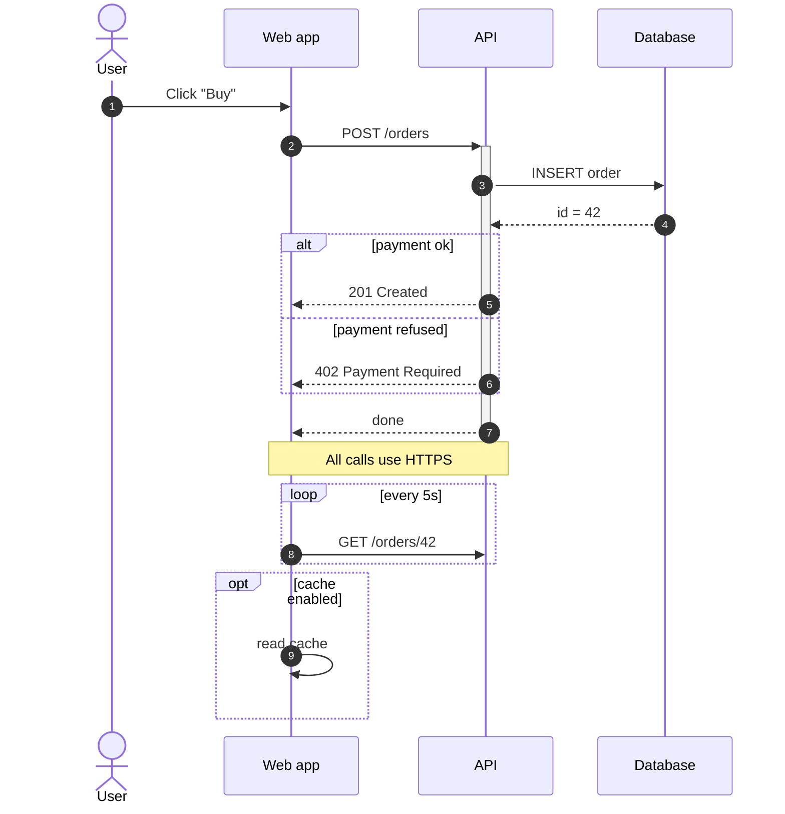

# sequenceDiagram

Arrows: `->>` solid with head, `-->>` dashed with head, `->` / `-->` without head, `-x` cross,
`-)` async. `+`/`-` after the arrow activates/deactivates the target.
Blocks: `alt/else/end`, `opt/end`, `loop/end`, `par/and/end`, `critical/option/end`, `break/end`,
`rect rgb(240,240,255) ... end`.

Common errors: a message needs `: text`; every `alt`/`loop`/`opt` needs its `end`;
participant aliases are declared before use (`participant A as API`).
