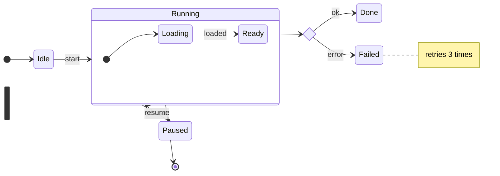

# stateDiagram-v2 (UML state machines)

`[*]` is start/end. Composite states use `state Name { ... }`. Pseudo-states: `<<choice>>`,
`<<fork>>`, `<<join>>`. Concurrency inside a composite state: separate regions with `--`.
Labels with spaces: `state "Waiting for payment" as Waiting`.
